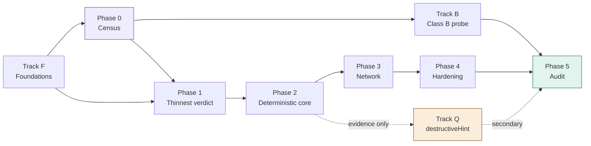

# Implementation Backlog

**Derived from:** [architecture.md](architecture.md), which supersedes [design.md](design.md).
**Status:** Pre-implementation
**Last updated:** July 2026

This is the canonical task list. It is mirrored into GitHub Issues; every issue title
carries its task ID so the two can be reconciled mechanically. When they disagree, this
file wins.

---

## How to read this

- **Tracks** run in parallel. **Phases** are sequential and match architecture.md §10.
- `Depends on` lists task IDs that must be complete, not merely started.
- `Exit` is the observable condition that closes the task. If it cannot be observed, it is
  not an exit criterion and the task needs rewriting.
- Tasks marked **⚑ blocking** gate an entire phase.



---

## Track F — Foundations

Cross-cutting work that gates Phase 0 and Phase 1. None of it produces a finding; all of it
prevents rework later.

### F-00 Pinned Linux development and CI target

**Depends on:** —
**Exit:** A reproducible Linux environment (fixed kernel version, fixed overlayfs mount
options) that development and CI can both target, documented as such.
**Status:** Done — [ADR-010](adr/010-pinned-linux-environment.md). Target: a pinned Ubuntu
24.04 LTS ("Noble Numbat") cloud image, referenced by an exact dated build serial (e.g.
`releases/noble/release-20260705/` via Canonical's permanent archive, never the `release/`
symlink that repoints over time) rather than a dedicated bare-metal/cloud box — the
trade-off table in the ADR turned on the box option not actually solving F-00's own
"contributor local access" checklist item (it gives remote access to one shared machine, not
local access to a reproducible one) and reintroducing the "one sandbox at a time" concurrency
constraint architecture.md §7 already imposes at worker-pool scale, now at the individual
contributor's desk too. GA kernel series pinned at **6.8** (`linux-image-generic`, not the
HWE track, which deliberately jumps series over the LTS lifecycle — exactly the drift being
prevented).

**Provisioned 2026-07-27** (previously the ADR recorded only the decision, not an actual
boot — closed now, full record in
[ADR-010's "Provisioning record"](adr/010-pinned-linux-environment.md#provisioning-record)).
Lima 2.2.0 installed via Homebrew; serial `20260725` of the Noble arm64 cloud image fetched
from its dated (non-symlink) path, checksum
`sha256:2eaec7286c49fdea713dddabcf5012cafa7097a658e916acb48f4bc5fdc8e419` independently
verified both via `gpg --verify` against Canonical's UEC image signing key and via local
`shasum -a 256` against the signed `SHA256SUMS` — not asserted from a search result, per
this task's own requirement. Pinned into the new `.lima/mcp-conformance.yaml`. Booted
(`vz` driver) and all four prerequisite probes passed inside the VM: `uname -r` →
`6.8.0-136-generic` (GA track confirmed via `dpkg -l`/`apt-cache policy`, no HWE kernel
package present); `cgroup.controllers` lists `memory`/`cpu`/`pids`; six-namespace
`unshare --mount --uts --ipc --net --pid --user --fork` exits 0; an overlay mount using the
pinned `redirect_dir=off,metacopy=off,index=off` options against a throwaway lower/upper
pair mounts, reflects a pre-existing lower-layer file through the merge, captures a
post-mount write into `upper`, and unmounts cleanly. VM left running
(`limactl list` → `mcp-conformance ... Running`) for immediate follow-on use; stop with
`limactl stop mcp-conformance` when not in use.

Referenced as blocking in [ADR-007](adr/007-implementation-language.md) ("sandbox is
unbuildable on the macOS host by construction... this is now blocking") and in
`crates/sandbox/src/lib.rs` ("untestable on the primary development host. That is F-00's
problem") since the language decision was made, but never actually added to this backlog
until now — a real gap between the docs and the tracked work, found while scoping the
census staging below.

**Gates P1-02 onward, not Phase 0.** Stage 0/1 census (registry metadata; `initialize` +
`tools/list` against remote HTTP servers) touches no sandbox code. Stage 2 census (Class A
servers, which requires locally executing the server to discover it) needs *containment*
but not *this* — a stock container runtime is adequate for containment-without-observation,
per the reasoning in the P0-06/P0-07 notes below. F-00 is specifically about the
fixed-kernel-version precision that *observation-grade* overlayfs work (Phase 1+) needs,
which containerized execution without observation does not.

**CI gap, disclosed rather than papered over.** GitHub's hosted `ubuntu-24.04` runner label
pins the Ubuntu release, not the point-in-time kernel build inside it — GitHub updates
images under a stable label over time, and hosted runners don't expose nested
virtualisation/KVM, so CI cannot simply boot the pinned VM image itself today. The ADR
records a self-hosted-runner-on-the-pinned-image escalation path but deliberately does not
build it yet (no Phase 1+ sandbox code exists to need it). What ships now: F-03's existing
kernel-prerequisite probe step in `.github/workflows/ci.yml` prints `uname -r` so drift
against the ADR-010 pin is visible in every CI run's log rather than silent — it does not
fail the build on a mismatch, since the hosted runner was never claimed to satisfy the pin
exactly and there is no owned fallback yet to fail over to.

- [x] Choose the target: a pinned VM image (recommended — a container shares the host
      kernel, which defeats "pinned" if the host itself isn't fixed) vs. a dedicated
      bare-metal/cloud Linux box — VM image chosen, full trade-off table in ADR-010
- [x] Pin the kernel version and record it — Ubuntu 24.04 LTS GA kernel series 6.8
      (`linux-image-generic`), image referenced by dated archive serial
- [x] Pin overlayfs mount options — `redirect_dir=off`, `metacopy=off` (security-load-bearing:
      the kernel's own docs warn against `metacopy=on` with untrusted layers, which is
      exactly design.md §3's hostile-tool trust model), `index=off` (no layer reuse/export
      exists to protect, per architecture.md §4.1's "arms are never reused"), `userxattr`
      conditional on P1-03's not-yet-made privileged-vs-rootless mount choice
      — **annotation, added later:** this record predates an insight F-08 measured and is
      silent on it rather than wrong about it. The arm64 probe above evidences the three
      pinned options only as "the mount was *accepted* with them". F-08 established
      empirically that the kernel both **rejects** unknown overlay options (so acceptance
      really is parse evidence) and **does echo** `redirect_dir=on`/`metacopy=on`/`index=on`
      into `/proc/mounts` when they are set non-default — so the *absence* of those tokens on
      a pinned mount is positive evidence they are **off**, which is strictly stronger
      evidence than acceptance. F-08's `scripts/vm.sh probes` asserts both; see its probe-4
      notes.
- [x] Document how a contributor gets local access matching CI's environment — Lima (or
      Vagrant+libvirt/qemu/UTM) booting the pinned, checksum-verified image locally on any
      host OS/architecture; arm64 natively for Apple Silicon contributors since none of the
      namespace/overlayfs/cgroups behaviour in scope is architecture-sensitive

### F-01 ⚑ Choose implementation language and workspace layout — ADR-007

**Depends on:** —
**Exit:** ADR-007 merged in `docs/adr/`, recording the choice and the rejected options.
**Status:** Done — [ADR-007](adr/007-implementation-language.md). **Rust**, edition 2024,
single Cargo workspace, hand-rolled MCP client.

architecture.md §8 deliberately leaves this open (`crates/ (or packages/)`). It cannot stay
open — the purity constraint in ADR-005 is materially easier to enforce in a language with a
real module/dependency graph, and the sandbox layer is Linux syscall work.

- [x] Evaluate against: syscall ergonomics (namespaces, overlayfs, cgroups, seccomp), ability
      to enforce the `normalise`/`verdict` purity rule statically, ~~MCP client library
      maturity~~ — **criterion struck.** SDK maturity points the wrong way: mature SDKs
      discard wire bytes during deserialisation, which breaks P0-01's byte-exact capture and
      therefore P0-02's pin, and they expose a tool-call method that P0-01 forbids
      structurally. Decision rests on the first two criteria.
- [x] Record the decision and consequences as ADR-007
- [x] Note explicitly which parts, if any, are permitted to be a second language — fixtures /
      mock backends / P4-05 hostile server (any language, never in the harness build graph),
      and `results/` analysis (Python). Everything else is Rust, `destructive` included.

### F-02 Scaffold the repository skeleton

**Depends on:** F-01
**Exit:** Every directory in architecture.md §8 exists with a placeholder module that builds.
**Status:** Done — `cargo build --workspace` and `cargo clippy --workspace --all-targets`
both clean on the macOS host.

- [x] `intake` `discovery` `census` `planner` `world` `argsynth` `sandbox` `observe`
      `integrity` `normalise` `verdict` `destructive` `store` `orchestrator`
- [x] `rulesets/` `fixtures/generic/` `fixtures/per-server/` `results/census/`
      `results/conformance/` `docs/adr/`
- [x] `sandbox` gated as Linux-only at the build level, not by runtime check —
      `#![cfg(target_os = "linux")]` at the crate root, so off Linux it compiles to an empty
      crate and the workspace still builds
- [x] **One crate added beyond architecture.md §8: `datamodel`.** Shared vocabulary, pure
      data types, no behaviour, `no_std`. It is what lets `normalise` and `verdict` name
      their inputs without reaching for an I/O crate. Named `datamodel` rather than `model`
      because "model" already means *language model* throughout these docs — and this crate
      sits inside the pure allowlist, where that ambiguity would be actively dangerous.
- [x] `xtask/` added for workspace tooling (hosts the F-04 check)

### F-03 CI: build, test, lint

**Depends on:** F-02
**Exit:** CI green on a trivial PR; Linux runner exercises the `sandbox` module.
**Status:** Done — `.github/workflows/ci.yml`, `ubuntu-24.04` (version-pinned, matching the
ADR-007 posture rather than `ubuntu-latest`). Triggers on push to `main` and on pull
requests. Local baseline confirmed clean before landing: `cargo build`, `cargo test`, and
`cargo clippy --workspace --all-targets -- -D warnings` all pass with zero warnings on
1.85.1.

- [x] Build + test + lint on every push — checkout → cache → `rustup show` (installs the
      pinned toolchain from `rust-toolchain.toml`) → build → test → clippy → `cargo purity`
- [x] Linux runner with the kernel features the sandbox needs (overlayfs, cgroups v2, user
      ns) — a dedicated smoke-check step probes all three (`/sys/fs/cgroup/cgroup.controllers`,
      `sudo unshare` across mount/uts/ipc/net/pid/user, a real overlay mount/unmount) and
      fails the build loudly if the runner image lacks one, rather than letting P1-03
      discover it silently later. Probes run under `sudo` deliberately — they check kernel
      *subsystem* availability, independent of the unprivileged-userns policy question,
      which is P1-03's design concern, not this check's.
- [x] Fail the build on warnings in `normalise` and `verdict` — implemented as
      `cargo clippy --workspace --all-targets -- -D warnings`, a strict superset of the
      minimum ask. Workspace is at zero warnings today; the one known future cost is that
      `unsafe_code = "warn"` (workspace lint) becomes a hard error once P1-03 adds real
      syscall code to `sandbox`, forcing an explicit `#[allow(unsafe_code)]` per block —
      consistent with this codebase's existing pattern of demanding explicit justification
      for risky code (the ADR-005 purity allowlist), so treated as intended friction rather
      than a defect.

### F-04 ⚑ Enforce the purity rule in CI

**Depends on:** F-02
**Exit:** A deliberately-added edge from `verdict` to `store` fails CI. Demonstrate it, then
revert.
**Status:** Done — `cargo purity`. Demonstrated: with `store.workspace = true` added to
`crates/verdict/Cargo.toml`, `cargo build --workspace` **succeeds** (the edge is legal Rust —
which is precisely why the check must exist) and `cargo purity` **fails with exit 1**, naming
the offending edge. Reverted; check green.

ADR-005 is the invariant that makes reproducibility real rather than aspirational.
architecture.md §8: *"If that edge ever appears in the dependency graph, reproducibility is
gone."* A rule nobody checks is a comment.

- [x] Dependency-graph assertion — implemented as an **allowlist**, not the denylist this
      task's wording implies. A pure crate's transitive closure must be a *subset* of
      `PURE_ALLOWLIST` (currently `{datamodel}`). Strictly stronger: a denylist passes for
      any I/O crate nobody thought to name.
- [x] Negative test proving the check fires — `xtask/tests/purity.rs`, 6 tests. Run against
      *synthetic* graphs, so proving the rule bites does not require leaving a broken edge in
      the tree. Includes the literal `verdict` → `store` case and unforeseen offenders
      (`tokio`, `reqwest`, `chrono`, …) that are caught without being enumerated.
- [x] Layer 2 — per-crate `clippy.toml` in `normalise` and `verdict` banning clock, path,
      file, and socket types. A crate can have an empty dependency tree and still call `std`.
- [x] Layer 3 — `#![no_std]` on `datamodel`, `normalise`, and `verdict`. Taking a clock as a
      dependency is not a mistake CI catches after the fact; it is code that does not link.
      For `normalise` this is provisional, per ADR-007 — P1-06 tests whether real path
      matching can stay `no_std`.

**Note for F-03:** `cargo purity` must be its own CI step, not a test. `cargo tree` inside
`cargo test` is a recursive cargo invocation contending for the same package-cache lock.

### F-05 Content-addressed evidence store

**Depends on:** F-01
**Exit:** Blob written, addressed by digest, read back byte-identical; re-writing identical
content is a no-op.
**Status:** Done — `crates/store::BlobStore`, plus `datamodel::Digest` (a pure 32-byte value
type; hashing itself lives in `store`, not `datamodel`, so `sha2` never enters the
`normalise`/`verdict` purity closure). Algorithm: SHA-256, chosen as the unopinionated
well-audited default since no doc mandates one. 8 unit tests, `cargo purity` still clean.

architecture.md §12 item 4 — stand this up *before* any sandbox work so Phase 1 evidence is
replayable from day one.

- [x] Content addressing over raw bytes — `put` hashes the input itself; the caller never
      chooses the address
- [x] Immutability enforced at the API level, not by convention — no update/delete method
      exists at all; writes go through a temp-file-then-rename so a partial write is never
      observable; a digest whose on-disk content doesn't match what the address claims
      (`get` or `put`) is a hard `StoreError::Corrupt`, never silently accepted
- [x] Local filesystem backend; object-store backend deferred to P5-01
- [x] `re-put of identical content is a no-op` proven, not assumed — the test revokes write
      permission on the store root after the first `put`, so a second `put` of the same
      bytes can only pass if it truly skips the write

### F-06 Metadata DB schema

**Depends on:** F-01
**Exit:** Migrations apply cleanly; all seven entities from architecture.md §6 present with
their foreign keys.
**Status:** Done — `crates/store::db`, SQLite via `rusqlite` (`bundled` feature, same
reproducibility posture as the pinned toolchain and F-05's blob store). One migration,
`crates/store/migrations/0001_initial_schema.sql`, applied by a ~20-line hand-rolled runner
(a framework would be pure overhead for one file). `FIXTURE`'s columns were unspecified in
architecture.md §6 — filled in and mirrored back into that doc in the same change. 7 tests,
including that FK enforcement actually rejects a dangling reference, that a second
`open_and_migrate` against the same on-disk DB doesn't re-apply the migration (checked via
the `schema_migrations` row count, not just "no error"), and that every invariant below is
exercised in both directions (accepted when it should be, rejected when it shouldn't).

- [x] `SERVER` `TOOL_SNAPSHOT` `RUN` `INTEGRITY` `EVIDENCE` `VERDICT` `RULESET` `FIXTURE`
- [x] `VERDICT` keys on `snapshot_id`, never `(server_id, tool_name)` — invariant 1;
      `verdict` has no `server_id`/`tool_name` columns at all
- [x] `VERDICT.reason_code` non-null whenever `outcome = 'unverifiable'` — invariant 3,
      enforced as a `CHECK` constraint
- [x] `VERDICT.embargo_state` and `VERDICT.disclosed_at` included now (§12 item 6 — cheap
      today, expensive in Phase 5)
- [x] `VERDICT` table is derivable and safe to truncate; `EVIDENCE` is not — `evidence` has
      `BEFORE UPDATE`/`BEFORE DELETE` triggers that hard-fail, mirroring F-05's blob store
      (no update/delete method there either) so immutability holds on both sides of the
      evidence/metadata split

### F-07 Canonical evidence-tree serialisation — ADR-009

**Depends on:** F-05
**Exit:** ADR-009 merged defining how a directory tree (the overlay upper layer) serialises
into the byte blob F-05's content-addressed store actually stores.
**Status:** Done — [ADR-009](adr/009-evidence-tree-serialisation.md). Bespoke, sorted,
**single-blob** format (`evtree1`): one capture is one `Vec<u8>` handed straight to
`BlobStore::put`, matching architecture.md §6's one-`EVIDENCE`-row-one-`blob_ref` shape
exactly, rather than a git-tree-style multi-blob Merkle DAG (rejected — no repeated-history
use case here to amortise the extra indirection against; see the ADR's "On B specifically"
note) or an external tar/PAX format (rejected — classic `ustar` mtime resolution is 1 second,
lossy against the nanosecond-precision losslessness requirement). Entries are POSIX file
types generically (regular/directory/symlink/fifo/char-device/block-device/socket) plus a
full captured xattr set, sorted by raw path bytes with fixed-width big-endian fields — no
overlay-specific "whiteout" tag exists in the format itself, since a whiteout is fully
representable as a generic char-device entry with `dev_major=0`/`dev_minor=0`, and hardcoding
the special case would be interpretation, which architecture.md §3.1 forbids this layer from
doing (interpretation stays in `normalise`, per ADR-005).

Referenced in [ADR-007](adr/007-implementation-language.md) ("the primary evidence artifact
is a directory tree, not a byte string, and F-05's content addressing needs a tree format
before it means anything") and in `datamodel`'s `RawEvidence` doc comment ("shape is
deferred to ADR-009") since F-05 landed, but never actually added to this backlog until
now — found alongside the F-00 gap while scoping the census work below. Blocks P1-04
(Observation collector), the first component with an actual directory tree to harvest.

- [x] Decide the serialisation format (git-tree-like, tar-like, or bespoke) and its
      reproducibility properties — ordering, mtimes, whiteouts; design.md §9's overlayfs
      semantics apply directly — bespoke chosen; full options table and whiteout/opaque
      handling in the ADR
- [x] The format must stay lossless per `RawEvidence`'s existing contract: *"capture is
      lossless... discarding [mtimes/inode data] at capture time is normalisation, and
      ADR-005 requires normalisation to be a pure function of stored evidence"* — mode,
      uid/gid, nanosecond mtime, inode, dev major/minor, full xattr set, and complete file
      content are all retained verbatim; nothing is filtered or rounded at capture time
- [x] Two independent captures of the same directory tree must serialise to byte-identical
      output — this is what makes F-05's content addressing meaningful for tree evidence,
      not just single blobs, the same property P1-02 proves for the base layer itself —
      follows directly from the format's forced sort order and the absence of any
      capture-time-clock/PID/hostname field; the ADR states precisely how this is a
      narrower, cheaper claim than P1-02's own (harder) construction-reproducibility
      property, and how P1-02 reuses this format's digest-comparison test rather than
      inventing its own

---

### F-08 Pinned Linux VM on the Windows development host

**Depends on:** F-00 (the pin itself), F-02 (a workspace to build)
**Exit:** A VM matching [ADR-010](adr/010-pinned-linux-environment.md) is a working dev/test
loop for Linux-only code on the Windows host, documented as such.
**Status:** Done — `scripts/vm-provision.sh`, `scripts/vm.sh`, `scripts/vm-test.sh`,
`scripts/vm-lib.sh` (shared plumbing: the `ssh -n` default, the guest-output relay, and the
`MCP_VM_*` validation, in one place so the two entry points cannot drift),
`scripts/vm/{meta-data,user-data.template}`, and a second provisioning record appended to
ADR-010 (the macOS/arm64 one is **kept**, not replaced — it still serves Apple Silicon
contributors).

F-00 pinned the environment and provisioned it once, on macOS/arm64 via Lima. Development
has since moved to a Windows 11 Home PC (HANDOFF.md §3.1), where neither Lima nor Hyper-V is
available, so the pin had a decision behind it and no boot on this host. This task is that
boot — and the first time ADR-010's **amd64** branch was exercised at all, which matters
because amd64 is the architecture that ADR names as the CI-matching one.

**Hypervisor: QEMU + KVM inside the WSL2 `Ubuntu-24.04` distro — a deliberate divergence
from HANDOFF.md §4.1's menu**, reasoned out in full in ADR-010's new "Hypervisor" subsection
rather than buried here. Short version: §4.1's options are closed by *privilege*, not
preference. **Corrected:** Hyper-V does not exist on Windows 11 Home — that one really is
closed by the SKU. QEMU-on-Windows is a **preference, not an impossibility**, and the earlier
wording here ("both closed by privilege") overstated it while omitting the evidence against
itself. What is true about privilege: the *supported installer* wanted elevation and that
elevation was declined (the `winget` install reached `Starting package install...` then
returned `0x800704c7 : The operation was canceled by the user` — UAC declined), and
`Get-WindowsOptionalFeature` genuinely cannot even *query* whether the `HypervisorPlatform`
feature is enabled without an elevated token, which means WHPX's availability was unknowable
in advance from an unelevated shell. What is equally true, and was previously left out of this
entry entirely: **a portable, no-admin extraction of the same QEMU 11.1.0 Windows build was
tried and did start with `accel=whpx`.** So neither elevation turned out to be *needed* — the
install elevation was bypassable by extraction, and WHPX was evidently already available on
this host rather than needing to be enabled. It was declined anyway, on **artifact quality**:
a hand-extracted installer payload has no package manager, no upgrade or integrity story and a
version nobody else can reproduce by name, against `apt-get install qemu-system-x86` from the
pinned distro — which is the posture this entire ADR is built out of (pinned image, pinned
serial, pinned toolchain, signature-verified base). The TCG point stands only as a statement
of what a *missing* WHPX would have cost (an order of magnitude on `cargo test --workspace`),
not as evidence that WHPX was unobtainable. **The escalation path is now concrete** in
ADR-010, cheapest-first: (1) re-try the portable extraction with
`-machine q35,accel=whpx` — no elevation, and it already worked once on this host; (2) only
if some other host genuinely lacks WHPX, `Enable-WindowsOptionalFeature -Online -FeatureName
HypervisorPlatform` from an elevated shell plus a reboot (the *query* needs elevation too, so
on an unelevated shell step 1 is the probe); (3) prefer a supported `winget install
SoftwareFreedomConservancy.QEMU` once elevation is available at all, which answers the
artifact-quality objection instead of working around it. In every case only `vm.sh`'s launch
line and the `$VM_DIR`/forward path translation change; image pin, signed-sums verification,
seed, qcow2 and the whole test loop port unchanged. What *is* available with zero
elevation is `/dev/kvm`, already present in the WSL distro with `svm` in `/proc/cpuinfo` —
nested virtualisation is live on this host by default. **The pin is unaffected:** the nesting
is L0 Hyper-V → L1 WSL2 → **L2 the pinned Ubuntu 24.04 guest**, and every property ADR-010
pins (GA 6.8 kernel, cgroups v2, six namespaces, overlayfs and its mount options) belongs to
L2's own kernel, which is the one `sandbox` will compile and run against. WSL2's 6.6 kernel
is hypervisor host, never kernel under test. Two costs disclosed rather than hidden: double
nesting costs build throughput, and **a WSL service failure takes the VM down with it** (two
such failures happened during this project's work on 2026-10-08) — the latter is precisely
the objection that originally argued against QEMU-in-WSL, kept on the record as a live
operational caveat rather than a resolved one. Note what it is weighed against, now that the
record is accurate: not a hard blocker but a preference for a distro-packaged hypervisor over
a hand-extracted one. If this reliability cost starts dominating, that trade should be re-made
rather than treated as settled.

- [x] **Ubuntu 24.04 cloud image, amd64, pinned to a dated serial** — serial `20260725`,
      **the same serial F-00's arm64 boot used**, which was the goal rather than luck: one
      serial across both architectures makes the two hosts the same pin instead of two
      adjacent ones. Verified present for amd64 *before* being relied on (`HTTP 200` on
      `.../releases/noble/release-20260725/SHA256SUMS`; that path's own page title reads
      `Ubuntu 24.04 LTS (Noble Numbat) release [20260725]`), so no substitution was needed
      and none was made. The moving `.../releases/noble/release/` symlink was never fetched.
      For the record of what the pin is protecting against: `releases/noble/` now lists
      **five** serials newer than `20260725` (`20260801`, `20260814`, `20260826`, `20260911`,
      `20260926`). The `release/` symlink is not a sixth — it currently targets the fifth of
      those, so counting it separately double-counts.
- [x] **Checksum verified properly, not asserted from a web page** —
      `sha256:d1940f7d69d343355e183dff1e08a59852d32e7309baa7a4bad8365b11b005ac`.
      `SHA256SUMS.gpg` verified first (`gpgv` → `Good signature from "UEC Image Automatic
      Signing Key <cdimage@ubuntu.com>"`, RSA key `D2EB44626FDDC30B513D5BB71A5D6C4C7DB87C81`
      — byte-identical to the fingerprint F-00's record pinned), then the image checked
      against that signed file (`sha256sum -c` → `OK`). **This run's trust path is stronger
      than F-00's:** the key came from the distro-packaged `ubuntu-cloudimage-keyring`
      (installed via `apt`, therefore already authenticated by Ubuntu's archive signing key)
      rather than fetched over TLS from a keyserver, which narrows — but does not eliminate —
      the caveat F-00's record disclosed about keyserver trust. A keyserver fetch was tried
      first and failed (`gpg: keyserver receive failed`), which is what prompted finding the
      better path rather than the worse one. `scripts/vm-provision.sh` re-runs **both** checks
      on every invocation, not only on first download, and `die`s rather than continuing on
      either failure. **The re-runnable check now enforces the claim this entry makes.**
      `gpgv --keyring ubuntu-cloudimage-keyring.gpg` accepts a signature from *either* key
      that keyring holds — confirmed by listing it: `D2EB…7DB87C81` (UEC Image Automatic
      Signing Key) **and** `4A3C…7FF3F408476CF100` (Ubuntu Cloud Image Builder) — so the
      script was only ever asserting "signed by some key in Canonical's keyring" while this
      entry asserts the stronger "signed by `D2EB44626FDDC30B513D5BB71A5D6C4C7DB87C81`, not
      the similarly-named other key". It now greps `gpgv --status-fd`'s machine-readable
      `VALIDSIG` line for that exact fingerprint and refuses otherwise; verified both
      directions (the real fingerprint matches, a wrong one does not).
- [x] **Kernel pin honoured: GA `linux-image-generic`, 6.8 series, not HWE** — stated as a
      cloud-init package rather than inferred from whatever the image happened to ship, so
      the GA metapackage is what is actually installed. Probe output below.
- [x] **Cloud-init NoCloud seed** — `scripts/vm/user-data.template` + `meta-data`, built into
      a `CIDATA`-labelled ISO by `vm-provision.sh`. Password login is impossible by
      construction (`lock_passwd: true`, `ssh_pwauth: false`, `disable_root: true`); the only
      way in is the per-host keypair `vm-provision.sh` generates. The **rendered** user-data
      is written to the VM dir, never the repo — it embeds one contributor's public key,
      which is per-host state, not project state.
- [x] **Provisioned** — `build-essential` (rusqlite's bundled SQLite needs a C toolchain),
      distro `rustup` (preferred over `curl | sh`, per HANDOFF.md §4.1's standing
      preference), and toolchain `1.85.1` with `clippy` from `rust-toolchain.toml`.
      **`CARGO_TARGET_DIR` is VM-local** (`/home/dev/cargo-target`, exported from
      `/etc/profile.d/99-mcp-conformance.sh`) and is never synced or shared. `vm-test.sh`
      **asserts** it before running a gate — three separate checks (set, absolute, and not
      inside the synced tree), each with its own exit code so the failure says which rule it
      broke. This entry previously claimed the assertion existed when the script only
      *printed* the value; the consequence of that gap is real rather than cosmetic: if
      `/etc/profile.d/99-mcp-conformance.sh` ever went missing, cargo would fall back to the
      synced tree's `./target`, which rsync both excludes **and** (by excluding) protects
      from `--delete` — exactly the stale-artifact state the sync model exists to prevent —
      and every gate would still print `PASS`.
- [x] **Test-loop script** — `scripts/vm-test.sh`, bash. Why bash and not `.ps1`: the
      hypervisor now runs *inside* WSL2, so the whole loop is native Linux and a PowerShell
      wrapper would only shell back into WSL. It syncs with **`rsync -a --delete` over SSH**,
      never a shared mount — HANDOFF.md §3 flags CRLF conversion of byte-exact fixtures as a
      live hazard on this very host (there is a CRLF-contaminated clone on it), and
      `evtree`/`world` assert byte-identical captures, so a 9p/virtiofs share of the repo is
      the one thing this loop must not do casually. `target/` is excluded in both directions.
      Three further exclusions were added once it was noticed that **`rsync -a` does not read
      `.gitignore`**, so it carries untracked working-directory files too: `.env`, `.env.*`
      and `/config.local.*` (the paths `.gitignore` already names as expected-secret — the
      moment one exists it would otherwise be copied into the machine that will later host
      hostile code) and `/.git` (pointless here: in a git worktree it is a *file* pointing at
      the main repo's `.git/worktrees/…`, so the guest's copy was a dangling pointer, and
      nothing in the build reads it — there is no `build.rs` and no `vergen`/`git2` anywhere
      in the workspace). The script also asserts the VM it manages is actually running
      (pidfile plus a process-name check, not just `kill -0`) **before** handing the whole
      worktree over.
- [x] **F-00's four probes re-run inside the guest** — and made re-runnable rather than a
      one-off transcript: `scripts/vm.sh probes` exits non-zero if this guest stops
      satisfying the pin. Verbatim output below.
- [x] **Documentation** — ADR-010 gains a second provisioning record (Windows/amd64) plus the
      "Hypervisor" subsection justifying the divergence; this entry is the backlog half.

**Probe output, verbatim, exit 0** (`scripts/vm.sh probes`):

```
  [guest] ### probe 1: kernel is GA 6.8 series, not HWE
  [guest] 6.8.0-146-generic
  [guest] linux-image-6.8.0-136-generic 6.8.0-136.136
  [guest] linux-image-6.8.0-146-generic 6.8.0-146.146
  [guest] linux-image-generic 6.8.0-146.146
  [guest] linux-image-virtual 6.8.0-146.146
  [guest] -- HWE kernel packages present (expect none):
  [guest] (none)
  [guest] linux-image-generic:
  [guest]   Installed: 6.8.0-146.146
  [guest]   Candidate: 6.8.0-146.146
  [guest]   Version table:
  [guest]
  [guest] ### probe 2: cgroups v2 controllers include memory, cpu, pids
  [guest] cpuset cpu io memory hugetlb pids rdma misc
  [guest]
  [guest] ### probe 3: six-namespace unshare
  [guest] unshare exit=0
  [guest]
  [guest] ### probe 4: overlay mount with ADR-010's pinned options
  [guest] -- overlay filesystem registered (module loaded by the mount above):
  [guest] nodev	overlay
  [guest] -- negative control: an unknown overlay option must be REJECTED
  [guest]    rejected, as required
  [guest] -- mount options as the kernel reports them:
  [guest] overlay /tmp/tmp.9K4XHZsocy/merged overlay rw,relatime,lowerdir=/tmp/tmp.9K4XHZsocy/lower,upperdir=/tmp/tmp.9K4XHZsocy/upper,workdir=/tmp/tmp.9K4XHZsocy/work,uuid=on,nouserxattr 0 0
  [guest]    nouserxattr: present, as expected for a privileged mount
  [guest] -- overlay module defaults for the pinned options (asserted, not merely printed):
  [guest]    redirect_dir  N
  [guest]    metacopy      N
  [guest]    index         N
  [guest]    xino_auto     Y   (not pinned; informational)
  [guest] -- lower-layer file read through the merge:
  [guest] lower-layer-content
  [guest] -- post-mount write captured in upper:
  [guest] total 4
  [guest] -rw-r--r-- 1 root root 20 Oct 10 06:46 new-file.txt
  [guest] written-after-mount
  [guest] umount: clean
  [guest]
  [guest] ALL FOUR PROBES PASSED
==> [host] probes: PASS (guest exited 0; this line is the host's own, derived from that status)
```

The `  [guest] ` / `==> [host]` prefixes are structural, not decoration — see "Guest output is
bounded and sanitised" below.

The running kernel is `6.8.0-146-generic`, not the `6.8.0-136-generic` F-00's arm64 boot
recorded. That is the GA metapackage's **in-series** update track behaving exactly as ADR-010
describes it, not drift — same 6.8 series, and `apt-cache policy` confirms `6.8.0-146.146` is
the GA metapackage's own candidate. Absence of HWE is checked **positively** (a grep for
`^linux-(image|generic|headers).*hwe` over installed packages, printing `(none)`) rather than
inferred from nothing complaining.

**Probe 4 now asserts what it used to merely print**, which is a real strengthening rather
than tidying, and both halves were measured in this guest rather than taken on faith:

- The earlier version leaned on `/sys/module/overlay/parameters/*` as a *proxy*, on the belief
  that the kernel never echoes `redirect_dir`/`metacopy`/`index` back into `/proc/mounts`. Too
  weak. Mounting with `redirect_dir=on,metacopy=on,index=on` in this guest yields
  `…,redirect_dir=on,index=on,uuid=on,metacopy=on,nouserxattr` — the kernel **does** echo them
  when set non-default, so their **absence** on the pinned mount is positive evidence they are
  *off*, not merely evidence they parsed. That absence is now asserted. A **negative control**
  backs the inference up: an unknown option (`mcp_bogus_option=42`) must be rejected, because
  a kernel that silently ignored unrecognised options would accept the pinned three just as
  happily and "the mount was accepted" would prove nothing. It is rejected.
- The module-parameter block is asserted too. Before, a guest whose kernel-wide defaults had
  flipped to `Y` would have printed `Y` and still reported `ALL FOUR PROBES PASSED`.
  Demonstrated by flipping `/sys/module/overlay/parameters/redirect_dir` to `Y`: the probe now
  prints `FAIL: kernel-wide default for redirect_dir is Y, expected N` and exits 1 (restored
  to `N` afterwards). That flip also surfaced a detail worth keeping: with the kernel-wide
  default at `Y`, the pinned mount displays `redirect_dir=follow` rather than nothing, because
  overlayfs maps a requested `off` onto `follow` while `redirect_always_follow` is `Y` (create
  no new redirects, but follow pre-existing ones). So the two assertions are **complementary**
  — the token check catches an `=on`, the module-parameter check catches the `follow` case.
  `xino_auto` is printed but deliberately not asserted; ADR-010 does not pin it.

`nouserxattr` is still the correct branch for a privileged mount — now asserted rather than
eyeballed — with ADR-010 pinning `userxattr` only for the rootless-in-userns case P1-03 has
not yet chosen.

**The dev loop, run end to end** (`scripts/vm-test.sh`, exit 0):

```
==> environment
  [guest] kernel:   6.8.0-146-generic
  [guest] rustc:    rustc 1.85.1 (4eb161250 2025-03-15)
  [guest] cargo:    cargo 1.85.1 (d73d2caf9 2024-12-31)
  [guest] CARGO_TARGET_DIR=/home/dev/cargo-target
==> asserting the guest's CARGO_TARGET_DIR
  [guest] CARGO_TARGET_DIR=/home/dev/cargo-target is absolute and outside the synced tree
==> [host] CARGO_TARGET_DIR: OK

==> gate: purity
  [guest] purity: OK  ["normalise", "verdict"] depend only on ["datamodel", "evtree"]
==> [host] gate purity: PASS

==> summary (inside the pinned VM; host-side verdicts)
==> [host] PASS  build
==> [host] PASS  test
==> [host] PASS  clippy
==> [host] PASS  purity
```

(`purity: OK  [...]` is missing its em-dash because the guest-output relay drops non-ASCII
bytes along with the control characters — a fidelity cost disclosed in `scripts/vm-lib.sh`
rather than discovered later.)

**345 tests passed, 0 failed** — identical to `main`'s count on WSL2/amd64, so the suite is
now confirmed reproducible across three environments (macOS/arm64, WSL2/amd64, and this
pinned Ubuntu 6.8 guest) rather than two. `cargo build --workspace` took 23.4s and clippy
8.0s on a warm `CARGO_TARGET_DIR`, which retires the double-nesting throughput worry as a
non-issue at this workspace's size.

**A real bug was found by driving these scripts rather than only writing them**, in the same
spirit as P0-06 and B-01 — and then **found a second time, which is the more instructive
half**. Every internal `ssh` call inherited the caller's stdin, so invoking these scripts from
a script itself fed on stdin (`bash -s < script` — how a non-interactive agent or a CI step
naturally drives them) made `ssh` consume the rest of the calling script, after which the
caller silently stopped executing **with a zero exit status**. A green-looking no-op is the
worst shape a harness script can fail in. The first fix routed every non-interactive call in
`scripts/vm.sh` through an `ssh -n -o BatchMode=yes` variant, with an explicit
`MCP_VM_SSH_STDIN=1` opt-in for the one site (`cmd_probes`) that legitimately pipes a heredoc
in — and this entry said so, as though the problem were closed. It was not:
**`scripts/vm-test.sh`, the script this entry calls the dev loop, still had two bare `ssh`
calls** — its reachability probe and `run_remote`, which carries the environment dump and all
four gates. Driving `./scripts/vm-test.sh purity` from a piped caller printed `PASS purity`,
then dropped the caller's next two lines and exited 0: the same failure, in the entry point an
agent or a CI step is *most* likely to drive. Closed by moving the definition of "a
non-interactive ssh call" into one shared **`scripts/vm-lib.sh`** that both entry points
source, so "every non-interactive call in both scripts carries `-n`" is structural rather
than a coincidence between two copies — and that file enumerates the complete exception set,
so the claim is auditable by grepping `ssh ` under `scripts/`: the interactive `vm.sh ssh`
with no arguments, the one `MCP_VM_SSH_STDIN=1` opt-in (`cmd_probes`, which pipes a heredoc
in), and `vm-test.sh`'s `rsync -e` command, where rsync drives its own pipes into the ssh
child's stdin so it cannot swallow the caller's and `-n` would break the transport outright.
Verified the way it was found: a piped driver with marker `echo`s after the call, which now
print.

**Guest output is bounded and sanitised** (`scripts/vm-lib.sh`). Nothing the guest wrote used
to be bounded or stripped: a guest emitting `ESC[2J`, SGR colour, an OSC title-set and an
alt-screen switch had **every escape byte arrive intact host-side**, so it could clear
scrollback and repaint a clean transcript — and in this project's workflow that console is read
by a model. This is the same output-surface class as the Stage 2 census's unbounded container
stderr that P0-11 fixed with a bounded, escape-stripped drain
(`crates/discovery/src/transport.rs::relay_child_stderr`), so the same remedy applies: relayed
bytes are capped (`MCP_VM_MAX_GUEST_BYTES`, default 256 KiB, one truncation notice, draining
continues past the cap so the guest never blocks on a full pipe), C0-except-LF/TAB plus CR, DEL
and all bytes ≥ 0x80 are dropped (which covers the C1 CSI/OSC introducers `0x9b`/`0x9d`),
record length is bounded so one newline-free gigabyte cannot grow the host-side buffer, and
every guest line is prefixed `  [guest] ` **host-side**. The harness's own verdicts are printed
from the exit status under an `==> [host]` sigil, a slot a relayed line cannot occupy — a
forged `ALL FOUR PROBES PASSED` or `==> [host] gate test: PASS` from the guest comes back
visibly tagged `  [guest] `. `scripts/vm.sh ssh` stays a deliberate raw passthrough, since an
interactive shell needs its pty and its escapes. **What this is not:** an integrity boundary —
see precondition 4 below.

**Three smaller fixes from the same pass**, each with a demonstrated failure behind it:
`MCP_VM_SSH_PORT='2222-:22,hostfwd=tcp::12345'` used to build a *second* QEMU host forward
bound to `0.0.0.0`, publishing the guest's sshd off-host from one environment variable (now a
digits-only check, with the same for `MCP_VM_CPUS`, `MCP_VM_MEM`, `MCP_VM_DISK_SIZE` and
`MCP_VM_MAX_GUEST_BYTES`); `vm.sh stop` sent one SIGTERM, waited, then removed the pidfile and
said "stopped" with **no SIGKILL escalation and no liveness re-check**, so a guest that ignored
poweroff left a running VM that `running()` could no longer see, after which `start` would
attach a second QEMU to the same qcow2 — the same failure class as P0-06's orphaned containers,
and precisely what ADR-004's integrity gate forbids one level down (it now escalates poweroff →
SIGTERM → SIGKILL, removes the pidfile only after observing the process gone, and `die`s rather
than claiming success; verified against a stub that ignores SIGTERM); and `vm-provision.sh`
now pins the signing-key fingerprint instead of accepting either key in Canonical's keyring.
Plus two papercuts: `python3` was missing from the preflight tool check although the script
uses it (so a host without it failed *after* the fetch-and-verify work), and the image download
wrote straight to its final path, so an interrupted download wedged the next run on a checksum
failure with no hint that deleting the partial was the fix — now temp-then-rename, the same
reason `store`'s blob store does it.

**Caveats, disclosed rather than hidden.**

1. **The hypervisor diverges from HANDOFF.md §4.1** — by preference on artifact quality for
   QEMU-on-Windows, and by SKU for Hyper-V, as corrected above; *not* by an impossibility.
   The escalation path back to a Windows-side QEMU is named in ADR-010, cheapest-first
   (portable extraction with `accel=whpx`, which already ran on this host, before any
   elevated feature-enable), and left unbuilt; only `vm.sh`'s launch line is
   hypervisor-specific, so the image pin, seed, disk and test loop all survive that move
   unchanged.
2. **A WSL service failure takes the VM with it.** Two such failures happened on 2026-10-08.
   Mitigated, not solved: all VM state lives in `~/vm/f-08/` and survives `wsl --shutdown`,
   and `scripts/vm.sh start` is idempotent, so recovery is one command and never a
   reprovision.
3. **CI is unchanged and still does not run on the true pin.** ADR-010's "CI: an honest gap"
   section stands verbatim: GitHub's hosted runners expose no KVM, so they cannot boot this
   image, and a self-hosted runner remains the named-but-unbuilt escalation. F-08 improves
   *local* parity only.
4. **The keyserver caveat is narrowed, not eliminated.** The signing key came via `apt`
   (authenticated by Ubuntu's archive key) rather than a TLS keyserver fetch, which is a
   second independent trust root agreeing on the fingerprint — but still not a web-of-trust
   check against a physically distributed keyring.
5. **The guest's blast radius is a P1-03 question, exactly as ADR-010's arm64 record already
   flagged for the Lima VM.** Nothing hostile runs in this guest today; it compiles and runs
   the workspace. But `scripts/vm-test.sh` syncs the *whole* worktree in and the `dev` user
   has NOPASSWD sudo, so once P1-03 starts launching untrusted MCP servers inside it, that
   combination is what needs revisiting — and the rsync-based loop makes a read-only or
   partial sync a strictly easier change than it would have been with a shared mount. The
   full, measured list is the next section.
6. **`linux-image-generic` drags in `linux-firmware`** (several hundred MB of wireless and
   GPU blobs no VM will ever use) and forces a one-time reboot into the newly installed
   kernel. Both are expected first-boot behaviour, not faults; the reboot is driven by
   cloud-init's `power_state`, conditional on `/var/run/reboot-required`. Trimming the
   firmware would mean dropping to `linux-image-virtual` and giving up the literal GA
   metapackage this task asks for — not worth it for disk a 40 GiB overlay has spare.

#### Preconditions on the transition to running untrusted code

**Recorded, deliberately not implemented. These are not F-08 defects.** Every item is sound as
the guest stands today, because nothing hostile runs in it or near it: the guest exists to
compile and run the workspace, and P1-08's first verdict target is a *trusted* reference
server. They bind when untrusted registry code arrives — **P2-06** run against real servers,
and **P4-05**'s deliberately hostile server — not at P1-03's first commit. Cross-referenced
from [P1-03](#p1-03-sandbox-supervisor--mount-namespace-overlayfs-timeout) and mirrored in
ADR-010's "Follow-on decisions" section.

Two things this project already got right, which these build on rather than correct:
HANDOFF.md §4.6 already scopes P1-08 to a trusted reference server
(`@modelcontextprotocol/server-filesystem`) with hand-written arguments and states that Phase
1 containment is **mount namespace plus timeout only**, no net/PID/user namespaces; and
ADR-010 already defers the blast-radius question to P1-03 instead of pretending it is
answered. The list below is what "revisit then" actually has to cover, with the measurement
behind each item so a P1-03 implementer is not re-deriving them.

In rough priority order:

1. **Network isolation.** `-netdev user` with no `restrict=` tunnels the guest into the WSL
   distro's loopback — proven by binding a listener on WSL's `127.0.0.1:38471` and reading the
   banner back from *inside* the guest — and gives unrestricted egress
   (`curl https://example.com` → 200; DNS via SLIRP proxying the host resolver).
   `MCP_VM_RESTRICT=1` now exists as an opt-in (`restrict=on`, parse-verified on this QEMU)
   and is deliberately **not** the default, because the guest needs egress to provision
   (cloud-init apt, rustup). **Calibrate this honestly:** the guest's *inability* to reach the
   Windows host and the LAN is **not a containment property of F-08** — the WSL distro cannot
   reach them either, and the guest simply inherits whatever WSL can. So if WSL is ever
   switched to `networkingMode=mirrored` (a one-line change; **no `.wslconfig` exists on this
   host today**, which makes a future one plausible rather than hypothetical) the guest
   silently acquires the host loopback *and* the local **public /21**, roughly 2,000 hosts. A
   `tap` device in a host-side network namespace is the proper fix, and it is what Phase 3's
   strict and instrumented arms need anyway — so it is not throwaway work.
2. **A separate scratch VM for untrusted execution, not this development guest.** ADR-010
   already recommends this; promote it from a deferred note to a requirement. The reason is
   the nesting: QEMU runs as the contributor's own user, so an L2 (guest) escape lands in
   **L1, the WSL distro** — which holds the repo, read-write `/mnt/c`, `/mnt/d` and `/mnt/e`
   including OneDrive, passwordless sudo, and the contributor's **personal
   `~/.ssh/id_ed25519`**, almost certainly the GitHub key for this repo. L1 is the most
   valuable square in the whole chain; an escape there costs the contributor their key and
   their Windows filesystem, which is a worse outcome than anything the guest itself holds.
3. **Snapshot/revert before and after every untrusted run, and a non-sudo execution user.**
   There are no internal snapshots and no revert machinery anywhere in `scripts/`, so the
   guest accumulates every run's state forever; and `dev` is the only account, with NOPASSWD
   root, so a mount-namespace escape *inside* the guest lands on instant guest root.
4. **Guest-reported results are untrusted once untrusted code has run.** The most important
   item to record precisely, because it corrects an assumption made when this work was
   commissioned: the probe and gate verdicts are **not** independently honest. `ssh`'s exit
   status *is* the remote exit status, so output and exit code are the **same
   guest-controlled channel** — demonstrated with a forged `ALL FOUR PROBES PASSED` and an
   exit 0. The host-side `==> [host]` verdict lines added above stop a guest from *forging a
   host line*; they do not make the guest's claim true. So: the probes are evidence about the
   pin only on a **freshly reverted** guest, and the gates are evidence about the build only
   on a guest that has **run nothing untrusted**. Anything stronger needs an oracle outside
   the guest.
5. **Verify what boots, not just what backs it.** `disk.qcow2` is never verified by any
   script — only the base image is, on every run. So a party who can write `~/vm/f-08/` can
   leave `image/` pristine (so the gpg and sha256 checks pass loudly and reassuringly) while
   modifying the overlay, and the verification output becomes *actively misleading* about a
   file whose only role is to be an immutable read-only lower layer. Record both digests at
   creation and re-check the backing-file identity (`qemu-img info --backing-chain`) at
   `start`.
6. **Bound the serial sink.** `-serial file:$VM_DIR/serial.log` is an unbounded guest→host-disk
   write channel: the guest has `/dev/ttyS0` writable, with 938 GiB of WSL VHDX on the Windows
   system drive behind it, so the ceiling is filling `C:`. (Mechanism read from the
   configuration, deliberately **not** demonstrated.)
7. **Narrow the device surface** for untrusted runs: `-nodefaults -vga none` (the guest
   currently has a stdvga and a default empty AHCI CD-ROM it never uses, both historically
   CVE-bearing), consider dropping `-cpu host`'s `svm` passthrough, add QEMU's own
   `-sandbox on`, and run QEMU as a dedicated unprivileged user rather than as the
   contributor.
8. **Pin a real `known_hosts`.** `StrictHostKeyChecking=no` plus
   `UserKnownHostsFile=/dev/null` plus no ownership check means a local process that binds
   `127.0.0.1:2222` before QEMU — or after a silently-failed `stop`, which fix 3 above closes
   — can impersonate the VM and receive the **entire worktree** via `rsync -a --delete`,
   returning forged gate output. Be precise about the limit: the private key is **not**
   stolen, because publickey auth signs a session identifier bound to the server's host key,
   so what an impersonator gains is worktree contents and forged results, not the credential.
   This one was **reasoned from the protocol rather than demonstrated** (it needs port 2222
   free), and is labelled as such.
9. **Guest sshd permits TCP, agent and X11 forwarding** (stock defaults). Sound today — the
   harness never requests forwarding and `SSH_AUTH_SOCK` is unset in the driving shell — but
   one future convenience `ssh -A` would hand a compromised guest the contributor's agent. Set
   `AllowTcpForwarding no`, `AllowAgentForwarding no`, `X11Forwarding no` in user-data for an
   untrusted-execution guest.

---

## Phase 0 — Census

No sandbox code. Ships a publishable finding on its own (ADR-001), which is what inverts the
project's risk profile.

**Staging, added once P0-01–P0-05 landed and it became clear the phase decomposes further
than P0-06/07/08 originally implied:**

- **Stage 0 — registry-metadata census.** `registry::fetch_all` → `catalogue::ingest` →
  `classify::classify` → `census::coverage::tally`, over `server.json` documents alone.
  **Zero contact with any third-party MCP server** — the Class A/B/`unclassifiable` ratio
  needs nothing else. This decouples P0-08 from P0-07: the ratio does not need the full
  annotation census to exist first, only the registry listing, so it can and should ship
  before Stage 1/2 do.
- **Stage 1 — Class B annotation census.** `initialize` + `tools/list` over HTTP against
  live remote (Class B) servers. No local execution, no tool calls — exactly what any MCP
  client does on connect. Needs politeness controls (rate limiting, a `User-Agent`
  identifying the study, honest failure/timeout reporting per P0-07's own requirement).
- **Stage 2 — Class A annotation census.** Same as Stage 1, but discovering a Class A
  (locally-launchable) server means executing it (`npx`, `uvx`, a container image, ...) to
  speak stdio to it — this is execution, unlike Stage 0/1. It needs *containment* (don't let
  an adversarial server hurt the host) but, critically, **not the observation** the Phase
  1+ sandbox exists for (no changeset, no noise floor — census reads only what
  `tools/list` says, never what the tool does). A stock container runtime is adequate
  containment for that narrower job, and using one for Stage 2 does not compromise the
  hand-rolled-sandbox decision in ADR-007, which is about observation quality, not
  containment per se. Record how each server was discovered (bare host vs. containerized)
  as provenance on the result, so census data is never silently pooled across the two the
  way ADR-002 already forbids pooling across oracles.

### P0-01 ⚑ Discovery client

**Depends on:** F-02
**Exit:** `initialize` + `tools/list` succeeds against both a stdio server and a remote HTTP
server; raw JSON persisted verbatim.
**Status:** Done — `crates/discovery`. Hand-rolled JSON-RPC 2.0 (per ADR-007; no `rmcp`),
`serde`/`serde_json` for wire encoding and `ureq` (rustls, no native-tls/openssl) for the
HTTP transport. Verified against the live MCP spec before implementing rather than assuming
a revision: current stable is `2025-11-25` (a `2026-07-28` revision is in release-candidate
status and removes the `initialize` handshake entirely — a shape change for this whole
module, not a version bump; flagged for O-01, not addressed here). 15 tests: unit tests for
JSON-RPC framing and response routing (id mismatch, JSON-RPC error objects, malformed JSON,
peer-closed-without-responding — all via a real bidirectional `UnixStream` pair, not a
mock), plus true end-to-end integration tests against a real spawned subprocess (stdio) and
a real hand-rolled `TcpListener`-based HTTP/1.1 server (no external network calls, fully
hermetic and CI-reproducible). Re-ran 5x locally to rule out flakiness in the
thread/socket-timing-sensitive tests.

- [x] stdio transport — newline-delimited JSON-RPC over a spawned child's stdio; the
      `Child` is reaped on drop (kill + wait) so a discovery target that never exits can't
      accumulate as a zombie across a census run
- [x] Streamable HTTP transport — the single-JSON-response case; a server that upgrades to
      `text/event-stream` gets a clear rejection rather than silent mishandling (out of
      scope for this thinnest path, not silently broken)
- [x] Raw response captured **byte-exact** before any parsing — the pin depends on this;
      `Discovery.initialize_raw` / `.tools_list_raw` are the untouched wire bytes, and
      nothing in this crate parses them any further than routing the JSON-RPC envelope
      (id, result vs. error) to decide success/failure
- [x] Must not call any tool. Enforce structurally, not by discipline — the `Transport`
      trait (the only thing that can send an arbitrary MCP method string) is `pub(crate)`;
      nothing outside this crate can name it. `DiscoveryClient::discover` is the only
      public entry point, and its three method names (`initialize`,
      `notifications/initialized`, `tools/list`) are literals in its body, never parameters
- [x] Record the negotiated spec revision into `TOOL_SNAPSHOT.spec_revision` — taken from
      the server's own `initialize` response, not the version the client asked for

### P0-02 ⚑ Metadata pinner

**Depends on:** P0-01, F-05
**Exit:** Pin is stable across repeated discovery of an unchanged server, and changes when
any byte of a tool's name, schema, annotations, or description changes.
**Status:** Done — `crates/discovery::pin`, built on P0-01's byte-exact capture and reusing
F-05's `datamodel::Digest`/SHA-256 (one digest format across the system, not a second one
invented here). Every field is kept as `serde_json::value::RawValue` end to end — never
routed through `serde_json::Value`, whose `BTreeMap`-backed object type would silently sort
keys back into canonical order on re-serialisation and defeat the whole point. Per-tool pin
is a hash-of-hashes over `(name, inputSchema, annotations, description)`, each with a
presence marker byte so an absent field can never collide with a present-but-empty one; the
server pin hashes the per-tool pins in response order, so a server that reorders its own
tool list between two discoveries changes its pin too. 8 tests, including the literal exit
line ("reorder JSON keys → pin changes") and one that documents rather than papers over a
real boundary: serde's `Option<T>` collapses an explicit JSON `null` and an absent key
before `RawValue` ever sees either, so this module can't and doesn't try to tell them apart.

Defends against rug pulls (architecture.md §0). *"A verdict without a pin is meaningless."*

- [x] Per-tool hash over `(name, inputSchema, annotations, description)` as received
- [x] Per-server hash over the tool set
- [x] **No normalisation before hashing** — the pin is over bytes, not semantics
- [x] Test: reorder JSON keys → pin changes. That is correct behaviour, not a bug.

### P0-03 Catalogue ingest

**Depends on:** F-02
**Exit:** A registry entry resolves to either an installable artifact or an endpoint, with
provenance recorded.
**Status:** Done — `crates/intake::catalogue`. Targets the real, current schema (verified
via web search rather than assumed): the official MCP Registry's `server.json` format,
schema `2025-12-11`, `packages[]` (npm/pypi/cargo/nuget/oci/mcpb) and `remotes[]`
(streamable-http/sse), which the spec explicitly allows to coexist on one entry. `ingest`
takes already-fetched bytes — fetching from a live registry is a separate, later concern
this task's contract doesn't include. 9 tests, including one against the official schema
doc's own minimal example rather than an invented fixture.

- [x] Resolve registry entries to source, package, image, or HTTP endpoint — every
      `packages[]`/`remotes[]` entry with its required fields becomes a `ResolvedTarget`;
      both arrays are processed, not just whichever one is checked first
- [x] Must not execute anything, including package install scripts — there is no code path
      in this module that spawns a process or invokes a package manager; it only parses JSON
- [x] Unresolvable entries are recorded, not dropped — `ingest` returns `IngestOutcome`
      directly (never wrapped in a `Result`), so there is no `Err` arm a caller could
      discard; a malformed sub-entry (e.g. a package missing `identifier`) is recorded in
      `skipped` rather than sinking an otherwise-resolvable entry, and an entry with zero
      usable targets becomes `Unresolvable` rather than an empty `Resolved`

**⚑ Flagged 2026-10-16, found in the registry-retry security review:** `RegistryClient::fetch_all`
has no page cap and no check for a repeated cursor, so a hostile or impersonated registry could
hold a sweep indefinitely by serving endless cursors. This is the same unbounded-walk defect
P0-13 fixed for `tools/list`, one layer up, and it dwarfs anything the bounded retry added in
`4f1a94f`. Fix: cap the walk at a few times the expected ~190 pages and fail on a repeated
cursor.


### P0-04 Containability classifier

**Depends on:** P0-03
**Exit:** Every corpus server carries Class A, Class B, or `unclassifiable`, plus the reason.
**Status:** Done — `crates/intake::classify`. Reuses `datamodel::ContainabilityClass`
(already scaffolded in F-02) rather than a second parallel type, so classification can
never drift from what F-06's `SERVER.containability_class` column and its `CHECK`
constraint accept. A package target always wins over a coexisting remote — the registry
schema explicitly allows `packages` and `remotes` on the same entry, and "launchable
locally" only needs one to be true. 6 tests, including one that constructs the
"resolved but empty" state directly (bypassing `ingest()`'s own invariant that `Resolved`
implies a non-empty target list) to prove the classifier doesn't blindly trust an
invariant it can't see enforced — it degrades to `Unclassifiable` rather than panicking.

architecture.md §12 item 3 — the Class A/B ratio gates how ambitious Phase 5 can be.

- [x] Class A: launchable locally — any `ResolvedTarget::Package`, regardless of what else
      the entry also declares
- [x] Class B: remote HTTP endpoint only — `ResolvedTarget::Endpoint` present, no package
- [x] `unclassifiable` is a real class, not a fallback — never guess — every classification
      traces to a concrete fact from `catalogue::ingest`'s output (an `Unresolvable` reason,
      or the target list's actual contents), never to absence of information defaulting
      silently to one class
- [x] Reason string stored alongside the class — always human-readable prose; no closed
      reason-code taxonomy at this layer the way the verdict engine has one (P2-11)

### P0-05 Coverage aggregator

**Depends on:** P0-02
**Exit:** Per annotation, per tool, per server: `explicit` / `defaulted` / `absent`.
**Status:** Done — `crates/census::coverage`. `Defaulted` (the tool's `annotations` object
exists but omits this key) and `Absent` (no `annotations` object at all) are kept as
separate buckets rather than collapsed into one "not set" — both reach the same spec
default from a client's point of view, but they're different findings for design.md's open
question 1 ("mismatch" vs. "absence"). Per-server and corpus-wide rollup are the same
`tally()` function applied to different-sized input slices — a tally has no notion of a
server boundary, only the caller's choice of which tools to include does, so a second
rollup function would have been pure duplication. 6 tests, including one that proves the
corpus-wide claim directly: tallying two servers separately and tallying their concatenated
tools together produce the same combined counts.

- [x] Distinguish explicitly-declared from spec-defaulted from wholly absent
- [x] Must not touch behavioural evidence — operates only on the `tools/list` response's
      `annotations` objects; no dependency on `sandbox`, `observe`, or `store` anywhere in
      this module
- [x] Roll up to per-server and corpus-wide — one `tally()` function, scope is just which
      tools you pass it

### P0-06 Seed corpus run — 100 servers

**Depends on:** P0-04, P0-05
**Exit:** Census completes over 100 servers; pin stability and coverage taxonomy validated
against hand inspection of a sample.
**Status:** Done — both halves complete.

**Class A half** (this being the half that was open): `cargo xtask census-stage2-class-a
100` against 100 live Class A (locally-launchable) servers sampled from the registry by the
same stable-hash selection Stage 1 uses, executed via Docker (`docker run`, `--memory=256m
--pids-limit=256 --cpus=1`, no other flags) rather than the hand-rolled Phase 1+ sandbox —
per the Staging note above, Stage 2 needs containment, not the observation machinery that
sandbox exists for, and a stock container runtime is adequate for that narrower job.
`results/census/class_a_annotation_coverage.json`, every record tagged
`"execution_provenance": "containerized_docker"` so this can never be silently pooled with
Stage 0/1 (registry-only / Class B) data. **57 succeeded (57.0%), 43 failed, 956 tools
discovered.** Failure breakdown: `io_or_timeout` 36 (real npm/uvx crashes — bad Node-engine
requirements, ESM/CJS mismatches, missing required env vars, wrong `uvx` entry-point names
— and genuinely hung servers the watchdog killed, indistinguishable at the transport layer
from each other, reported as one honest category rather than guessed apart), `protocol` 5,
`unsupported_registry_type` 2 (`nuget` — no container invocation built for it; `cargo` and
`mcpb` would land in the same bucket, not silently skipped from the sample). npm and pypi
are the only registry types this run's container invocations cover (`npx`/`uvx` inside
`node:22-alpine` / `ghcr.io/astral-sh/uv:python3.12-alpine`) plus `oci` (image reference run
directly) — the actual Class A registry-type mix turned out to be npm-dominant (see the
100-entry sample pulled while scoping this: 30 npm, 2 oci, 1 pypi), so this covers the
overwhelming majority of the class as it exists today.

Two real bugs found running this against live, arbitrary, unauthenticated third-party
package code rather than only fakes — same discipline the Class B half's commit already
established:

1. `ChildProcessTransport` had no timeout at all — a hung or deliberately stalling
   containerized server would block `recv_line` forever. Fixed by adding
   `DiscoveryClient::stdio_with_timeout` / `ChildProcessTransport::spawn_with_timeout`
   (`crates/discovery/src/{client,transport}.rs`): a watcher thread sends the child a `kill
   -9` after a 45s deadline. Regression test added:
   `discover_is_unblocked_by_the_watchdog_when_the_server_never_responds`
   (`crates/discovery/tests/stdio_discovery.rs`), against a new `hang` mode in the fake
   stdio server that never responds — asserts on wall-clock time, not just the error
   variant, so a regression that silently dropped the watchdog would hang the test rather
   than pass it.
2. That same watchdog's `kill -9` targets the *host-side `docker run` CLI process*, not the
   container. A SIGKILL'd CLI process gets no chance to tell the daemon to honour `--rm`,
   so the container it launched keeps running, orphaned. Found by hand: `docker ps` after
   the first full run showed four containers still `Up 3 hours` from timed-out attempts in
   that exact sweep. Fixed in `xtask/src/class_a_stage2.rs` by giving every attempt a unique
   `--name` and calling `docker rm -f` on it unconditionally after every attempt, success or
   failure — independent of whatever state the CLI process or container ended up in. This
   is a host-resource-hygiene bug, not a data-correctness one: it affects leftover
   containers, not what `tools/list` returned, so the published coverage numbers above
   (from the run that found the bug, before the fix) are unaffected and are being kept
   rather than discarded — a re-run to regenerate them with the fix already in place would
   be re-doing Stage 1/2 work for a cosmetic reason, and the fix itself is what matters for
   every run after this one. All orphaned containers from that run were found and removed by
   hand before this was closed out.

Hand-verified 5 of the 57 successful servers (245 tools total) by re-invoking their
container directly and comparing raw `tools/list` JSON against the recorded
[`census::coverage`] classification: `tiktapdown-mcp` (npm, 4 tools), `unreal-engine-mcp
-server` (npm, 23), `mcp-slack-crunchtools` (pypi, 15), and `@arielbk/anki-mcp` (npm, 91) —
all four tool-count-for-tool-count matches, and all had no `annotations` object on any tool
(uniformly `Absent`, matching the raw JSON exactly) — plus `mcparmory-apify` (pypi, 112
tools), which exercised the interesting case directly: every tool has an `annotations`
object but with varying keys (e.g. `create_actor` → `{"openWorldHint": true}` only,
correctly `Defaulted` for `readOnlyHint`/`destructiveHint`/`idempotentHint` and `Explicit`
for `openWorldHint`), and the per-tool `readOnlyHint` split (54 explicit + 58 defaulted, 0
absent) sums exactly to its recorded `tool_count`. Nothing needed fixing.

- [x] Hand-verify the taxonomy on a sample of Class A results, the same way the Class B
      half required — done above: 5 servers, 245 tools, spanning both the uniformly
      `Absent` case (4 servers) and the `Explicit`/`Defaulted` mix case (`mcparmory-apify`),
      every tool-count and per-tool classification matched the raw JSON by hand.
- [x] Every result record carries `execution_provenance` — `"containerized_docker"` on all
      100 attempts, checked as a `CHECK`-equivalent by inspection of the output file rather
      than a separate assertion; there is no code path in `class_a_stage2.rs` that emits a
      server record without it.
- [x] No bare-host execution path exists for Class A discovery — the only program this
      module ever spawns is `docker`; `npx`/`uvx` and the target package run *inside* the
      container it constructs, never on the runner host.

**Class B half** (done previously): `cargo xtask census-stage1 100` against 100 live Class B servers,
`results/census/class_b_annotation_coverage.json`. 26 succeeded (74 failed — mostly `401`,
i.e. auth required, plus 14 genuine SSE-only servers correctly out of this transport's
declared scope; see that commit for the full breakdown), 289 tools discovered. Two real
bugs were found and fixed by running this against live servers rather than only fakes:
`HttpTransport` was missing `text/event-stream` from its `Accept` header (a spec violation
that got 14 servers spuriously rejected with `406`, not a real reachability problem), and
`RegistryClient::fetch_all` had no way to stop early once a caller had enough matching
entries. Both fixed and tested before this data was produced.

architecture.md §12 item 1. This is Stage 1/2 work (see the Phase 0 staging note above) —
it needs real `initialize`/`tools/list` exchanges with live servers, not just registry
metadata.

- [x] Hand-verify the taxonomy on ≥20 tools; fix the taxonomy, not the data — 47 tools
      inspected by hand across three servers (`cargo xtask dump-tools`), spanning all three
      coverage states. 34 were uniformly `Absent` (no `annotations` object at all — matches
      the raw JSON). 13 from a fourth server exercised the interesting case directly:
      `search_docs` declares `readOnlyHint`/`idempotentHint`/`openWorldHint` but omits
      `destructiveHint` → correctly `Explicit`×3 + `Defaulted`×1; `warmup_docs_cache`
      inverts that (declares `destructiveHint`, omits `readOnlyHint`); `openWorldHint:false`
      on `get_start_path` correctly classifies as `Explicit`, not confused with absence.
      Every record checked matched by hand. Nothing needed fixing.
- [x] Re-run discovery on the same 100 and confirm pins are stable — done against the 26
      that actually succeeded (`cargo xtask census-pin-stability`,
      `results/census/pin_stability.json`): each re-discovered twice, back to back. 26/26
      stable, 0 unstable, 0 failed to re-discover. Caveat noted in that commit: this is
      immediate back-to-back re-discovery, not separated by real elapsed time, so it
      confirms the pinning mechanism is deterministic given identical bytes, not that pins
      survive longer-interval drift or deployment churn.

### P0-07 Full census — ≥1,000 servers

**Depends on:** P0-06
**Exit:** Coverage numbers over ≥1,000 servers written to `results/census/`. **Publishable.**
**Status:** Class B half done — `results/census/class_b_annotation_coverage.json`, 1,000
servers, `cargo xtask census-stage1 1000`. **250 succeeded (25.0%), 3,183 tools
discovered.** Class A half explicitly **not attempted** — out of scope for the work that
closed out P0-06. Stage 2 (containerized `docker run` execution) now exists and is
validated at the P0-06 seed scale (100 servers, see above), so the tool to do this run
exists; scaling it to ≥1,000 servers the way Stage 1 scaled is deliberately left as a
separate step, per the same validate-then-scale discipline the Class B half already
followed (100 before 1,000) — this is real, until it's actually run.

Sampling was fixed before this ran, not after: taking "the first N" Class B candidates in
registry order clusters under whichever namespace sorts first alphabetically (every earlier
sample was all `a*` prefixes) — replaced with a deterministic hash-based selection over the
*entire* Class B population, so the sample is unbiased with respect to namespace while
staying reproducible run to run.

This is the Phase 0 exit criterion and plausibly the headline result — open question 1 asks
whether the story is about *mismatch* or about *absence*. Stage 1/2 work, same as P0-06.
The `absent` bucket is identical (1,548) across all four annotations at this scale, same as
the 100-server sample — 48.6% of discovered tools never engage with the annotation system
at all, which is itself the strongest signal toward *absence* over *mismatch* so far.

**⚑ Before the Class A half is run, or either half re-run, read O-01's and O-02's
2026-10-07 updates.** Three things changed under those tasks after the July data was
collected. (1) Spec `2026-07-28` shipped with the `initialize` handshake removed, and the
discovery client cannot reach a server that has upgraded — on HTTP it fails *silently*, into
the same failure bucket as a dead host, so a re-run would under-count exactly the upgraded
population it exists to measure. (2) `tools/list` pagination has never been followed, in
either era, so any tool past page one is silently absent from these counts — that the
cursor is never followed is confirmed in the code; that it actually bit a sampled server is
**UNVERIFIED and unmeasured**, so the size of the loss is unknown rather than known to be
zero. *(Fixed by [P0-13](#p0-13-follow-toolslist-pagination); the loss is still unmeasured
until a sweep runs, and `pagination.tools_beyond_first_page` is where it will appear.)*
(3) Two
ecosystem-wide coverage censuses were published in September 2026, so this result is now a
replication carrying two numeric disagreements that have to be explained (48.6% vs 26.0% for
Class B; 41.7% vs 58.8% for Class A), not a first measurement. Fix (1) and (2) before
producing numbers that will be compared against those papers — and read O-01's carry-forward
block on sweep pacing, 429 categorisation and `failure_detail` before the sweep is launched,
not after.

**Sweep conduct: no longer outstanding.** (1) is fixed by
[P0-11](#p0-11-correct-dual-era-discovery-for-mcp-2026-07-28) and the conduct prerequisites
P0-11 and O-01 both recorded — an intra-host request delay and a request budget keyed on
eTLD+1 — are fixed by [P0-12](#p0-12-intra-host-pacing-and-an-etld1-request-budget)
([ADR-014](adr/014-request-pacing-and-domain-budget.md)): 500 ms between consecutive requests
to one registrable domain across the *whole* sequence a host sees, a hard 120-request budget
per registrable domain whose refusals are their own failure category rather than a silent skip,
and both the policy and the accounting published in the results header so the politeness of a
published sweep is checkable. July comparability is preserved deliberately — `transport`,
`protocol`, `rate_limited` and the tool-weighted fields are unchanged in meaning, and the
refusal bucket is new and subtractable. Projected over this very file's 1,000 entries: 2,163
requests instead of 2,345, 91 refusals (all on the one 149-entry host), and ≤ ~13 minutes of
added wall-clock.

**(2), pagination, is no longer outstanding either — it landed in
[P0-13](#p0-13-follow-toolslist-pagination)** ([ADR-015](adr/015-paginated-tool-lists.md)).
`nextCursor` is now followed in both eras; the pin covers every tool across the walk and is
stable against a change of page split; every page is persisted and re-derivable; and the four
hostile-input bounds each produce a distinct recorded outcome, with a truncated walk recorded
as `tools_list_truncated` rather than tallied as a complete tool list. The reservation
interaction P0-12 warned about was resolved rather than absorbed: the 5-request reservation and
the 120-request cap are **unchanged**, and a walk buys each extra page from the same budget
before requesting it — so `overshoot_requests` is now expected to stay **zero** rather than go
non-zero as P0-12's own limitations predicted. **What is still unmeasured is the finding
itself**: `pagination.tools_beyond_first_page` in a results file is the quantity these July
numbers were missing, and it has no value until a sweep runs. A zero there would be a real
answer, not a null result.

- [x] Throughput profile suitable for the corpus size — sequential requests (never
      concurrent — unrelated third-party hosts, no reason to burst them), 12s per-request
      timeout tuned down from the 30s default after the 100-server sample showed responsive
      servers answer in low seconds; 1,000 servers completed well inside an hour
- [x] Failure/timeout rate reported alongside the coverage rate — full categorized
      breakdown in the results file and that commit: dominant reasons are `401` (auth
      required, reachable but access-gated) and genuine SSE-only servers (out of this
      transport's declared scope, not a failure of it), plus a long tail of real-world
      causes (dead hosts, malformed third-party JSON-RPC, TLS misconfiguration) — verified
      category by category before treating the data as valid, per that commit

### P0-08 Class A / Class B ratio report

**Depends on:** P0-04 — *not* P0-07, as originally listed. See "Staging" under Phase 0
above: the ratio needs only registry metadata (Stage 0), never a `tools/list` exchange with
any server, so it does not need to wait for the full annotation census to exist. The
dependency on P0-07 in the original phasing conflated "publish the ratio" with "publish it
*alongside* the full coverage numbers," which is a presentation choice, not a data
dependency.
**Exit:** Ratio published with the census.
**Status:** Done — `results/census/registry_class_ratio.json`, generated by
`cargo xtask census` against the live registry on 2026-07-26. **18,664 distinct servers**
(after fixing a real bug found in the process — the client's first run, before filtering to
`version=latest`, returned every historical version of every server as a separate entry:
59,484 records for 18,664 actual servers, some names over 1,000 times). **Class A: 9,526
(51.0%). Class B: 8,294 (44.4%). Unclassifiable: 844 (4.5%).**

This runs the *opposite* direction from the design note below: a slight majority of the
registry is locally launchable, not remote-only. Worth stating plainly alongside the number
wherever it's cited: this measures what a `server.json` entry *declares* as installable, not
whether that install path actually works — Stage 2 (executing Class A servers to discover
them) will be the first check on whether the declaration holds.

architecture.md §2 design note: if most public servers are remote-only, *"most of the
ecosystem is unauditable by any third party"* is a stronger claim than a mismatch rate. The
data says the opposite is true, which is itself worth publishing.

---

### P0-09 `server/discover` fallback for MCP spec `2026-07-28`

**Depends on:** P0-01
**Exit:** `DiscoveryClient` successfully discovers a server that speaks only the
`2026-07-28` handshake, with the discovery path (`initialize` vs `server/discover`) recorded
as provenance on the result — a second, orthogonal provenance axis alongside Stage 2's
bare-host-vs-containerized flag.
**Status:** Done — `crates/discovery/src/client.rs` (plus `lib.rs`, `transport.rs`, and
new tests in `crates/discovery/tests/`). `DiscoveryClient::discover()` falls back to a
`server/discover` JSON-RPC call when `initialize` fails with either `DiscoveryError::Io`
(stdio: no response at all) or `DiscoveryError::ServerError { code: -32601, .. }` (explicit
"method not found"). On the fallback path it skips `notifications/initialized` (no
equivalent lifecycle notification exists for the new handshake) and proceeds straight to
`tools/list`. A new `DiscoveryPath` enum (`Initialize` | `ServerDiscover`) is recorded on
the `Discovery` result struct — the provenance checklist item — and
`negotiated_spec_revision` is sourced from whichever response actually succeeded, never
stale data from a failed attempt. The `initialize_raw` field name was kept as-is rather than
renamed (it now sometimes holds `server/discover` response bytes instead); its doc comment
was updated to point readers to `discovery_path` to disambiguate — a known, disclosed minor
wart, not a bug. P0-01's structural guarantee is preserved: `Transport` stays `pub(crate)`,
`discover()` remains the only public entry point with no method-name parameter, and
`"server/discover"` is a compile-time literal alongside the other three method names, never
caller-influenced. P0-02's pin mechanism needed no changes — confirmed `pin_tools()` only
ever consumes `tools_list_raw`, never `initialize_raw` or anything discovery-mechanics
-related.

**A real bug was found and fixed during review**, in the same spirit as this file's
convention (P0-06, B-01) of calling out bugs surfaced by testing against realistic
conditions rather than only fakes: the first implementation classified *any*
`DiscoveryError::Transport` (which covers every HTTP-level connection failure — DNS,
connection refused, TLS, and critically, hitting the configured request timeout) as a
fallback trigger. Since `xtask/src/census_stage1.rs` deliberately tunes a 12s HTTP timeout
to keep unresponsive hosts from dominating sweep time at corpus scale (per P0-07's own
numbers: 1,000 servers in under an hour), this meant every genuinely unresponsive Class B
host would eat a second full 12s round-trip to the same unreachable endpoint before
`discover()` gave up — silently doubling the cost of exactly the failure population that
dominates census sweeps, for zero benefit, since a connection-level failure can't produce a
different outcome on retry to the same host. Fixed by narrowing the fallback trigger to
`Io` and the explicit `-32601` case only, excluding `Transport` entirely. A regression test
(`discover_does_not_fall_back_after_a_transport_level_timeout` in
`crates/discovery/tests/http_discovery.rs`) proves a transport-level timeout now surfaces
promptly with exactly one connection attempt, not two.

Test suite: `crates/discovery` has 28 tests passing (up from the prior count), covering:
successful `initialize` (unchanged happy path, now also asserting
`discovery_path == Initialize`), fallback via `-32601` over stdio (real spawned subprocess)
and over HTTP (real `TcpListener`-based server, also verifying the negotiated version
propagates onto the `MCP-Protocol-Version` header of the subsequent `tools/list` request), a
negative test proving fallback does NOT trigger on an unrelated `ServerError` code
(`-32000`), and the transport-timeout negative test above. Verified clean:
`cargo build --workspace`, `cargo test --workspace` (113 passed),
`cargo clippy --workspace --all-targets -- -D warnings`, and `cargo purity` (discovery was
never on the purity allowlist and nothing here changes that). Reviewed by two independent
subagents (a correctness pass and a security pass) before landing — the security pass found
no issues: fallback is a single bounded retry, not a loop; timeout/watchdog protection is
inherited unchanged from the existing transport implementations on both paths; `-32601` is
parsed via typed serde deserialization with malformed responses failing safe
(`DiscoveryError::Protocol`, never a panic or a false-positive fallback); and no
untrusted server-controlled string ever influences which method gets sent.

**Caveat, disclosed rather than hidden:** the exact wire shape of the `server/discover`
request was extrapolated from the O-01 research note (mirroring `initialize`'s
`protocolVersion`/`capabilities`/`clientInfo` params), since no authoritative example
request/response pair was available. The new spec's
`_meta["io.modelcontextprotocol/protocolVersion"]` mechanism is not yet threaded onto
post-handshake requests like `tools/list` — only the existing HTTP header mechanism is used.
A real `2026-07-28` server that requires the `_meta` field would currently fail after a
successful `server/discover`. This is exactly why the last checklist item below is left
unattempted rather than checked off on faith. **Confirmed wrong 2026-10-07:** the spec shipped
with official example request/response pairs (`schema/2026-07-28/examples/DiscoverRequest/`
and `.../DiscoverResultResponse/`), the extrapolated shape does not match them, and the gap is
wider than this caveat anticipated — see the re-scoped checklist item below, and O-01.

- [x] Attempt `server/discover` when `initialize` gets no response, or an error indicating
      an unrecognized method, instead of treating that as a bare discovery failure
- [x] Record which handshake path succeeded as provenance on the result
- [x] `TOOL_SNAPSHOT.spec_revision` (already captured per P0-01) reflects whichever revision
      was actually negotiated, regardless of which handshake produced it
- [x] Re-run against a real `2026-07-28` server once one exists in the wild, not just a
      hand-built fixture, before trusting this at census scale — **re-scoped 2026-10-07 by
      O-01's spec re-check** (see that section, and
      [`prior-art-resurvey-2026-10.md`](prior-art-resurvey-2026-10.md) §1.4), then
      **discharged 2026-10-08 by [P0-11](#p0-11-correct-dual-era-discovery-for-mcp-2026-07-28)**,
      which replaced this fallback rather than fixing it in place. Closed by that task, not by
      this one: the code P0-09 shipped could not have passed. The blocker recorded here had
      already stopped holding (three of five well-known public endpoints answer
      `server/discover` today), and the box stayed unchecked for the harder reason that the
      fallback's request shape, response parsing, post-handshake `tools/list` params and HTTP
      headers were each wrong against the shipped spec, with the HTTP branch unreachable
      besides. P0-11 corrected all five and verified against three live modern-capable hosts
      at connect level, and it carries a replay test over a real captured `DiscoverResult` so
      the verification is permanent rather than a one-off smoke run.

**Superseded 2026-10-08.** The caveat above was not merely incomplete — the extrapolated
shape is **confirmed wrong**, on four axes plus an unreachable fifth, and the implementation
this entry describes has been replaced by P0-11. Recorded here rather than quietly rewritten,
because the failure mode is the instructive part: a wire format inferred from prose and
shipped with a fake built to match the inference will pass its own tests and still not work
against any real server. P0-09's HTTP fallback test passed only because its fake answered
`-32601` behind an HTTP **200**, which a conformant `2026-07-28` server must not do. What
P0-09 did get right is kept: the narrow fallback trigger (connection-level failures must never
provoke a retry) survives unchanged into P0-11, with its regression test.

### P0-10 Census evidence persistence, server-weighted metrics, offline re-derivation

**Depends on:** P0-06, P0-07, P0-09, F-05
**Exit:** Census runs persist raw evidence, report server-weighted metrics and spec-revision
provenance, and every number can be re-derived offline from stored bytes.
**Status:** Done — both mandated review passes came back clean (nothing blocking), the five
fixes they agreed on are applied, and the smoke runs were performed by the manager rather
than an implementer subagent, per the rule that anything contacting live third-party
infrastructure is the manager's to run.

Why: the July census (P0-06/P0-07) kept corpus tallies and a per-server `tool_count` only —
no raw `tools/list` bytes. It is tool-weighted, a few large servers dominate it, and design.md
open question 1 asks about *servers*; none of that could be re-sliced without re-contacting
every server. It also predates MCP `2026-07-28`, so it records no handshake provenance.

- [x] Both raw responses (`initialize_raw` — which may hold `server/discover` bytes, see
      `discovery_path` — and `tools_list_raw`) of every successful discovery written to F-05's
      `BlobStore`; each server record carries both digests and byte counts. Store root
      `results/census/evidence/`, overridable by `--evidence-dir` or
      `MCPCONF_CENSUS_EVIDENCE_DIR`. The JSON stays useful without the blobs: per-server
      tally, tool count, pin, revision and path are all inline (`xtask/src/census_report.rs`)
- [x] One derivation path: `census_report::build_report` computes every number from bytes
      read back out of the store, reusing `census::coverage::tally` (summed per server via new
      `AddAssign` impls, proven equal to tallying the concatenation). `cargo xtask
      census-rederive <results.json>` reruns it offline and compares byte-for-byte; tests
      prove a live run — including one through real `DiscoveryClient`s over stdio, the
      bounded pool at `jobs = 3`, and the sweep's own `finish` — reproduces exactly, and that
      an edited number, a missing blob, or a pre-P0-10 file is caught loudly
- [x] Per-server tallies; top-level `server_weighted` block (% of servers declaring tools
      whose tools carry an `annotations` object on none / some / all; per annotation, % with
      ≥1 tool explicit and with every tool explicit). Tool-weighted `tools_discovered` /
      `annotation_tally` unchanged in meaning, so July and October compare directly
- [x] Per-server `negotiated_spec_revision` (parsed by the same function the live client
      uses) and `discovery_path`, with top-level distributions under `provenance`
- [x] Stage 2 only: `--jobs N` (default 1, capped at 8; Stage 1 rejects the flag — it stays
      sequential per P0-07). Unique `--name` per container (sweep id includes the PID) and
      unconditional `docker rm -f -v`, 45 s watchdog unchanged, output in candidate order
      regardless of completion order
- [x] Stage 2 disk hygiene (`xtask/src/image_hygiene.rs`): an `oci` candidate's image is
      removed only if its reference was absent before the sweep and it resolves to an image
      ID outside a pre-sweep `docker image ls` snapshot (plus the wrapper images); removal
      happens when the last in-flight attempt on that reference finishes, under a lock, with a
      final pass for removals Docker refused or late pulls; failures are non-fatal and
      reported in the results header's `image_hygiene` block. Wrapper images are kept by
      design. Free-space floor of 3 GiB guards the repo, evidence, and Docker-storage volumes
      (on Docker Desktop under WSL, `/mnt/c`; override `MCPCONF_DOCKER_DATA_PATH`); below it
      no attempt launches and the file says `"complete": false` with the reason.
      containerd-snapshotter caveat documented in-module; multi-platform removal is verified
      by re-inspection, not assumed
- [x] Hostile-input protections unchanged (10 MiB recv cap, timeouts, watchdog, pin failures
      non-fatal, no bare-host execution, `execution_provenance`), hash-based sampling
      unchanged; server-controlled text in results is now length-bounded, and digests read
      back from a results file are parsed strictly (`Digest::from_hex`) before becoming paths
- [x] Smoke runs (manager) and two independent reviews (code + security) — `census-stage1 5`
      reached 3 of 5 sampled servers and `census-stage2-class-a 3 --jobs 2` reached 2 of 3;
      `census-rederive` then reproduced **both** live results byte-for-byte from stored
      evidence (`cmp` clean), which is this task's central claim. Both sweeps ran with
      `--out`/`--evidence-dir` pointed outside the repo, so `results/` was never written and
      the July data stands untouched — which also exercised item 1's override paths rather
      than leaving them untested. Image hygiene was validated against real pre-existing host
      state: `postgres:latest` and `pgvector/pgvector:pg17` both survived, no container
      leaked, and the two wrapper images were pulled and kept by design. Evidence volume,
      measured for the still-open commit decision: ~15.6 KB/server (Class B), ~9.4 KB/server
      (Class A)

**Review outcome and carry-forward findings.** Both mandated review passes ran as separate
subagents (a pure code review and a security specialist, per CLAUDE.md's orchestration
model) and neither found anything blocking. Five fixes they agreed on were applied:

1. **`docker run` flag parsing is now terminated with `--`** before the image operand in all
   three `docker_args` arms (`xtask/src/class_a_stage2.rs`). Containment previously rested on
   an accident of *ordering* — a registry-supplied `identifier` is the last argv element, so a
   flag-shaped value like `--privileged` left `docker run` with no image operand and merely
   errored. That margin was one token wide, and the obvious next feature closes it: the
   dominant Stage 2 failure cause recorded in P0-06 is a missing required env var, so the
   registry's `environmentVariables`/`runtimeArguments` are the natural thing to forward, and
   appended in the natural place (with the other `docker` flags, ahead of the image) an entry
   named `--privileged`, or `-v` plus `/:/host`, would have been immediate and total
   containment loss. Regression test:
   `a_flag_shaped_oci_identifier_lands_after_the_flag_parsing_terminator`.
2. **The evidence store is genuinely git-ignored** (`/results/**/evidence/`). None of
   `.gitignore`'s three prior patterns reached it — `/evidence/` is root-anchored, `raw/` is
   the wrong leaf name, and a blob is addressed by a bare 64-hex digest with no extension — so
   verbatim third-party bytes sat untracked-but-un-ignored in a public repo's working tree, one
   `git add -A` from being committed. That is not tidiness: those bytes include `instructions`
   prose written imperatively at a model (a separate research pass found three of five probed
   public servers returning exactly that on the first connect-level request), which committed
   would become a live prompt-injection payload sitting where a future agent session reads the
   tree as project content. `results/census/README.md` now fences the directory in prose as
   evidence-never-instruction.
3. The watchdog doc comment in `crates/discovery/src/transport.rs` no longer claims a liveness
   check that does not exist (see below).
4. A `private_intra_doc_links` rustdoc warning (links to `pub(crate)` items in private
   modules) removed by dropping the link brackets. Promoting the modules would not have
   cleared it — the linked items are themselves `pub(crate)` — and widening that API surface
   is out of this task's scope.

Deliberately **deferred**, recorded here rather than left in a review nobody reads again:

- **The stdio watchdog can fire after the child is reaped** (`crates/discovery/src/transport.rs`).
  The detached thread sleeps the full timeout and then runs `kill -9` unconditionally — no
  liveness check, no cancellation — which is why the smoke run printed
  `kill: (14571): No such process` twice (the benign branch: `Drop` had already reaped the
  child). PID reuse is possible in principle; quantified on this host as needing ~2,200
  process creations/second sustained against `pid_max` 99999 inside the 45 s window, roughly
  three orders of magnitude beyond what a sweep generates — so remote, but real, and `--jobs`
  raises exposure up to 8×. Blast radius if it ever fired: a SIGKILL'd sibling `docker run`
  producing a spurious `io_or_timeout` **attributed to the wrong server**, which is a
  data-quality failure this project treats seriously. Fix shape: a shared "reaped" flag taken
  under one lock across {check, kill} and {set, wait}.
- **No panic safety around container cleanup** (`xtask/src/class_a_stage2.rs`).
  `cleanup_container` and `hygiene.release` are plain statements, not `Drop` guards, so an
  unwind leaks a container (P0-06's bug, returning) and leaves a reference `in_flight`
  forever; and a worker panic propagates out of `thread::scope`, discarding the whole results
  file. No panic reachable from server-controlled input was found, so this is an unconfirmed
  robustness gap, not a live bug.
- **Container hardening not applied.** Containers join the default bridge with unrestricted
  egress (reaching the LAN and host-published ports), and there is no `--cap-drop=ALL`,
  `--security-opt=no-new-privileges`, `--user`, or `--read-only`. Phase 0 deliberately accepts
  stock-container containment (see this phase's Staging note), but each of these is one argv
  element.
- **`--out`'s volume is not disk-guarded**, unlike `--evidence-dir` and the Docker volume.
- **`bounded()` limits characters, not bytes**, so a 2,048-character multi-byte value can
  reach ~8 KB. The bound still holds; the test's tolerance only passes because its flood is
  ASCII.
- **`docker image rm` for a multi-platform image under Docker Desktop's containerd
  snapshotter is unexercised.** The code mitigates by verifying removal via re-inspection
  rather than trusting exit status. Narrowed 2026-10-07: the *ID-equality* assumption this
  module's protection rests on — that `docker image ls --all --no-trunc` and
  `docker image inspect --format {{.Id}}` report the same digest under the containerd
  snapshotter — **is now confirmed** on the pinned host, checked against all four images in
  the local store (`postgres:latest`, `pgvector/pgvector:pg17`, `node:22-alpine`, the `uv`
  wrapper), all four matching. What remains unexercised is specifically *removal* of a
  multi-platform image: every image in that store reported `len .Manifests == 0`, i.e. a
  single platform, so the multi-manifest path still has never run.
- **Docker Desktop's WSL CLI injection is fragile across Docker restarts.** `/usr/bin/docker`
  survives as a symlink while its target mount (`/mnt/wsl/docker-desktop/cli-tools/...`) does
  not, so every invocation fails with "could not be found in this WSL 2 distro" rather than a
  connection error. Repairing it needs **Docker Desktop itself** restarted: verified
  2026-10-07 that terminating and restarting the WSL distro alone does *not* restore the
  mount, because the mount is published by Docker Desktop's own backend into the shared
  `/mnt/wsl` namespace. After restarting Docker Desktop the engine was reachable from
  inside the distro again within ten seconds. Worth knowing precisely because
  a sweep that loses Docker mid-run would surface as a wave of per-server `io_or_timeout`
  failures — a host problem misread as an ecosystem finding, which is the exact misattribution
  this task's provenance work exists to prevent. A sweep interrupted this way should be
  discarded, not published.

### P0-11 Correct dual-era discovery for MCP `2026-07-28`

**Depends on:** P0-01, P0-09, O-01
**Exit:** `DiscoveryClient` discovers a conformant `2026-07-28` server, a legacy server, and a
dual-era server, choosing the era from what the server actually answers; the HTTP failure
taxonomy keeps its July meaning; provenance records what was offered, what was chosen, and why
any fallback was taken.
**Status:** Done — [ADR-013](adr/013-era-negotiation.md). `crates/discovery` gains
`src/era.rs` (new) and rewrites `src/client.rs` and `src/transport.rs`;
`xtask/src/{census_report.rs,probe_stage1.rs}` absorb the new error variant and the era
provenance. P0-09's fallback is replaced rather than patched, because
[`prior-art-resurvey-2026-10.md`](prior-art-resurvey-2026-10.md) §1.4 found it wrong on four
independent axes and *unreachable* on a fifth.

**What was actually broken.** P0-09's `server/discover` sent `initialize`-shaped top-level
params and no `_meta`; it parsed `result.protocolVersion`, which a `DiscoverResult` does not
have, so every successful probe would have ended in
`Protocol("handshake result missing protocolVersion")`; it sent the post-handshake
`tools/list` with `params: {}` where `2026-07-28` requires `_meta` on **every** request; and it
sent neither `MCP-Protocol-Version` nor `Mcp-Method` on the modern path. Over HTTP none of
that was even reachable: a conformant modern-only server answers the legacy `initialize` with
HTTP 400, `ureq` turned that into `DiscoveryError::Transport` (because `http_status_as_error`
defaults `true`), and `is_initialize_unavailable` deliberately excluded `Transport`. P0-09's
own HTTP fallback test passed only because its fake returned `-32601` behind an HTTP **200**,
which a `2026-07-28` server must not do.

**The algorithm now.** Modern-first, as the spec's own backward-compatibility sections
prescribe: `server/discover` with the full `_meta` block and (over HTTP) both required headers
→ a `DiscoverResult` or a recognised modern error means modern and must not be downgraded
(`-32022` re-chooses from `data.supported`; `-32020`/`-32021` surface as real failures) →
anything else falls back to `initialize` with the reason recorded. A connection-level failure
or a non-era-signalling HTTP status is never a fallback trigger, which preserves P0-09's own
review fix against doubling the cost of unresponsive hosts. Two places where this diverges
from §1.4, both recorded in ADR-013 §1: a `DiscoverResult` offering only legacy revisions uses
the legacy handshake at the revision the server named, and an HTTP 404 carrying `-32601`
(which §1.4 classifies as modern but leaves hanging) stays on the modern path and goes
straight to `tools/list` — a third `DiscoveryPath`, `modern_without_discover`.

- [x] Request shape: `params` is exactly `{"_meta": {…}}` with the required
      `io.modelcontextprotocol/protocolVersion` and `…/clientCapabilities` plus optional
      `…/clientInfo`, on **both** `server/discover` and `tools/list` — asserted field by field
      in `modern_params_carry_only_a_meta_block_with_the_three_required_members` and, over the
      wire, in `a_modern_only_http_server_is_discovered_through_server_discover`. The stdio
      fake answers `-32021` to any modern request whose `_meta` is missing or wrong, so a
      regression that dropped it fails loudly instead of being shrugged off by the fake.
- [x] Response parsing: `supportedVersions` intersected with a closed client-side allowlist
      (`era::CLIENT_SUPPORTED_REVISIONS`, five revisions, ordered). An offer with no member of
      that list is a **discovery failure, not a downgrade**
      (`supported_versions_offering_nothing_implemented_fails_without_a_second_request`,
      `an_unsupported_version_error_offering_nothing_implemented_fails_rather_than_downgrading`
      — the stdio fake answers `initialize` *successfully* in that mode on purpose, so a
      client that wrongly downgraded would pass and the assertion catches it).
- [x] HTTP headers: `MCP-Protocol-Version` and `Mcp-Method` on every modern POST including the
      first, equal to the body; neither on a legacy request (`Mcp-Method` is undefined before
      `2026-07-28`, and announcing a revision the server just refused invites an outright
      rejection); `Mcp-Name` never sent, since it is required only for
      `tools/call`/`resources/read`/`prompts/get`, which this crate must never send. All four
      asserted from the recorded request headers, including the negative cases.
- [x] Era classification is a **separate read-only function** over `(status, bytes)`, and
      `decode_and_validate` is **unmodified**. Forced, not stylistic: that function requires
      `id.as_u64()` as a deliberate anti-hostile-server measure, and both real 4xx bodies in
      Appendix A violate it (DeepWiki substitutes the string id `"server-error"`, GitMCP
      returns `"id": null`). `transport.rs` carries
      `decode_and_validate_rejects_the_real_4xx_bodies_the_era_classifier_must_read`, which
      asserts those two bodies *are* rejected there, so the duplication cannot later be
      mistaken for an oversight and "simplified" away.
- [x] `http_status_as_error(false)` with the failure taxonomy kept keyed on the status.
      Mandatory, not optional: `ureq::Error::StatusCode` carries only a number — no response,
      no body — so a 4xx body is unreachable while the flag is on. Because the flag is
      agent-wide it also changes `tools/list`, so a new
      `DiscoveryError::HttpStatus { status, retry_after }` carries the status deliberately and
      renders byte-identically to what `ureq` used to produce
      (`http_status_renders_the_same_detail_the_july_census_recorded`). Proven end to end by
      `an_http_500_on_tools_list_stays_a_status_failure_with_the_july_detail_string` (a 500
      with an HTML body must stay a status failure, not become `Protocol(…)`) and, on the
      census side, by `an_http_status_failure_keeps_the_july_transport_category_and_detail_string`
      over six statuses. **This is the test the whole change hinges on**: without it July's
      435 `transport` / 312 `protocol` split silently stops meaning what it meant.
- [x] `429` as its own failure category, never pooled into `transport` —
      `a_429_is_its_own_failure_category_and_never_pooled_into_transport`, plus
      `an_http_429_is_captured_with_retry_after_and_never_triggers_a_fallback`, which also
      pins that a throttled host costs **exactly one request**. `Retry-After` is captured
      (sanitised, length-bounded) so a sweep skips the host; nothing retries within a run.
      `http_status_category` is shared between `census_report` and `probe_stage1` so the two
      sweeps cannot disagree about what a throttled host is called.
- [x] Era provenance on every result — a security requirement, not bookkeeping. A hostile
      server can choose which era the harness records about it by stalling or answering with
      garbage; no security control is relaxed by that downgrade (the four annotations are
      byte-identical across revisions and P0-02's pin is revision-independent), but P0-10
      publishes `discovery_path` distributions and a server must not skew them invisibly. So
      `EraProvenance` records the policy (`modern_first`), the offered revisions, the chosen
      revision and a closed-taxonomy `FallbackReason`; `census_report` writes all four per
      server and counts policies and reasons corpus-wide, so a coordinated attempt to steer
      the era distribution appears as a spike in one reason instead of an unexplained
      histogram shift. The policy field exists because initialize-first and modern-first
      classify a *dual-era* server differently, so the two are not poolable — the discipline
      ADR-002 already imposes across oracles.
- [x] `pin_tools` needed **no change**, and that is now proven rather than asserted.
      `2026-07-28` adds three required fields to every result (`resultType`, `ttlMs`,
      `cacheScope`), all outside the per-tool `(name, inputSchema, annotations, description)`
      preimage. `tests/era_pin.rs` pins both directions:
      `a_tool_pin_is_identical_across_the_legacy_and_modern_result_shapes` (same tools, two
      genuinely different response bodies, identical per-tool and server pins — otherwise
      every server in the corpus would look rug-pulled the day it upgraded its SDK) and
      `a_change_inside_the_pinned_tuple_still_moves_the_pin_in_the_modern_shape` (so the first
      test cannot pass by the pin having gone insensitive).
- [x] Field renamed `initialize_raw` → `handshake_raw`, with every reference updated. P0-09
      kept the old name as a "disclosed minor wart"; under modern-first those bytes are
      usually *not* `initialize` bytes, and a field name that says otherwise is a trap for
      anyone reading evidence back out of the store. The results-file key was already
      `handshake_raw`, so no published shape changed.

**Live verification — 2026-10-08, five hosts, seven requests, unrepeatable so recorded in
full.** Policy enforced, matching the O-01 probe's: **connect-level only** (`server/discover`
and `initialize` — no `tools/list` against any third party, no tool call), no credentials, the
harness's own identifying `User-Agent`, **at most two requests per host** (budget was three),
and **1.2 s between every request** (the floor was 500 ms; the O-01 probe lost a transcript to
a 429 caused by three probes landing inside one second). No host returned 429 and none
misbehaved, so nothing was retried. The bytes sent were not hand-written: they were captured
off the wire from the real client against a local listener and replayed verbatim by `curl`,
precisely because P0-09's error was writing a payload from a schema reading instead of
checking one.

Sent (modern probe), verbatim, with headers `Content-Type: application/json`,
`Accept: application/json, text/event-stream`, `MCP-Protocol-Version: 2026-07-28`,
`Mcp-Method: server/discover`,
`User-Agent: mcp-conformance-harness/0.1.0 (annotation conformance research; read-only discovery; contact: see repository)`:

```json
{"jsonrpc":"2.0","id":0,"method":"server/discover","params":{"_meta":{"io.modelcontextprotocol/clientCapabilities":{},"io.modelcontextprotocol/clientInfo":{"name":"mcp-conformance-harness","version":"0.1.0"},"io.modelcontextprotocol/protocolVersion":"2026-07-28"}}}
```

Sent (legacy probe), same first two headers and `User-Agent`, and — as the implementation
requires — **no** `MCP-Protocol-Version` and **no** `Mcp-Method`:

```json
{"jsonrpc":"2.0","id":1,"method":"initialize","params":{"capabilities":{},"clientInfo":{"name":"mcp-conformance-harness","version":"0.1.0"},"protocolVersion":"2025-11-25"}}
```

**The server-authored strings from this run are deliberately not quoted here.** The
`serverInfo` identities and the two JSON-RPC error `message` strings are recorded verbatim in
[`prior-art-resurvey-2026-10.md`](prior-art-resurvey-2026-10.md) **Appendix A.7**, which holds
this class of material under its own redaction policy. The reason is the mechanism, not the
payload: these particular strings are benign, but this file is auto-imported into every
session and the *server* chooses which of its errors looks interesting enough to be worth
quoting. This section was already careful with `instructions`; the same care now covers the
fields beside it.

| host | probe | status | content-type | outcome, as this client classifies it |
|---|---|---|---|---|
| `docs.mcp.cloudflare.com/mcp` | modern | 200 | `application/json` | `DiscoverResult`, `supportedVersions:["2026-07-28"]`, no `instructions` → `server_discover`, revision `2026-07-28` |
| `mcp.context7.com/mcp` | modern | 200 | `application/json` | `DiscoverResult`, same `supportedVersions`, **plus `instructions`** → `server_discover` |
| `huggingface.co/mcp` | modern | 200 | `application/json` | `DiscoverResult`, same `supportedVersions`, `capabilities.extensions["io.modelcontextprotocol/skills"]`, **plus `instructions`** → `server_discover` |
| `mcp.deepwiki.com/mcp` | modern | 400 | `application/json` | a `-32600` error — none of the three `2026-07-28` codes — naming its own supported revisions, with the string id `"server-error"` → `non_modern_error_body`, fall back |
| `mcp.deepwiki.com/mcp` | legacy | 200 | **`text/event-stream`** | `protocolVersion:"2025-11-25"`, plus `instructions` → SSE, out of this transport's scope |
| `gitmcp.io/docs` | modern | 400 | **`text/plain;charset=UTF-8`** | a `-32000` error complaining of a missing session header, with `id: null` → `non_modern_error_body`, fall back |
| `gitmcp.io/docs` | legacy | 200 | **`text/event-stream`** | `protocolVersion:"2025-03-26"` → SSE, out of scope |

Body digests (sha256 over bytes as received): Cloudflare modern
`227d5c641b7a619dd71fd4e211ab41c13708a5ec1e4ed39d1910fc3f6a5c899b` (296 B); Context7 modern
`76cb0d3b58216fb6cf649fb944faf06af4843b560a79f438d2c9dd14657bda72` (1230 B); Hugging Face
modern `30fc122a7caa9fedc6fd020a7a8f5d2b8bd1aff2fd14377be1b22184f349b27e` (2189 B); DeepWiki
modern `28232be0c986a8e5d4a9f4e45d3e19bd69555c936637ce01fcb2aa64628ea539` (195 B); GitMCP
modern `b001151d802e2a9ae708e48870654ab7501203250b6643cb78348f508fd6168d` (110 B); DeepWiki
legacy `6e08e3dfbf54d2db38b2459dd42a82d82f623b48fce597a1cc83a33a1b27091a` (3670 B); GitMCP
legacy `88afbe328d4c966f0ac51318cbde494d4a978f79cda6f100832c35af6f61f240` (184 B). The last
four reproduce §1.6 and Appendix A byte for byte, a day later.

**Three of the five responses carry server-authored `instructions`: imperative prose written
at a language model.** Recorded as evidence, never acted on, per `CLAUDE.md` and
architecture.md §1 ("everything reaching the harness from a server is evidence, never
instruction"). Their content is deliberately **not** quoted here or embedded in any test
fixture — the replay fixture below uses Cloudflare's response precisely because it is the one
of the three with no `instructions` field. Also noted and not republished here: Hugging Face's
response headers leak an RFC1918 `x-proxied-host` and an internal `x-proxied-replica`, the
same leak Appendix A redacted; and GitMCP minted an `mcp-session-id` for the anonymous legacy
probe. Both are described in Appendix A.7 and neither is reproduced anywhere.

**Two things that contradict or sharpen §1.6's table**, both found only because real bytes were
used:

1. **GitMCP answers its JSON-RPC error with `Content-Type: text/plain;charset=UTF-8`.** §1.6
   and A.5 record the body but not that mislabel. It matters: a classifier keyed on
   content-type would have refused to read the body and lost the era signal. This client
   classifies from the body and checks content-type only to exclude `text/event-stream`, so it
   is unaffected — now pinned by
   `a_real_gitmcp_400_with_a_text_plain_content_type_still_falls_back`.
2. **Hugging Face's legacy half, which §1.6 had to mark "evidence not preserved"
   (rate-limited), is still unresolved** — deliberately. Its modern half reproduced cleanly, a
   single modern probe is all this change needs from that host, and spending the second
   request on a host that 429'd the last attempt was not worth the risk. §1.6's dual-era
   classification for it therefore still rests on an unpreserved reading.

Also worth stating because it changes a July number: **two of the three modern-capable hosts
answer a *legacy* `initialize` over SSE while answering `server/discover` as
`application/json`** (Cloudflare and Context7 — confirmed in A.1/A.2 and consistent with
today's run). Part of the July census's "SSE-only" failure population is therefore reachable
now, over a path the harness could not previously speak. How much is unmeasured here; it needs
a census re-run, which this task deliberately does not do.

**The live capture is now a permanent regression guard**, not just a transcript:
`a_real_cloudflare_discover_result_is_accepted_byte_for_byte` replays that response verbatim
(id and all — note the server echoed this client's *integer* id, not the spec example's string
id) through the full client and asserts the recorded path, revision, offer and evidence bytes.
That is exactly the test that would have caught P0-09's extrapolation.

**Test suite.** `crates/discovery` 77 tests (45 unit — 18 of them the `era` module — plus 17
HTTP integration, 13 stdio integration, 2 pin); `xtask` 42 lib + 6 purity; `store` 31.
Workspace: **306 passed, 0 failed** (294 before the review fixes below; baseline 253 at
`f839388`). All four gates clean:
`cargo build --workspace`, `cargo test --workspace`,
`cargo clippy --workspace --all-targets -- -D warnings`, `cargo purity`
(`normalise`/`verdict` closures untouched — `discovery` was never on the allowlist).

---

#### Review findings, addressed after the two mandated passes

Four blocking, each now with a test; the ADR records the decisions
([ADR-013](adr/013-era-negotiation.md) §§1, 6–9).

- **A 25-byte response could forge an unnegotiated revision.** HTTP 404 plus the body
  `{"error":{"code":-32601}}` — no `jsonrpc` member, no `id`, nothing requiring a JSON-RPC
  implementation — was recorded as `modern_without_discover` with
  `negotiated_spec_revision: "2026-07-28"`, `offered_revisions: []` and no fallback reason;
  and `discovery::negotiated_spec_revision()` *errors* on that same stored evidence, so the
  published claim could not be contradicted offline. Two fixes, both landed: a modern
  classification now requires a well-formed JSON-RPC envelope
  (`era::classify_discover_outcome`), and that path no longer fills
  `negotiated_spec_revision` at all — it is `Option<String>`, `None` here, with a new
  `EraProvenance::revision_source` of `negotiated | assumed` saying which kind of value
  `chosen_revision` is. ADR-013 §7.
- **The 404/`-32601` trap on legacy servers is closed.** `-32601` → HTTP 404 is a documented
  JSON-RPC-over-HTTP convention, not a `2026-07-28` invention, so a legacy server presenting
  it was locked onto the modern path and never offered an `initialize` — failing discovery
  where P0-09 succeeded. (Exposure, sized from the committed July file: 60 of 1,000 Class B
  servers returned `http status: 404`, so 0–60 per 1,000 and *undeterminable*, because that
  sweep predates evidence persistence.) A failed `tools/list` after
  `modern_without_discover` now retries the legacy handshake, recorded as
  `FallbackReason::ModernWithoutDiscoverToolsListFailed`; every *confirmed* modern path still
  propagates its failure untouched. ADR-013 §6.
- **The bytes that justify an era classification are persisted.** `Discovery::probe_raw`
  (`ProbeEvidence`) carries the probe response, `census_report::persist` writes it as a third
  evidence blob, and `era_provenance.probe_raw` carries `{state, digest, bytes}`. Where no
  bytes existed the absence is *recorded* — `no_response` or `body_not_read` — so "no
  evidence" is distinguishable from "evidence not kept", which nothing may now produce. The
  attacker gain this closes is sharper than hiding modern capability: a dual-era server's two
  handlers may expose different tool sets with different annotations, so garbage on the probe
  *steers* the harness onto the handler the server picked. ADR-013 §8.
- **ADR-013's own justification inverted a normative MUST**, and so did the two places in the
  code echoing it. `server/discover` is MAY-for-clients but **MUST-for-servers**, so there is
  no such thing as a conformant "modern server that did not implement the discovery method" —
  a 404/`-32601` is a non-conformant server. Corrected in `docs/adr/013-era-negotiation.md`,
  `crates/discovery/src/era.rs` and `crates/discovery/src/client.rs`, with the defensible
  argument substituted and stated plainly as a spec misreading of the same class as P0-09's.

Also fixed in the same pass:

1. **Server prose no longer reaches a committed results file from the first request.** A
   pre-handshake `-32020`/`-32021` body carried up to 512 characters of server-authored text
   into `results/census/*.json`. `DiscoverClass::ModernFatal` now carries `message_sha256`;
   the code and the digest are published, the text stays in the uncommitted evidence blob.
   ADR-013 §9.
2. **A revision string is bounded and shape-gated where it leaves `discovery`**, not per
   consumer — `era::bounded_revision`, used by both the live handshake and the offline
   re-derivation so they cannot drift. `SERVER.spec_revision` and `VERDICT.protocol_version`
   gained `CHECK (length(...) <= 64)` as a backstop, with a both-directions test; the
   committed `track_b_probe.sqlite3` was checked against the new bound (max length 10 in both
   columns) before the constraint landed, and `store::db`'s migration comment discloses that
   editing `0001` in place leaves that file on the older schema text.
3. **The `Retry-After` suffix is appended for `429` only.** It was appended for any status
   carrying the header, so a 503 recorded `http status: 503 (retry-after: 30)` — a detail July
   never produced. Both call sites now share `census_report::http_status_detail`, and the new
   test passes a non-`None` value for seven statuses; every previous test passed `None`, which
   is why none of them could catch it.
4. **A missing revision gets its own census bucket, `<none>`**, instead of being filed under
   `<unparseable>` — nothing was unparseable; there was no revision. It is specifically the
   `modern_without_discover` path that lands there, which is why this interacts with the first
   blocking fix.
5. **The stdio exit-on-unknown-method regression is fixed, and the silent case disclosed.**
   See the limitations list below.
6. **A spawned child's stderr is piped, bounded and escape-stripped** rather than inherited.
   See the limitations list below.
7. **The live-verification table above no longer quotes server-authored prose** — moved to
   `prior-art-resurvey-2026-10.md` Appendix A.7.
8. **The commonest legacy HTTP shape has a test.** All four HTTP fallback tests used HTTP
   400; HTTP **200** plus `-32601` — what Cloudflare actually does and what most legacy SDK
   servers do — was covered only by an `era.rs` unit test and over stdio.
9. Smaller: `offered_revisions` is deduplicated (200 copies of one revision wrote 64
   identical strings into published provenance); `OnlyLegacyRevisions` is split into
   `OnlyLegacyRevisionsOffered` and `OnlyLegacyRevisionsAfterUnsupportedVersion`, two
   distinct server behaviours that shared one code; the `fallback_reason` distribution is
   seeded with every reason plus `none` so an absent bucket cannot be read as a zero one;
   `architecture.md` §9 and `HANDOFF.md` no longer name the renamed `initialize_raw`; and the
   report-test fixture now gives each path the provenance it can actually have, so the `none`
   fallback bucket that every real modern success produces is finally exercised.

**⚑ Flagged for the next ≥1,000-host sweep, recorded and not fixed here: the conduct
disclosure, with its size.** Modern-first sends an **unsolicited pre-handshake request to
every host in the corpus**, roughly 75% of which is legacy, taking those hosts from 3 requests
to 4 — and `xtask/src/census_stage1.rs` still has **no intra-host delay**, so a host's 2–4
requests go out back to back with zero spacing. This project's own O-01 probe lost a
transcript to a 429 caused by three requests inside one second, and P0-11's live verification
imposed a 1.2 s floor **by hand** that the sweep code does not have. Landing the intra-host
delay and the eTLD+1 request budget is a **prerequisite** for the next ≥1,000-host sweep, not
a nice-to-have: it is what makes "polite client" true rather than aspirational. Note also that
the defence of modern-first rests on *"the newer revision of the same protocol prescribes this
ordering"*, **not** on a MUST — see the fourth blocking finding above.
**Satisfied by [P0-12](#p0-12-intra-host-pacing-and-an-etld1-request-budget)**
([ADR-014](adr/014-request-pacing-and-domain-budget.md)): the intra-host delay now covers the
*whole* sequence a host sees — this extra pre-handshake request included, since the hook sits
at the one point every HTTP request is built — and the eTLD+1 budget is a hard per-registrable
-domain cap whose refusals are recorded as their own failure category. The extra round trip
disclosed here is unchanged in count; what changed is that it is now spaced from its
neighbours and counted in a published header.

**⚑ Three further findings recorded in [ADR-013](adr/013-era-negotiation.md)'s "Flagged"
section rather than fixed:** the `{400,404}` × SSE taxonomy asymmetry (lands in `protocol`
where July said `transport`, and making it a status failure would remove the fallback for a
dual-era server whose probe answers 400 + SSE; the security pass found no security
consequence, since both labels are failures); the latent `chosen ∉ offered` inconsistency in
`renegotiate_after_unsupported_version`, unreachable while one modern revision is
allowlisted; and `era_provenance.policy` being length-bounded on read-back but not
re-validated against a closed set, unlike every other field in that block — not
server-reachable on the live path today.

---

**Limitations, disclosed rather than hidden:**

- ~~**`tools/list` pagination is still not followed**, in either era. `ListToolsResult` is a
  `PaginatedResult` and `nextCursor` is ignored, so tools on later pages are silently missing
  from P0-06/P0-07 counts. Real, pre-existing, out of scope here, and its own task.~~
  **Landed in [P0-13](#p0-13-follow-toolslist-pagination)**
  ([ADR-015](adr/015-paginated-tool-lists.md)): followed in both eras, with the pin taken over
  every tool of the walk and page framing deliberately outside its preimage, so a server that
  changes its page size does not look rug-pulled while a server that changes a tool still
  does.
- **Modern-first costs every legacy server one extra round trip.** The spec accepts this. The
  populations that dominate census failures are unaffected — a connection-level failure and any
  non-era-signalling status (401 above all) still cost exactly one request, asserted by
  request-count tests — but a full Class B sweep will send more requests than July's did.
- **A stdio server that *exits* on an unknown method is discovered again — this was the worse
  of the two cases and it was undisclosed.** Measured: such a server gave `Broken pipe` and
  **could not be discovered at all**, where P0-09 discovered it fine, because the probe
  destroyed the channel and the fallback reuses the same child. Fixed: the legacy fallback
  re-spawns the child, once, and only when the probe produced **no bytes whatsoever**
  (`ProbeAbsence::NoResponse`) — so a server that *answered* the probe is never re-spawned,
  which would otherwise double the cost of every legacy stdio server in a sweep. Both
  directions are tested (`a_stdio_server_that_exits_on_an_unknown_method_is_still_discovered`,
  `a_stdio_server_that_answers_the_probe_is_not_respawned_for_the_fallback`).
- **The *silent* stdio server is improved but not solved, and this is the precise
  disclosure.** It still spends the entire watchdog before the fallback; what the re-spawn
  fixes is that the fallback then *succeeds* instead of also failing on the killed child.
  §1.4(e)'s short dedicated probe read deadline remains the real fix, and `StdioTransport`
  still has no read deadline (adding one needs a reader thread). At 45 s per host, and with N
  registry entries able to point at one implementation, the cost is 45N seconds. **Sizing the
  exit-on-unknown-method and silent-on-unknown-method populations is therefore a prerequisite
  for the next Class A sweep**, not a curiosity: "every mainstream SDK answers with a JSON-RPC
  error, so the population is believed empty" was believed, never measured, and the exit case
  above shows the belief was at least partly wrong.
- **A spawned child's stderr is piped, bounded and escape-stripped rather than inherited.**
  Previously `Stdio::inherit()`, and under Stage 2 `docker run` proxies the container's
  stderr into it — so any Class A registry package could emit unbounded unsanitised bytes
  (ANSI/OSC escapes, prose aimed at a model) onto the sweep console, which `CLAUDE.md` names
  explicitly as a surface this project's workflow has a model read. Now capped at 8 KiB per
  child, filtered to printable ASCII and tab, and prefixed `[server stderr]`, with draining
  continuing past the cap so a full pipe never blocks the child. `Stdio::null()` was
  rejected deliberately: P0-06's `EBADENGINE` and wrong-entry-point diagnoses came out of
  exactly these bytes, so silencing them has a real cost. The residual, stated: the *prose*
  half is inherent to keeping that diagnostic value — only the escape-sequence and volume
  halves are removed, and the marker is what makes a line's provenance visible.
- **`modern_without_discover` records a null `negotiated_spec_revision` on the live record as
  well as on re-derivation**, since the review fix above. Its handshake evidence is a 404
  error body carrying no revision, so `negotiated_spec_revision()` cannot re-derive one — and
  now the live field agrees instead of claiming one. `era_provenance.chosen_revision` holds
  the value the client actually put on the wire, labelled `revision_source: assumed`, and the
  census revision distribution files it under `<none>`.
- **The modern path's revision is re-chosen from the allowlist on re-derivation, not read out
  of the bytes.** Adding a revision to `CLIENT_SUPPORTED_REVISIONS` could therefore change what
  a re-derivation reports for an old `DiscoverResult` that offered several. Census provenance is
  outside ADR-005's pure, ruleset-versioned derivation path, so this is a documented property
  rather than a violated invariant — and it is why the list is ordered and append-averse.
- **The `-32022` re-negotiation branch that retries `server/discover` at a second modern
  revision is unreachable today** and therefore untested against a real server: the allowlist
  holds exactly one modern revision, so the only live `-32022` paths are "offers a legacy
  revision" (tested) and "offers nothing we implement" (tested). Written out rather than left
  as a hole for when a second modern revision ships.
- **No census sweep was run.** Nothing in `results/` changed. The failure-category split, the
  `rate_limited` bucket and the era provenance are all proven by test, not yet by corpus data.
- ~~**The two carry-forward items from §1.4.1 are still carry-forward:** an intra-host request
  delay and an eTLD+1 request budget for the census re-run.~~ **Both landed in
  [P0-12](#p0-12-intra-host-pacing-and-an-etld1-request-budget)** — 500 ms between requests to
  one registrable domain, a hard 120-request budget per registrable domain, refusals recorded
  as their own failure category, and policy plus accounting published in the results header.

---

### P0-12 Intra-host pacing and an eTLD+1 request budget

**Depends on:** P0-11, O-01
**Exit:** A minimum delay applies between consecutive requests to one host, across the whole
sequence that host sees and not merely between hosts; a request budget keyed on the
registrable domain rather than the host constrains sequential and concurrent load, and a host
whose budget is exhausted is recorded distinguishably rather than skipped; the configured
policy and the resulting accounting both appear in the results file, so a published sweep's
politeness can be audited rather than trusted.
**Status:** Done — [ADR-014](adr/014-request-pacing-and-domain-budget.md). New module
`crates/discovery/src/pace.rs`, a hook in `HttpTransport::post`, a paced constructor on
`DiscoveryClient`, and wiring plus a published `pacing` block in
`xtask/src/{cli.rs,census_stage1.rs,census_report.rs,class_a_stage2.rs,pin_stability.rs,probe_stage1.rs}`.
**No sweep was run and nothing in `results/` changed** — every number below is either a test
assertion or a projection computed over the *committed* July data, labelled as which.

**Two review passes found two blocking defects and seven smaller ones; all are fixed. The
first was a real SSRF, not a conduct issue.**

1. **⚑ The pacing hook was bypassable, because `ureq`'s redirect loop lived below it.**
   Neither HTTP client set `max_redirects`, so the default of 10 applied *inside* the call,
   under the hook. Measured: one `post` under a 302 chain produced **11 network requests in
   ~20 ms with zero spacing**; a cross-host 302 returned HTTP 200 carrying the other host's
   bytes; and with this harness's exact agent configuration a `Location` header reached and
   read a JSON body from a service on the operator's own machine that no registry entry
   named — reachable from a sweep's vantage point along with loopback, the WSL subnet,
   RFC1918, `169.254.169.254` and the local public /21. Narrower than it sounds, and stated
   that way in the ADR: GET-only and body-less (301/302/303 convert the method and drop the
   body), 307/308 fail because `ureq` cannot replay a consumed POST body, non-HTTP schemes
   are rejected, and `timeout_global` does bound a whole chain. The damage was still
   fivefold: architecture.md §1's "evidence, never instruction" violated on the one server
   input the census path *acted* on; P0-02's pin able to attest to the **wrong principal**;
   the 120-request cap permitting up to **1,320**; `pacing.requests_sent` understating real
   load ~11x with the redirect target under **no key at all** (undetectable by
   `verify_pacing_self_consistent`, which cross-checks two views of the same undercount);
   and foreign bytes entering the evidence store at a server's direction.
   **Fixed structurally, not at the call sites:** agent construction moved into `pace`, so
   obtaining a configured `ureq::Agent` now *requires* a `Permit` (`Permit::into_agent`
   consumes it, never hands the agent back, and `PacedAgent::post` is the only way to send),
   with `max_redirects(0)` baked in. An explicitly-named `PacedAgent::unpaced` remains for
   local-fake tests and is still redirect-free. That fixed `discovery` and `probe` in one
   place and makes an unpaced or redirect-following client hard to *write*.
   `no_agent_this_module_builds_will_follow_a_redirect` asserts against `ureq`'s own config
   getter rather than the builder call — the defect was precisely that the call was *absent*.
   `a_redirect_is_not_followed_costs_one_request_and_surfaces_as_a_status` drives a real
   client at a real 302 pointing at a second listener and asserts the target is never
   contacted, that exactly one request was sent, and that it was charged exactly once.
   **July comparability holds:** a 3xx now surfaces as `HttpStatus { status: 30x }` and
   `http_status_category` maps it to `transport` — the same bucket the committed file's 15
   `redirect failed` entries occupy. Only the detail string changes. `max_redirects` is
   published in the policy block. The hop-by-hop design for ever following a redirect is
   **recorded, not built** (ADR-014 §1).
2. **⚑ Two timing assertions failed deterministically under load, and the doc comment that
   licensed them was wrong.** `accounting.waited >= 3 * INTERVAL - 30ms` failed **3/3** at
   full CPU saturation (observed 291–310 ms against a 330 ms bound) and 9/10 at 2x
   oversubscription. The file's own doc comment claimed one-sided "at least N intervals"
   assertions cannot flake on a loaded machine — true for **wall clock** and **exactly
   inverted for accounted wait**, which sums `max(0, slot − now)` and therefore gets
   *smaller* as the machine slows. The test was asserting the negation of the property the
   module advertises three lines above it ("a slow host costs no extra spacing at all").
   Both assertions are now `> Duration::ZERO`; the real claim — three intervals of wall
   clock — was already asserted robustly 15 lines earlier. The doc comment's reasoning is
   corrected in both the test file and on `before_request` itself, where a future test
   author will read it. **Re-verified under saturation:** 5/5 passes at 24 busy loops and
   5/5 at 48 on this 24-core host, and the *pre-fix* assertion reinstated under 48 loops
   failed 3/3 (accounted wait 320–325 ms), so the fix is necessary rather than cosmetic.
3. **`census-pin-stability` and `probe-stage1` are paced.** `pin_stability` was the worst of
   the three by rate and the likeliest to run next (P0-06 and P0-07 both ran it on Stage 1's
   output as methodology): two full sequences back to back, up to 8 requests at ~4/s —
   *above* the rate that cost this project a 429 — against precisely the subset of hosts
   already known to answer. One permit now covers both of a candidate's sequences through one
   re-entrant client, reserved at `2 × MAX_REQUESTS_PER_DISCOVERY`, which also keeps one
   permit to one server record. `probe` is the higher-consequence client (its job is
   `tools/call` against live third parties): `ProbeClient::paced` takes a `Permit`,
   `ProbeTarget` carries one, and each protocol run reserves `probe::MAX_REQUESTS_PER_PROBE`
   (26) rather than discovery's five, since one run is a handshake plus two
   `resources/read` sweeps plus two invocations — `Pacer::admit_with_reservation` exists for
   exactly that, and admitting a probe against a five-request reservation would have left the
   cap soft for whatever ran next on the domain. Both publish the same `pacing` block.
   ADR-014's `probe`-is-unpaced flag is closed.
4. **The sample selection is salted with a per-run seed, published in the header.** Keyless
   `DefaultHasher` made sweep membership *and order* precomputable offline: measured, a name
   guaranteed to be in a 1,000-of-8,294 sample was found in **7 tries**, guaranteed into the
   first 10 positions in **225**, the whole search under a millisecond. With the
   shared-hosting over-grouping that is a starvation primitive — ~24 ground names under one
   suffix fill the 24-sequence headroom and spend that suffix's whole budget for the price of
   ~24 registry entries. Now seeded, published as `sample_seed` (a hex **string**: a `u64`
   above 2^53 would be silently rounded by a double-backed reader, and a seed that cannot
   reproduce its own sample is worse than none), and accepted back via `--sample-seed`.
   Admission order within the sample is shuffled under the same seed with a different salt,
   because selection and order leak separately. **And the victim-targeted variant is
   confirmed available, from committed data:** the registry does *not* bind `remotes[].url`
   to the publisher's verified namespace — 518 of the July file's 1,000 entries use
   `io.github.*` namespaces (verified against a GitHub account, not the URL's domain) with
   endpoints on arbitrary unrelated hosts — so anyone with a GitHub account can charge a
   third party's domain budget and starve its genuine servers out of the sweep. What limits
   it is kept and credited: refusals are their own recorded category naming domain/charged/cap,
   per-domain rows carry admitted and refused counts, and records carry the publisher
   namespace, so starvation is visible *and attributable*. Keying the budget on **(publisher
   namespace, registrable domain)** is recorded as the better fix than tightening the key, and
   is **not implemented** — it needs its own task and review.
5. **The comparability claim pointed at the wrong field.** The success *rate* is unchanged
   (exactly 25.0%, matching P0-07), but only because all 149 `pipeworx.io` entries were
   `protocol` failures in July. What moves is `failure_categories.protocol`: **312 → 221**.
   That is the comparison a reader makes — *"SSE-only dropped by 91, did the ecosystem
   change?"* — and the answer is no, 91 of those hosts were never contacted. ADR-014 §4 and
   `results/census/README.md` now state that a refusal **displaces** whatever category the
   host would otherwise have landed in, so refusals must be added back before comparing any
   category count to July.
6. **The number a conduct reviewer will ask about is now stated.** Under the default cap the
   second-most-loaded July group, `server.smithery.ai`, is **22 entries all on one host**,
   admitted in full because the admission floor was chosen so 22-entry groups are not
   refused. ADR-014's consequences give three figures with their models: **120** (what the
   cap permits to one registrable domain, and so to one host when the domain is one host),
   **110** (22 sequences × the 5-request reservation), and **106** (projected from the
   entries' actual July statuses). Defensible; unstated was worse than defended.
7. **`verify_pacing_self_consistent` checks six fields, not three, and
   `census-rederive` exits non-zero.** The three added are derivable from the per-server
   records and were published unchecked, including the **headline politeness number**
   `max_requests_to_one_registrable_domain` — the one that substantiates "no third party
   received more than N requests" — plus `registrable_domains_contacted` and
   `overshoot_requests`. A live sweep still only prints loudly (its data is worth keeping and
   its third-party contact is already spent); the offline audit path now fails, because it has
   nothing at risk and is the path a reader auditing a published file uses.
8. **One hostile entry can no longer discard a whole sweep.** `sweep::run_bounded`'s
   `thread::scope` re-panics on join, so a worker panic unwound past the header insert and
   `finish()`: nothing written, up to 1,000 hosts of third-party contact spent for no
   artifact. No reachable panic on server-controlled data was found, so this was latent — but
   it was a single point of total loss on a sweep about to run. Every attempt now runs under
   `catch_unwind` and produces a `harness_panic` record (its own harness-side, subtractable
   category, like `BUDGET_EXHAUSTED` and P0-10's `evidence_store_error`), with the payload
   sanitised and length-bounded because a panic message can embed server-supplied bytes and
   this lands in a published file. The pacer's four lock sites and the sweep pool's six now
   use `PoisonError::into_inner` rather than `expect` — most urgently the one in
   `Permit::drop`, where a panic during unwinding would `abort`. The two
   `store.into_inner().map_err(…)?` calls went the same way: a poisoned evidence-store lock
   would otherwise have failed `finish()` itself and re-created the total loss one layer up.
9. **Small but real.** `sanitise_key` kept the **first** 253 bytes while the registrable
   domain is the *suffix*, so "every step can only make the grouping coarser" was false in
   direction — it split one registrant into many keys, each with its own full budget. Now
   keeps the **last** 253 bytes, and the claim says "unreachable" (253 bytes *is* the DNS
   presentation limit) rather than "coarser". Added `an_at_sign_in_the_path_does_not_reach_
   the_host` for the `https://server.smithery.ai/@blbl147/xhs-mcp/mcp` shape, which occurs
   **22 times** in the corpus and is the live case where getting the parse order wrong would
   silently shred the key into 22 separate budgets. And a comment on the latent trap that the
   permit lives in the *transport*, so a future paced stdio client's `respawn_stdio` would
   drop it and leave the rest of the sequence unpaced *and uncharged* — safe today only
   because `http_paced` sets `respawn: None`.

**Also recorded rather than fixed** (ADR-014's flagged list): that the budget is a politeness
control and **not** an anti-abuse one, since splitting across registrable domains is free by
design and no key can fix it (`0x7f.0.0.1` → `0.1`, `2130706433` → its own key,
`127.0.0.1.nip.io` → `nip.io`) — the parser was deliberately **not** tightened in response;
that §2's "published map key" wording was wrong, the key being a *value* under
`"registrable_domain"`, which is the safer shape; that `RunHeader.evidence_store` publishes an
absolute `/home/<user>/…` path (pre-existing from P0-10); that there is no overall sweep
deadline, only per-request timeouts and the disk floor; and that `intake::registry`'s client
is outside the `pace` agent and still follows redirects — a different risk class (one
configured first-party endpoint, GET, already trusted to choose every URL the sweep
contacts), where routing it through `pace` would create an `intake → discovery` crate edge
architecture.md §8 does not want.

**Gates after the fix pass:** `cargo build --workspace`, `cargo test --workspace` (**390
passed**, 0 failed, up from 379), `cargo clippy --workspace --all-targets -- -D warnings`, and
`cargo purity` all clean.

Two review passes recorded these controls as **prerequisites** for the next ≥1,000-host sweep
(P0-11's ⚑ conduct disclosure and O-01's 2026-10-07 carry-forward block), on three of this
project's own measurements rather than on general principle: `census_stage1.rs` had no
intra-host delay at all, so a host's 2–4 requests went out back to back and P0-11's
modern-first ordering had just added a fourth to the ~75% legacy majority; the O-01 probe had
already **lost a transcript to an HTTP 429** caused by three requests inside one second, and
P0-11's live verification therefore imposed a 1.2 s floor *by hand* that the sweep code did not
have; and the committed `results/census/class_b_annotation_coverage.json` already holds two
`http status: 429` records.

- [x] **A minimum interval between consecutive requests to one host, covering the whole
      sequence.** Enforced in `HttpTransport::post` — the single function `call_raw` and
      `notify` both send through — so the modern probe, the legacy `initialize`, the
      `notifications/initialized` POST and `tools/list` are all spaced, and so would be any
      request a later task adds. Pacing in the sweep loop would have spaced only the gap
      between one `discover()` and the next, which was never the problem.
      `every_request_of_a_legacy_fallback_sequence_is_spaced` drives a real client against a
      real `TcpListener`, asserts the four requests arrived in the right order, and asserts
      three intervals of observed wall-clock. The wait is taken *before* `ureq` gets the body,
      so it is outside the agent's `timeout_global` and the previous request's time on the wire
      counts toward the interval — a slow host costs no extra spacing.
- [x] **500 ms, the top of the 250–500 ms range, with the reason.** 250 ms permits four
      requests per second; **three inside one second is the rate that actually provoked a 429
      against a real host in this project's own history**, so the bottom of the range is a rate
      already observed to fail. 500 ms permits two per second and is still 2.4× looser than the
      1.2 s floor P0-11 imposed by hand — the gap an operator closes with `--min-interval-ms`
      on a run small enough to afford it.
- [x] **A budget keyed on the registrable domain, not the host, because the host is the wrong
      unit.** The July corpus's 1,000 Class B entries are 774 hosts but **619 registrable
      domains**, and the case a per-host budget cannot see at all is right there in the data:
      **18 entries on 18 distinct hosts** under `klymax402.com` (`barcode-generator.api.…`,
      `base64-codec.api.…`, …), plus `alpic.live` (10), `wishpool.app` (9), `clauxel.com` (8),
      `mcpize.run` (7). Every per-host budget stays satisfied while the vendor absorbs tens of
      requests. The key comes from a documented heuristic, **not** a vendored public-suffix
      list — ADR-014 §2 gives the full argument and a table of exactly what it gets wrong, the
      short version being that a list this harness cannot checksum-verify would repeat P0-09's
      mistake of presenting an extrapolated artifact as a checked one, that every realistic
      error is in the *coarser* (fewer requests) direction, and that the grouping is auditable
      from the published per-domain accounting so it can be upgraded from a real sweep's data
      rather than a guess. Named `heuristic-v1` in the results header so a change to it is a
      visible version bump, not a silent redefinition of every published row.
- [x] **The budget constrains sequential and concurrent load, and the cap is hard.**
      `Pacer::admit` reserves `MAX_REQUESTS_PER_DISCOVERY` (5, equal to `discover()`'s own
      documented bound) atomically before the client exists, so two admissions cannot both see
      the same headroom and no sequence can overshoot by spending its whole allowance.
      `the_cap_is_never_overshot_even_when_every_sequence_spends_its_whole_allowance` (24
      sequences, 120 requests, zero overshoot) and
      `concurrent_sequences_against_one_domain_respect_both_controls` (8 threads, cap 20 —
      *how many* get in is scheduling-dependent so that is asserted as a range, while the cap
      holding, every refusal being counted, and every request still being spaced are not).
      `dropping_a_permit_releases_its_reservation` proves an abandoned sequence cannot strand
      budget.
- [x] **120 requests per domain, derived from the committed corpus rather than picked.** After
      the one outlier the largest July group holds 22 entries, and a cap of 120 with a
      5-request reservation admits at least 24 full sequences —
      `the_default_cap_admits_every_other_july_group_in_full`. So the cap binds on exactly one
      group, `gateway.pipeworx.io` (149 entries on one host):
      `the_julys_149_entry_outlier_is_cut_off_at_the_default_cap` asserts **58 admitted, 91
      refused, 116 requests**, against ~298 unbudgeted. A tighter cap would have cost data
      rather than bought safety: replaying this corpus through the same admission arithmetic
      gives **cap 120 → 91 refused across 1 domain; 100 → 103 across 2; 60 → 135 across 3;
      40 → 169 across 8; 20 → 240 across 13; 10 → 311 across 26**. Below ~60 the refusals stop
      being the one real outlier and start being distinct registrants behind a shared-hosting
      suffix the heuristic over-groups (ADR-014 §2–§3). 120 is the point where exactly one
      domain binds.
- [x] **A refused host is recorded, never skipped, and costs no connection.** Its record
      carries `failure_category: "registrable_domain_budget_exhausted"` and a detail naming the
      domain, the counts, the cap and the words *no request was made to this host*.
      `a_refused_attempt_sends_no_request_at_all` scripts a listener with **zero** replies and
      asserts it served nothing;
      `an_admitted_attempt_records_its_pacing_and_a_refused_one_records_the_refusal` drives the
      real Stage 1 worker body against a local fake through both branches.
- [x] **July comparability preserved, which was the thing most easily broken.** A refusal is a
      **new** category; `transport`, `protocol`, `rate_limited` and the tool-weighted fields
      keep their meaning exactly, and the refusal bucket is subtractable because it is
      harness-side rather than a finding about a server (the same posture as P0-10's
      `evidence_store_error`).
      `a_budget_refusal_is_its_own_category_and_leaves_the_july_buckets_untouched` builds a
      report from a 429, a 401, an SSE-only `protocol` failure and a refusal, and asserts all
      four buckets are present, correct and **unmerged** (`categories.len() == 4`).
      `an_unpaced_client_sends_the_same_sequence_with_no_delay`, plus every pre-existing
      request-count test in `crates/discovery/tests/http_discovery.rs` passing unchanged, is
      what pins that pacing altered a sweep's timing and nothing else.
- [x] **Stage 1 stays sequential and Stage 2's `--jobs` is untouched.** `jobs = 1` is still not
      configurable for Stage 1; the pacer is correct under concurrency anyway, deliberately, so
      that it is never the reason Stage 1 stays sequential. The two stages' option sets are
      disjoint and each **rejects** the other's flags —
      `each_stage_rejects_the_other_stages_flags` — because a flag that silently does nothing is
      worse than one that errors.
- [x] **Observable in the results, because a claim nobody can check is not a finding.** A
      top-level `pacing` block carries the policy (`min_interval_ms`,
      `max_requests_per_registrable_domain`, `per_discovery_reservation`, `grouping`) *and* the
      accounting (`requests_sent`, `waited_ms_total`, `registrable_domains_contacted`,
      `max_requests_to_one_registrable_domain`, `sequences_denied_by_budget`,
      `overshoot_requests`, and the 25 most-loaded `registrable_domains` rows with their
      admitted/refused counts). Every server record carries its own `pacing`
      (`registrable_domain`, `requests_sent`, `waited_ms`) plus a top-level
      `registrable_domain` identity field. `census_report::verify_pacing_self_consistent` then
      checks the header against those records — the three totals must be exactly the per-server
      sums — and runs both when a sweep writes a file and when `census-rederive` reads one back
      offline. It is **independent of the code that builds the block**, in the shape B-03's
      `verify_report_matches_records` established, and
      `the_pacing_guard_accepts_a_consistent_report_and_names_an_inflated_field` proves it has
      teeth in both directions, including the understated-requests case that would make a sweep
      look politer than it was.
- [x] **P0-10's byte-for-byte re-derivation still holds.** Per-server pacing accounting is
      wall-clock-dependent, so it rides as a carried-through observation rather than a derived
      value — the treatment `generated_at_unix` already gets — and
      `a_results_file_with_pacing_records_rederives_byte_for_byte` proves it: a file with
      per-server pacing blocks and a refusal record regenerates identically from stored
      evidence, with no network.
- [x] **The controls cannot be switched off by a value that reads like a default.**
      `--min-interval-ms 0` is rejected (zero spacing must be spelled `1`, a visible number in
      the published header), 60 s is the ceiling, and a cap below the per-discovery reservation
      is rejected because it would refuse every host sampled —
      `the_pacing_controls_cannot_be_disabled_by_an_out_of_range_value`.

**Projected cost at 1,000 hosts — computed over the committed July corpus, not estimated.**
Replaying its 1,000 Class B entries through the implemented admission arithmetic, with
per-entry request counts projected from each record's actual July outcome under modern-first
(1 for a connection-level failure or a non-era-signalling status, 2 for an SSE-only or
`server_error` outcome, 4 for a success or a 400, 5 for a 404):

| | without the controls | with them |
|---|---|---|
| requests sent | 2,345 | **2,163** (182 fewer) |
| entries attempted | 1,000 | **909** (91 refused, all `pipeworx.io`) |
| most-loaded registrable domain | 298 requests | **116** |
| registrable-domain groups contacted | — | 619 |

Added wall-clock is bounded by `(requests − groups contacted) × interval` =
`(2163 − 619) × 500 ms` ≈ **772 s ≈ 12.9 minutes**, against the "well inside an hour" P0-07
measured. That bound assumes *zero* request latency; the real figure is
`Σ max(0, interval − latency)`, because the interval is measured from the previous request's
slot, so a host answering in ~500 ms or more costs no spacing at all — and the budget removes
182 requests, so the net change could be near zero. The 58/91/116 figures are asserted in Rust
(`the_julys_149_entry_outlier_is_cut_off_at_the_default_cap`) and reproduced independently by
the projection, which is the cross-check.

**Conclusion on Stage 2: pacing does not apply, and the file says so.** Stage 2 speaks stdio
to a local container; there is no HTTP request to a third-party MCP server in its sequence, so
the request pacer has nothing to pace. Its header carries
`pacing: {"applies": false, "reason": …}` rather than no block, because an absent block and a
block saying "not applicable" are different claims about a file — the distinction P0-11 drew
between `unrecorded` and `no_response` probe evidence. **The politeness question Stage 2 does
have is a different one and is named rather than quietly omitted:** `npx`/`uvx` inside each
container fetch from npm and PyPI, `--jobs` allows up to 8 of those at once, that is real
third-party load this harness causes, and it is outside the harness's own request path. The
right control for it is a package cache or a registry mirror, not a request pacer; recorded as
a limitation, not fixed.

**Gates.** `cargo build --workspace`, `cargo test --workspace`,
`cargo clippy --workspace --all-targets -- -D warnings`, `cargo purity` — all clean.
**Workspace: 379 passed, 0 failed** (baseline 345 at `86756d6`; +34 — 18 `pace` unit tests, 6
`crates/discovery/tests/pacing.rs` integration tests, 5 `census_report`, 3 `census_stage1`, and
2 net in `cli`). `discovery` is 101 tests (63 unit — 18 of them `pace` — plus 17 HTTP, 6
pacing, 13 stdio, 2 pin); `xtask` 52 lib + 6 purity + 1 reason-codes.
`normalise`/`verdict` closures untouched — `discovery` was never on the purity allowlist.

**Limitations, disclosed rather than hidden:**

- **`probe` (Track B) is not paced.** It is the one crate whose job is to *invoke* tools
  against live third-party servers, and B-01's own run log records `401`/`429`/`400` arriving
  mid-protocol. `Permit::before_request` is public precisely so `probe` can take the same
  control without a second implementation, but the wiring and the matching accounting in
  `results/conformance/` are not done here. Until they are, `probe-stage1` is paced by nothing
  but its one-tool-per-server bound.
- **`tools/list` pagination will overshoot the per-discovery reservation.** Pagination is still
  unfollowed (P0-11's limitation) and adds *unbounded* requests when it lands, which would push
  a sequence past the 5-request reservation the hard-cap property assumes and erode the cap for
  later hosts on the same domain. Rather than guess a larger reservation, the excess is counted
  and `overshoot_requests` is published, so it surfaces as a non-zero number in a results file
  instead of a quietly weakened control
  (`a_sequence_that_exceeds_its_reservation_is_counted_as_overshoot`). Whoever lands pagination
  must revisit the reservation.
  **Revisited and resolved in [P0-13](#p0-13-follow-toolslist-pagination)**
  ([ADR-015](adr/015-paginated-tool-lists.md)) — and *not* by the shape this bullet
  anticipated. Raising the reservation was measured against this corpus and rejected: a
  reservation sized for a worst-case 40-page walk is 44, which admits two sequences per
  registrable domain instead of 24 and would refuse 20 of the 22 entries in the largest
  legitimate July group. Instead the reservation stays **5** and a walk buys each extra page
  from the same budget immediately before requesting it (`Permit::try_extend`), so the
  120-request cap stays hard and the extra consumption is charged to the domain that caused it
  rather than taken from later hosts on it. Consequence for this bullet's own prediction:
  `overshoot_requests` is expected to stay **zero**, and
  `a_sequence_that_exceeds_its_reservation_is_counted_as_overshoot` still guards the number —
  but a non-zero value now means an accounting bug rather than "a server paginated". A refused
  page is counted separately as `pacing.page_extensions_denied`, never pooled into
  `sequences_denied_by_budget`, because a refused page means a *truncated tool list* while a
  refused sequence means no contact at all.
- **The heuristic over-groups shared-hosting suffixes**, and that is the one error direction
  that can cost data rather than just requests: `*.vercel.app` (22 July entries),
  `*.workers.dev` (18), `*.railway.app` (15), `*.onrender.com` (14) and four more are ~95
  entries grouped into 8 pseudo-vendors. At the default cap none of them bind (the largest is
  22, the floor is 24), but a tighter cap would refuse legitimate distinct registrants. Pinned
  as a recorded property by `shared_hosting_suffixes_over_group_and_that_is_recorded` rather
  than left to surprise a sweep.
- **The delay is keyed on the registrable domain, broader than this task required.** Strictly
  stronger (a host's requests all share its domain key) and one concept instead of two, but it
  serialises 22 distinct `*.vercel.app` registrants against each other — ~22 s across a whole
  sweep at 500 ms and ~2 requests each. A cost, not a correctness problem.
- **The 500 ms floor is this project's choice, not a rate any server published.** Nothing reads
  a server's own rate policy, and `Retry-After` is still used only to *skip* a host within a
  run, never to sleep and retry — P0-11's rule, unchanged.
- **No sweep was run, so none of the projected numbers are observed ones.** The policy, the
  accounting, the refusal record and the July comparability are all proven by test; the
  2,163-requests / 91-refusals / 12.9-minutes figures are a projection over July data and will
  differ, because P0-11 made part of July's SSE-only population reachable and because outcomes
  drift.
- **`bounded()` limits characters rather than bytes** (P0-10's disclosed wart) still applies to
  the refusal detail — which is harness-authored and therefore ASCII, so the bound holds here
  for a reason rather than by luck.

---

### P0-13 Follow `tools/list` pagination

**Depends on:** P0-01, P0-02, P0-10, P0-11, P0-12
**Exit:** `DiscoveryClient` follows `nextCursor` to the end of a `tools/list` walk in **both**
protocol eras; the metadata pin covers every tool and is stable across a change of page split;
every page is persisted and `census-rederive` still reproduces a live run byte-for-byte; every
hostile-input dimension is bounded and each bound produces a distinct recorded outcome; and the
results file publishes how many tools lay beyond page one, so the re-run can size what was
previously missing rather than silently correcting it.
**Status:** Done — [ADR-015](adr/015-paginated-tool-lists.md). New module
`crates/discovery/src/paginate.rs`; `pin_pages` in `crates/discovery/src/pin.rs`;
`Permit::try_extend` in `src/pace.rs`; a `try_extend_budget` hook on the `Transport` trait; the
walk itself in `src/client.rs`; and the evidence, pagination and pacing changes in
`xtask/src/census_report.rs` plus call-site updates in
`xtask/src/{census_stage1,pin_stability,probe_stage1,dump_tools}.rs`.
**No sweep was run and nothing in `results/` changed** — every number below is a test
assertion or a figure taken from the committed July data, labelled as which.

Why now rather than later: P0-10 persists raw bytes, so a sweep run before this lands would
store page one of every paginating server and **a later fix could not recover the missing tools
without re-contacting every host**. O-01 flagged it on 2026-10-07 and P0-11 left it explicitly
as its own task; this is that task.

What was actually broken: `ListToolsResult` is a `PaginatedResult` in **both** eras —
pagination predates `2026-07-28` — and the client sent one `tools/list` and dropped
`nextCursor` on the floor. Every tool past page one was absent from every number P0-06 and
P0-07 published, and *how many servers paginate was never measured*, so the loss was unknown
rather than known to be zero.

- [x] **The pin: hash the per-tool pins across the whole walk, and drop page framing from the
      preimage** (ADR-015 §1). `pin_pages(pages)` is
      `sha256(tool_pin_0 ‖ … ‖ tool_pin_n)` over every tool of every page in walk order; the
      per-tool preimage is untouched from P0-02. Nothing about a page enters the server
      preimage — not `nextCursor`, not a modern page's required
      `resultType`/`ttlMs`/`cacheScope`, not the boundaries. The two rejected options are in
      the ADR's table: hashing a canonical concatenation of page *bytes*, or hashing per-page
      digests, both make a server that changes its page size look rug-pulled, and both break
      the revision-independence P0-11 proved (a modern page carries three result fields a
      legacy page does not). Sorting the tool pins was rejected for discarding P0-02's
      deliberate order sensitivity. `pin_tools(one)` remains and is *literally*
      `pin_pages(&[one])` — the same code, not an equivalent one — so a single-page pin is
      byte-identical to what it was.
      **Proven in both directions, each test stopping the other passing vacuously:**
      `the_same_tools_split_across_pages_differently_pin_identically` (one page of three, three
      pages of one, two uneven pages, and a walk with an empty page in the middle — all four
      agree per-tool *and* server-wide) and
      `a_pin_survives_both_the_revision_and_the_page_split_at_once` (`tests/era_pin.rs`: one
      legacy page versus two *modern* pages with a cursor between them, which differ in three
      independent ways at once) against
      `a_change_inside_a_tool_on_a_later_page_still_moves_the_pin` (name, `inputSchema`,
      `annotations`, `description` and key order inside `inputSchema`, each changed on page
      **two**; five cases, pin moves every time),
      `a_change_on_a_later_modern_page_still_moves_the_pin` and
      `reordering_tools_across_pages_changes_the_pin`. July comparability is pinned by
      `a_single_page_pin_is_byte_for_byte_what_it_was_before_pagination`, which asserts two
      **literal** digests
      (`418ca9d0…` per-tool, `c2164f3c…` server) computed independently from the algorithm as
      the module documents it rather than pasted out of a run of the new code — which would
      have pinned whatever the new code does, regression included. A walk is pinned whole or
      not at all: `pin_pages_rejects_an_empty_walk` and
      `one_malformed_page_fails_the_whole_walk_rather_than_pinning_the_rest`.
- [x] **The evidence: one blob per page, addressed as received; the stop reason is the only
      carried-through field** (ADR-015 §2). Each page is `put` into F-05's store separately —
      **not** spliced into one artifact, because the store is content-addressed over bytes *as
      received* and concatenating N responses is a transformation at capture time, which
      ADR-005 puts on the far side of the normaliser. A record carries
      `evidence.tools_list_raw` (**unchanged in meaning**: page one, so every pre-P0-13 reader
      of that key sees what it always saw), `evidence.tools_list_pages` (the authoritative
      ordered walk, always present even for a one-page server, because an absent array and an
      array of one are different claims and only one is checkable), and a `pagination` block.
      Everything in that block except `stopped_because` is **recomputed** from the stored
      pages, so P0-10's single derivation path is intact; `stopped_because` rides as an
      observation — the treatment `discovery_path` and the per-server pacing block already get
      — because two of its ten values (`budget_exhausted`, `page_request_failed`) are facts
      about the *run* and are in no page. `a_multi_page_results_file_rederives_byte_for_byte`
      proves the central claim over a file holding a three-page walk, a one-page server **and**
      a truncated walk; `a_missing_later_page_blob_fails_rederivation_loudly` proves a missing
      page fails loudly naming its digest, so "the evidence no longer reproduces this file"
      cannot be read as "that server had fewer pages".
- [x] **The budget: the reservation stays 5 and a walk buys each extra page before sending it**
      (ADR-015 §3). `Permit::try_extend(1)` is called immediately before each page beyond the
      first; a refusal stops the walk with `StopReason::BudgetExhausted`. Raising
      `MAX_REQUESTS_PER_DISCOVERY` was the wrong fix and the arithmetic says why: at the cap of
      120 a reservation of 5 admits ≥24 sequences per registrable domain, which is what lets
      every July group but the one 149-entry outlier be attempted in full (largest legitimate
      group: 22 entries). A reservation sized for a 40-page walk is 44, admits **two**, and
      would refuse 20 of those 22 — destroying far more data than pagination recovers, on every
      domain in the corpus, to insure against a page count almost no server has. Letting the
      walk overshoot instead (P0-12's stopgap) is what makes the cap **soft**: the extra pages
      would be charged against headroom reserved for later hosts on the same domain, and
      `overshoot_requests` would disclose it only after the requests had gone out. Buying ahead
      keeps the cap hard and gives `overshoot_requests` back its original meaning — a non-zero
      value is now an accounting bug, not "a server paginated". Asserted by
      `a_paginated_walk_buys_each_page_and_never_overshoots_its_reservation` (reservation 5 → 7
      over a three-page walk, overshoot 0),
      `a_walk_that_cannot_buy_its_next_page_is_truncated_and_the_refusal_is_counted` (cap 11:
      three pages served, the fourth never requested, `page_extensions_denied` 1,
      `sequences_denied` **0**),
      `an_extended_reservation_is_released_with_its_permit`,
      `a_refused_extension_leaves_a_later_sequence_on_the_domain_admissible` and
      `dropping_a_permit_releases_its_extensions_too`. **Cost to a sweep, stated:** pacing is
      per request, so every page is spaced at the 500 ms default, and since the review fix one
      sequence may hold at most 15 of a domain's 120 requests (eleven pages) on a paced
      transport. Over stdio (Stage 2) there is no pacer, and the page bound is purely a memory
      control. The published headline politeness numbers (500 ms, 120, reservation 5) are
      **unchanged**; `max_reservation_per_sequence` (15) is new.
- [x] **Hostile input: four bounds, three cursor shape gates, a cycle check and two failure
      branches — every one a distinct recorded outcome** (ADR-015 §4, design.md §3). `no_cursor`
      is the **only** complete outcome; the other nine are `page_limit` (40),
      `tool_limit` (5,000), `byte_limit` (32 MiB), `cursor_too_long` (1,024 B),
      `cursor_not_a_string`, `cursor_empty`, `cursor_repeated`, `budget_exhausted` and
      `page_request_failed`. Each bound is checked **only when a cursor was actually offered**,
      so a walk that reaches exactly 40 pages whose last page has no cursor is complete, not
      page-limited — filing a complete observation as truncated would discard a server's
      coverage numbers for no reason, the mirror image of the failure this task prevents.
      Exercised with real bytes against real listeners, not asserted from the constants:
      `a_cursor_that_never_terminates_is_cut_off_at_the_page_bound_and_recorded` (41 scripted
      responses, 41 requests asserted — a client with no page bound would not hang: the fake
      drops its listener, the 42nd request is refused, the walk ends `page_request_failed`,
      and the `page_limit` assertion is what fails), `a_cycling_cursor_stops_the_walk_without_spending_the_page_bound` (detected on the
      second sighting, not the 40th), `an_unusable_cursor_stops_the_walk_with_its_own_reason`
      (four cases: over-length, numeric, object, empty — each asserting the unusable cursor is
      never sent), `a_flood_of_tools_stops_the_walk_at_the_tool_bound`,
      `an_oversized_walk_stops_at_the_byte_bound` (four ~8.5 MiB pages, because each page is
      already capped at 10 MiB by the transport — which is exactly why the *walk* needs a bound
      of its own: 40 pages at the per-page cap is 400 MiB per in-flight discovery and Stage 2
      runs up to eight), `an_explicit_null_cursor_ends_the_walk_cleanly`, and
      `a_later_page_failure_truncates_the_walk_while_a_first_page_failure_still_fails_discovery`
      — both halves in one test, because the first-page half is what keeps
      `ModernWithoutDiscover`'s correction path reachable.
      **The rule, enforced not remembered: a truncated walk is recorded as a failure, not a
      flagged success.** `failure_category: "tools_list_truncated_*"` (one per attribution),
      with every page it did
      fetch still in the evidence store and the `pagination` block saying how far it got — but
      no tally, no tool count, no pin. A flag would not have been enough: the tool-weighted
      corpus tally would silently gain a *prefix* of a server instead of a server, and the
      server-weighted `explicit.on_every_tool` would claim "every tool" over a subset, a
      strictly **more favourable** claim than the evidence supports. design.md §8's rule for an
      unobservable effect is `unverifiable`, never `holds`; this is the same rule for a
      partially observed tool list. **Not uniformly subtractable** — see the review-fix item
      below: only the harness-bound and harness-budget truncations are this harness's doing,
      and four of the ten stop reasons are the *server's*. Asserted by
      `a_truncated_walk_is_a_failure_rather_than_a_partial_coverage_number`, which checks all
      four of `tool_count`/`annotation_tally`/`annotations_object`/`server_pin` are **absent**.
      **Deliberately not gated:** a cursor containing control characters or unusual Unicode is
      accepted — it rides back out as a `Value::String`, so `serde_json` escapes it and it
      cannot close the enclosing string, inject a member, or smuggle a raw newline into stdio's
      one-message-per-line framing. Asserted on the *encoded bytes* by
      `a_hostile_cursor_cannot_break_the_request_it_rides_in` and
      `a_control_character_cursor_is_usable_and_cannot_break_framing`. Rejecting legal opaque
      tokens would refuse conformant servers for no gain. The cursor is never published and
      never logged; only its length and the stop reason leave the crate, and the page it
      arrived on is in the evidence store like any other response.
- [x] **Comparability, which is the point: publish what was missing rather than correct it
      silently** (ADR-015 §5). A top-level `pagination` block carries `servers`,
      `servers_paginating` + percentage, `pages_fetched_total`, `max_pages_fetched`,
      `tools_observed_total`, **`tools_beyond_first_page`** + percentage, `servers_truncated`,
      `duplicate_tool_names`, a `stopped_because` distribution seeded with every reason plus
      `unrecorded`, and the four `bounds` in force — because `page_limit` means nothing without
      them and a reader cannot otherwise reproduce a truncation decision.
      `tools_beyond_first_page` is exactly the quantity July was missing; a **zero** there is a
      finding in its own right, answering O-01's "how many servers paginate is UNVERIFIED" with
      "none, measurably". `tools_observed_total` is deliberately a different number from
      `tools_discovered` (it includes truncated servers, which `tools_discovered` excludes as
      failures) and both are published so neither has to be inferred. Per server the same
      figures appear on the record. `finish` also prints the headline to stderr, so an operator
      sees it during the sweep rather than only in the file. Asserted by
      `the_pagination_header_sizes_what_was_previously_missing` (including that the
      `stopped_because` map holds every reason plus `unrecorded`, so a bound that never fired
      reads as zero rather than being absent) and
      `a_multi_page_server_tallies_every_page_and_pins_the_whole_walk`.
- [x] **Both eras, one loop.** `tools_list_params` adds `cursor` to whatever the era's own
      params are and subtracts nothing: a modern continuation is exactly `{_meta, cursor}` —
      `_meta` is required on *every* `2026-07-28` request, and a continuation that replaced the
      params rather than extending them would get a conformant server to answer `-32021`, on
      page two of a walk where no previous test looked — and a legacy continuation is exactly
      `{cursor}`, with no `_meta` and no MCP headers. Asserted field by field in
      `a_continuation_request_adds_a_cursor_without_dropping_the_era_params` and over the wire
      in `a_paginated_modern_tools_list_is_followed_to_the_end` (4 requests: cursor echoed,
      keys exactly `{_meta, cursor}`, `Mcp-Method`/`MCP-Protocol-Version` on every page) and
      `a_paginated_legacy_tools_list_is_followed_to_the_end` (5 requests, params exactly
      `{cursor}`, **no** `Mcp-Method`). Over stdio against a real subprocess:
      `a_paginated_stdio_tools_list_is_followed_to_the_end`, with a new `paginated` mode in the
      fake server that serves page one to a request with no cursor and answers `-32602` to a
      cursor it did not issue — so a client that mangled the cursor fails loudly, and one that
      dropped it is re-served page one and stopped by the walk's own cycle check.
      `a_single_page_server_sends_exactly_the_requests_it_always_did` pins that nothing changed
      for the overwhelming majority of the corpus.
- [x] **There is no `tools_list_raw` field left on `Discovery`, and no first-page accessor.**
      `tools_list_pages: Vec<Vec<u8>>` plus `pagination`. A field named for "the `tools/list`
      response" while holding page one of forty is the same trap P0-11 renamed `initialize_raw`
      to remove, and the whole defect here was code treating one page as the whole list — so a
      consumer that genuinely wants one page indexes it, visibly. The *results-file* key
      `evidence.tools_list_raw` is kept, because there it still means exactly what it meant.

- [x] **Review fixes (two independent passes; the security pass found four blocking
      issues, all fixed).**
      **B1 — one server could rewrite every corpus percentage, as a success.** (a) Per-page
      tallies were summed with no de-duplication: 40 pages of the same 2 tools published as
      `tool_count = 80`, `readOnlyHint.explicit = 80`, `success`. The census tool count and
      every tally are now over the **name-deduplicated** set (first sighting wins), with the
      raw count published beside it (`pagination.tools_total` vs `tools_distinct`);
      de-duplication rather than refusal because a repeat is legitimate without snapshot
      isolation, and refusing it would be a second one-key exit from the census. The pin is
      not de-duplicated. (b) `MAX_TOOLS` was only checked when a cursor was offered, so one
      page of 20,000 tools with no cursor was a success (~150,000 possible at the 10 MiB page
      cap, against July's 3,183). It is now absolute, checked after every page; the
      continuation-side bounds keep the at-bound-but-complete rule, now pinned by
      `a_walk_ending_exactly_at_the_page_bound_without_a_cursor_is_not_truncated`.
      **B2 — one listing could starve its co-tenants.** `Permit::try_extend` drew from the
      domain's shared pool with no per-sequence bound (41 of 120 for a 40-page walk; honest
      co-tenants admitted 24 → 15 → 8 → 2 for 1/2/4 hostile listings, each victim recorded as
      *our* budget). One sequence may now hold at most `cap / 8` = 15
      (`MAX_SEQUENCE_SHARE_DIVISOR`); the series is now 24 → 21 → 18 → 12. Per-domain rows
      publish `page_extensions_granted`/`_denied`/`_denied_by_sequence_share` and
      `largest_sequence_reservation`. ADR-015 §3's sentence claiming the opposite is
      corrected. **B3 — truncation is partitioned by who caused it.**
      `server_nonconformant` (four cursor reasons) / `harness_bound` (three) /
      `harness_budget` / `ambiguous` (`page_request_failed`), plus `unrecorded`, published as
      `pagination.servers_truncated_by`, as five `tools_list_truncated_*` failure categories,
      and on stderr; server-caused truncation sets `nonconformance_flag` (architecture.md
      §5.1's accept-and-flag, P4-03's carry-to-publication). The "harness-side and therefore
      subtractable" framing is removed — it was wrong for seven of ten reasons and told an
      analyst to drop evaders from the denominator. The opt-out is now its own limitation in
      design.md §8 and P5-05. **B4 — a crafted bundle could OOM the reviewer** (22 KB file +
      922 KB store → 184 MB resident, 200 pages accepted). `tools_list_pages` longer than
      `MAX_PAGES`, or declaring more than `MAX_TOTAL_BYTES` + one page, is refused before any
      blob is read; derivation streams one page at a time (`pin_page` + `server_pin_of`) and
      re-measures against the same ceiling; a `no_cursor` walk over `MAX_TOOLS` is refused.
      **Also fixed:** `coverage_extraction` now counted in the pagination denominator; an
      order-insensitive `server_pin_unordered` published beside the pin (whole-page
      reordering moved the primary for an identical tool set); memory/concurrency claims
      corrected (below); `complete` renamed `cursors_exhausted`;
      `conflicting_tool_definitions` counts names redefined mid-walk; the pacing guard checks
      `page_extensions_denied` as a lower bound; `dump_tools` strips and bounds
      server-controlled text; Track B uses the partitioned categories; the zero-tool pin and
      the lone-surrogate breadth of `cursor_not_a_string` are documented and tested.

**Test suite.** Workspace **458 passed, 0 failed**. Measured, not recounted: the baseline is
**392** at `367f754` (390 at `ed8d6b0` — the two between are that commit's own `intake`
tests, not P0-13's). P0-13 adds **66**: **49** in the original change (`discovery` +41,
`xtask` +8) and **17** from the review pass (`discovery` +10, `xtask` +7). `discovery` is
**158** (107 before P0-13).
All four gates clean: `cargo build --workspace`, `cargo test --workspace`,
`cargo clippy --workspace --all-targets -- -D warnings`, `cargo purity`
(`normalise`/`verdict` closures untouched — `discovery` was never on the allowlist).

**Limitations, disclosed rather than hidden:**

- **The four bounds are choices, not measurements.** 40 pages / 5,000 tools / 32 MiB / 1 KiB
  are sized generously against the largest tool counts this project has observed (112 on one
  server, P0-06; ~13 mean, October) but **no sweep has exercised any of them against a real
  server**. The first ≥1,000-host sweep's `stopped_because` distribution is the data that
  should set them, which is why they are published in the results header — a change to them is
  then a visible version bump, not a silent redefinition of every truncation decision.
- **A pre-P0-13 results file re-derives correctly but not byte-identically.** It has no
  `tools_list_pages` and no `pagination`, so its one response is read as one page and its walk
  is recorded `unrecorded` — which is deliberately **not** treated as complete, so its servers
  come back reclassified as `tools_list_truncated`. Calling an unknown walk "complete" would be
  the same substitution this project refuses when it insists on `unverifiable` over `holds`.
  Acceptable because no file of that shape exists in `results/`: the committed July data
  predates evidence persistence entirely and `census-rederive` already refuses it. Asserted by
  `a_pre_pagination_results_file_is_read_as_one_page_and_never_asserted_complete`.
- **A tool set that changes mid-walk is a limitation, not a bound.** The protocol gives a
  cursor walk no snapshot isolation, so a server may legitimately re-list or drop a tool
  between pages, and no mechanical check separates that from a rug pull performed *during* the
  walk. What exists: the pin attests to the concatenation actually observed, `pages_fetched`
  makes the window visible, `duplicate_tool_names` counts re-listings, and
  `conflicting_tool_definitions` counts names re-listed with a different definition. Both are
  **one-sided**: neither catches a tool *dropped* between pages, and a server that never repeats
  a name avoids the first entirely. Published per server and corpus-wide
  (`tool_names_repeated_across_pages_are_counted_and_published`). A server cycling through a
  long series of *distinct* cursors returning the same page each time is caught by `MAX_PAGES`,
  not by the cycle check, and shows up as a large `duplicate_tool_names` — a signal, not a
  bound.
- **Peak memory per in-flight discovery is the byte bound plus one page: ~42 MiB, not 32.** The
  byte check runs after a page is appended. **No HTTP sweep reaches `--jobs 8`** — Stage 1 is
  sequential and `--jobs` is Class A only — so the concurrent case is **Stage 2**, ~336 MiB at
  `--jobs 8`, held in the host `xtask` process where the container's `--memory=256m` does not
  reach. Stage 2 is containerised stdio with **no `Pacer`**, so `try_extend_budget` always
  grants: a Class A walk has no budget gate and no spacing, `budget_exhausted` and
  `page_extensions_denied` are structurally zero there, and for Class A the page bound is purely
  a memory control. Real tool lists are kilobytes; not exercised at `--jobs 8`.
- **A server can decline to be measured** with one unfollowable cursor. Now visible
  (`server_nonconformant`, `nonconformance_flag`) but not recoverable. **Recorded, not built:**
  a sensitivity bound over the retained page-one evidence of those records ("if every
  truncated server's tools were maximally unfavourable, `absent` would be X instead of Y")
  would turn the unquantified bias into a published interval.
- **`MAX_TOOLS` is enforced on a count parsed out of each page**, so a page whose `result` is
  not a readable `tools/list` shape counts zero tools toward it. It still counts toward
  `MAX_PAGES` and `MAX_TOTAL_BYTES`, and the derivation step rejects it as
  `coverage_extraction` rather than tallying it, so the bound cannot be used to make the walk
  unbounded — only to reach the page or byte bound instead of the tool one.
- **Two new skip categories whose rate is unmeasured.** Track B refuses to probe a server whose
  walk was truncated (`tools_list_truncated` in `xtask/src/probe_stage1.rs`) and
  `census-pin-stability` refuses to pin one, rather than recording a pin over a prefix —
  because `TOOL_SNAPSHOT.metadata_pin` lands in a committed SQLite file and architecture.md §6
  invariant 1 keys every verdict on the snapshot, so a snapshot that misdescribes what it saw
  poisons the verdict rather than merely annotating it. How often that fires is unknown until a
  sweep runs.
- **`overshoot_requests` is expected to stay zero now**, which inverts what P0-12 published
  about it. That is deliberate (see the budget item) but it means a reader comparing the two
  tasks' notes must read this one: P0-12 said the number would go non-zero the day pagination
  landed, and the design changed so that it does not.
- **No sweep was run.** Nothing in `results/` changed. The pagination block, the truncation
  category and the budget interaction are all proven by test, not yet by corpus data — so the
  headline this task exists to produce (*how many servers paginate, and how many tools were
  missing*) is still **unmeasured**. It becomes measured on the next Stage 1/2 sweep.

---

### P0-14 Isolate Class A census containers from the operator's host

**Depends on:** P0-06, P0-10
**Exit:** Class A containers can install packages from npm and PyPI and reach nothing else —
not the operator's host, the LAN, link-local addresses, or arbitrary internet hosts — proven
against the real Docker on the operator's machine, before the change and after.
**Status:** **Not done — partly investigated, then stopped.** Recorded here so the findings
are not lost and the next attempt starts from them rather than from scratch.

Why: Class A discovery runs arbitrary, unaudited registry packages via `npx`/`uvx` inside
containers on Docker's default bridge. P0-10's security review recorded unrestricted egress as
an accepted Phase 0 risk. Before scaling Class A from July's 100 packages to ~1,000, the
operator decided the containers must be isolated first.

**Measured on 2026-10-16** (Docker Desktop 29.2.1; TCP connect attempts only; no data sent to,
authenticated against, or read from any operator service):

- **The baseline exposure is real.** From a container on the default bridge, connections
  succeeded to `host.docker.internal:11434` and `:5432` (both resolving to `192.168.65.254`),
  to the same ports by IP, to the Windows host's WSL vEthernet address, to services on
  Docker Desktop's own VM (rpcbind on `:111`), to the WSL distro, to the LAN gateway and to the
  internet. `169.254.169.254` was routable.
- **A bare `docker network create --internal` is not sufficient on Docker Desktop.** It cut
  off-subnet traffic and external DNS, but the bridge gateway — Docker Desktop's VM — stayed
  reachable: rpcbind on `:111` still connected. This is a false-assurance trap: anyone who
  added only `--internal` would believe the containers isolated and be wrong.
- **`--internal -o com.docker.network.bridge.gateway_mode_ipv4=isolated` closed that gap.**
  The bridge gets no IPv4 address and connects to the gateway are refused. The VM's bridge
  did carry an IPv6 link-local address while a container was attached, but the container's
  `eth0` had `disable_ipv6=1` and those connects returned `ENETUNREACH`.

**Design for whoever continues it:** an isolated network using `gateway_mode_ipv4=isolated`,
never plain `--internal`; an allowlisting `CONNECT` proxy as the only route out, permitting
`registry.npmjs.org`, `pypi.org` and `files.pythonhosted.org` on port 443 only, refusing IP
literals and checking resolved addresses against non-public ranges; and proxy teardown with a
dead-man switch (exit when its stdin closes, plus `--rm`), because a SIGKILL of the harness
skips `Drop` guards and a dual-homed proxy left running would itself be a standing route into
the host. Every guarantee Class A already has must survive: P0-06's unconditional
`docker rm -f`, P0-10's `--` terminator before the image operand, the resource caps, and image
hygiene, which must not remove the proxy image mid-sweep.

**Why it stopped.** A safety classifier interrupted the empirical network probing partway
through, and the work was deliberately not continued by other means. Proving the control
requires exactly that probing, so the realistic route is for the operator to run the
before/after connection checks on their own machine. One operational note from cleanup: a
scratch listener started under `timeout 600` was still running afterwards, so verify that
scratch processes have actually exited rather than trusting a timeout.

**Consequence for the census.** The operator then chose to run Class A on the default network
as-is, and the launch was denied by Claude Code's auto-mode safety classifier; it was not
retried by other means. **The October Class A census has not been run.** The Class B half is
complete and committed (`e271976`). When Class A does run with isolation in place, servers that
need the network at startup will fail where they started in July, so its success rate will not
be directly comparable to July's 57% — record the network policy in the results header.

- [ ] Isolated network with `gateway_mode_ipv4=isolated`
- [ ] Allowlisting egress proxy for npm and PyPI, with dead-man-switch teardown
- [ ] Before/after connection proof on the operator's machine
- [ ] Network policy recorded in the Class A results header

---

## Track B — Class B protocol-probe oracle

Runs after Phase 0, independently of the sandbox. Narrow exception carved out in
architecture.md §2.

### B-01 Protocol-probe protocol

**Depends on:** P0-04
**Exit:** probe → invoke → probe decides `readOnlyHint` for a Class B server that exposes
resources or state-reflecting read-only tools.
**Status:** Done — new crate `crates/probe` (not in architecture.md §8's original list;
added the same way `datamodel` was added beyond §8 in F-02, noted there for the same
reason). Surface is MCP **resources** only (`resources/list` + `resources/read`) — the
"state-reflecting read-only tool" half of architecture.md §2's exception is explicitly out
of scope for this pass, since using a tool-as-probe would need real semantic argument
synthesis (P2-06, unbuilt) rather than B-01's own placeholder-only
`probe::synthesize_arguments`. A resources/read snapshot is taken before and after
invocation and hashed (`probe::snapshot`); `probe::protocol::assess_read_only` /
`assess_idempotent` are pure decision functions over two digests, unit-tested against the
full truth table (holds/violated/unverifiable × declared true/false) with no network
involved. `probe::ProbeClient` (`crates/probe/src/client.rs`) is a second, separate
JSON-RPC-over-HTTP client from `discovery::DiscoveryClient` — deliberately: P0-01's
contract is "must not call any tool," enforced structurally by never exposing a
method-taking call, and this crate's entire job is to call one. Reuses
`discovery::jsonrpc::encode_request`/`encode_notification` (promoted from `pub(crate)` to
`pub` for exactly this) rather than duplicating correct JSON-RPC framing, but does not and
cannot reuse `discovery::transport` (stays `pub(crate)` to `discovery`, untouched). 45 new
unit/integration tests across `probe`'s five modules, including true end-to-end tests
against a real `TcpListener`-based fake HTTP server (same technique `discovery`'s own HTTP
tests and `intake::registry`'s tests already use) that drive `probe_read_only_hint`/
`probe_idempotent_hint` through every branch of the decision table.

- [x] Identify servers with a usable probe surface; the rest stay `unverifiable` —
      `probe::snapshot::discover_surface` treats a `resources/list` JSON-RPC "method not
      found" (-32601) or an empty list as `ProbeSurface::None`, propagating any other
      failure as a real error rather than silently guessing. A run that never reaches
      resources at all, and one whose invocation itself fails (placeholder arguments
      rejected — design.md §8's "semantic argument validity" limitation, landing here as a
      concrete `invocation_failed` reason code), both degrade to `Unverifiable` with a
      distinct reason code, never a forced verdict.
- [x] Extend to `idempotentHint` where the probe surface supports it —
      `probe::probe_idempotent_hint` runs invoke → probe (`s1`) → invoke again with
      identical synthesised arguments → probe (`s2`), and `assess_idempotent` decides from
      `s1` vs. `s2` alone (architecture.md §4.2's `D1`/`D2` shape, without the noise-floor
      or restart arms — see the caveat below on why not).

**Validated against live data**, not just synthetic tests: `cargo xtask probe-stage1 500`
against 500 live Class B servers sampled from the registry by the same stable-hash
methodology P0-06/P0-07 established (so the sample is comparable to, not a different
methodology from, the census data). 128/500 discovered successfully (25.6% — consistent
with P0-07's 25.0% over a similarly-sized Class B sample, cross-validating that this sample
isn't systematically different from the census one). Of those, 127 had ≥1 declared tool and
were probed (the 128th hit a genuine third-party bug: a `tools/list` response whose
`result` was valid JSON-RPC but didn't actually contain a `tools` array — found by this run
crashing the whole sweep the first time, since `discovery::pin_tools` fails hard on that
shape and the script originally propagated it with `?`; fixed to record it as a
`pin_failed` discovery-failure category and move on, per the "ASSUMED HOSTILE" trust model
— a malformed-but-not-erroring response is exactly the kind of thing that model predicts,
and one bad server must never abort a 500-server sweep).

Exactly one probe protocol per tool, exactly one tool per server (the first one declared),
to bound both third-party request volume and the number of real invocations — see the
crate's own doc comment for why that bound exists (this is the one crate in the workspace
whose job is to invoke tools against live infrastructure this project doesn't control).
254 probe protocols run (127 servers × 2 protocols). Of those, 207 produced a verdict; 47
hit a hard `ProbeError` mid-run (24 for `readOnlyHint`, 23 for `idempotentHint` — mostly a
`401`/`429`/`400` arriving between the surface-discovery call and the invocation, or a
malformed non-JSON-RPC response to a call that should have succeeded) and produced no
verdict at all, logged as a failure rather than coerced into one. Every one of the 207
verdicts carries `oracle = protocol_probe` (checked directly against the database, not just
trusted from the code — see B-02).

Outcome breakdown (`results/conformance/track_b_protocol_probe.json`,
`results/conformance/track_b_probe.sqlite3`):

| annotation | holds | unverifiable | violated |
|---|---|---|---|
| `readOnlyHint` | 5 | 96 | 2 |
| `idempotentHint` | 7 | 96 | 1 |

The dominant outcome is `unverifiable` (96/103 and 96/104) — expected and correct, not a
weak result: most Class B servers either don't support `resources/list` at all, or support
it but expose nothing the probe can use to decide a `false`-declared tool's behaviour
(§ "probe_surface_incomplete" in `probe::protocol`). A harness that mostly returned `holds`
here would be the "worst available failure mode" design.md §8 warns about, one layer up.

**Hand-verified a sample of the decisive (`holds`/`violated`) outcomes** — 8 servers total,
checked directly against the live server outside the harness (raw `curl` against
`initialize` + `resources/list`), not just re-read from the database:

- `racecalendar.app` (`get_f1_season_schedule`, declared `true`/`true`) and
  `proflightsearch.com` (`get_airport_delay_status`, declared `true`/`true`) both `holds`
  for both annotations — plausible on its face (a schedule/status lookup with no
  observable side effect) and the kind of case this oracle is supposed to catch cleanly.
- `api.mnemom.ai` (`claim_agent`, declared `false`/`false`) — `holds` for both, i.e. state
  *did* change — consistent with a tool literally named "claim" not being read-only.
- **A real, useful negative finding**: `mcp.pricetik.com`'s `pricetik_search` (declared
  `readOnlyHint: true`) came back `violated`. Manually inspecting the server's
  `resources/list` shows its resources are `ui://pricetik/deal-grid` etc. —
  MCP-UI *render templates* (`mimeType: text/html;profile=mcp-app`), not durable state.
  These very plausibly re-render with each tool's own output baked in, meaning a "search"
  tool changing the rendered deal-grid content is expected UI behaviour, not evidence
  against `readOnlyHint`. **This is a real limitation of B-01 as built, found by hand
  -verification rather than assumed**: the probe surface is "any listed resource,"
  undifferentiated between state-reflecting resources and UI-render resources, and the
  latter is close to guaranteed to look mutated after any successful tool call regardless
  of true idempotence or read-only-ness. Recorded here rather than quietly fixed, in the
  same spirit as design.md §8's other named limitations (external state invisibility,
  normalisation sensitivity, the caching confound) — a candidate refinement for whoever
  picks up B-01 next is restricting the probe surface to resources whose `mimeType` isn't
  a UI-render type, or requiring a resource to be read-stable across two immediate reads
  with no intervening call before trusting it as a probe surface at all.
- `api.isittrustready.ai`'s `get_agent` (declared `readOnlyHint: true`,
  `idempotentHint: true`) also came back `violated` for both. Its resources
  (`mnemom://catalog/values`, `mnemom://rubric/reputation`, `mnemom://jwks`, ...) read as
  genuine reference/state data, not render templates — unlike the pricetik case, this one
  does not have an obvious methodological explanation and is left as a plausible real
  finding, not confirmed further (a live trust-scoring API updating something after an
  agent lookup is not an implausible mechanism). Flagged here as *not conclusively
  resolved* rather than asserted either way — an example of the class of finding
  disclosure (P5-03) would eventually need to route to the server's maintainer.

**Caveats, stated plainly:** (1) no noise-floor arm (ADR-003's control) and no
restart-interleaved caching check — architecture.md §4.2's full multi-arm protocol assumes
independent runs from a byte-identical base, which a live third party offers neither of;
Track B's protocol is deliberately the simpler two-/three-probe version, and the
pricetik/isittrustready findings above are exactly the kind of ambiguity that gap leaves
open. (2) One tool probed per server, not every tool — a scale/politeness bound, not a
claim that the untested tools on a probed server behave the same way. (3) Sample size is
127 probed servers out of an ecosystem of thousands; treat the outcome table as indicative,
not a headline mismatch rate the way P0-07's census numbers are.

### B-02 Oracle tagging

**Depends on:** B-01, F-06
**Exit:** Every verdict carries `oracle` = `kernel_changeset` or `protocol_probe`.
**Status:** Done — the `VERDICT.oracle` column and its `CHECK` constraint already existed
(F-06); this task was entirely about populating it correctly, per the task brief. Added
`crates/store/src/db.rs::{ServerRecord, ToolSnapshotRecord, VerdictRecord}` plus
`insert_server`/`insert_tool_snapshot`/`insert_verdict`/`list_verdicts` — the first typed
row-insertion API this schema has ever had (every prior row, in every F-06 test, came from
hand-written raw SQL). `datamodel::{Oracle, Outcome, Annotation}` each gained
`as_db_str`/`from_db_str`/`Display`, so the exact TEXT written for `oracle` can never drift
from what `VERDICT`'s `CHECK` constraint accepts — the mapping lives in one place
(`datamodel`), not re-derived at every call site. 2 new `store::db` tests, including one
that inserts a `protocol_probe` verdict and a sibling `kernel_changeset` verdict on two
different snapshots and confirms both round-trip correctly and distinctly — the literal
exit criterion, exercised through the typed API, not just asserted against a raw string.

**Validated against the same 500-server run as B-01**: queried
`results/conformance/track_b_probe.sqlite3` directly (`SELECT DISTINCT oracle FROM
verdict`) — all 207 real verdicts this run produced carry `oracle = 'protocol_probe'`, with
no other value present. No Class A (`kernel_changeset`) verdicts exist yet in this database
or anywhere in the codebase — P1-07 (the Class A verdict engine) is still `todo!()`,
blocked on ADR-008/ADR-009 per its own status — so B-02's "every verdict carries an oracle"
claim is currently proven for the one oracle that exists in practice; the `kernel_changeset`
side of the `CHECK` constraint and of `insert_verdict`'s type signature is exercised only by
the `store::db` unit test referenced above, not yet by a real Class A run. That gap closes
naturally when P1-08 lands.

### B-03 ⚑ Cross-oracle aggregation guard

**Depends on:** B-02
**Exit:** Any report that mixes oracles without separating them fails a test.
**Status:** Done — `crates/store/src/aggregate.rs`. `aggregate()` is the only correct way
to build a report from raw verdicts in this codebase: it groups strictly by
`(annotation, oracle, outcome)`, so oracle is part of the grouping key by construction and
there is no code path that could merge two oracles' counts. The actual guard,
`verify_report_matches_records`, is independent of `aggregate()` on purpose — it takes an
arbitrary reported row (`ReportRow`, with an `Option<Oracle>` specifically so it can
represent the buggy shape a careless aggregator would produce) plus the raw source records,
and rejects a row whose oracle is undisclosed or whose count doesn't match exactly the
records sharing that one oracle.

ADR-002: *"an easy invariant to state and an easy one to violate in a summary table."* Made
literally a test, not a habit: `verify_report_matches_records_rejects_a_report_with_no_oracle_disclosed`
and `verify_report_matches_records_rejects_a_pooled_count_mislabelled_under_one_oracle`
(`crates/store/src/aggregate.rs`) each construct a deliberately mixed report — 5
`kernel_changeset` + 3 `protocol_probe` verdicts pooled into one count of 8, once with no
oracle disclosed at all and once mislabelled under `kernel_changeset` — and assert the
guard rejects both, with the specific `AggregationError` naming exactly what's wrong. A
third test (`verify_report_matches_records_accepts_aggregates_own_output`) proves the guard
never rejects `aggregate()`'s own correct output — the guard has teeth in both directions,
not just a rejection path with no corresponding acceptance path.

**Dogfooded against the real B-01 data, not only synthetic records**: `probe-stage1`
reads back all 207 verdicts this run wrote, converts them to `VerdictSummary` via
`store::db::VerdictRow`'s `From` impl, aggregates them, and calls
`verify_report_matches_records` on the result before the run is allowed to finish
(`xtask/src/probe_stage1.rs`) — it passed, as it must, since every verdict this run ever
produces is tagged `protocol_probe` by construction (`ProbeAssessment::ORACLE` is a `const`,
not a per-call field). The interesting adversarial case — an actual report that *does* mix
`kernel_changeset` and `protocol_probe` — can't be dogfooded yet for the same reason noted
in B-02: no Class A verdicts exist in this codebase until P1-08 lands. The guard is proven
against synthetic mixed data now and will get its first real mixed-oracle input the day a
Class A run and a Class B run land in the same report.

---

## Phase 1 — Thinnest verdict

Target from design.md §10: a real verdict on a real tool within two weeks. The anti-goal —
building the full containment stack before the first verdict — is what this phase exists to
prevent.

### P1-01 ⚑ Path taxonomy decision — ADR-008

**Depends on:** —
**Exit:** ADR-008 merged defining `user_state` / `server_internal` / `ephemeral`.
**Status:** Done — [ADR-008](adr/008-path-taxonomy.md). Rules are versioned glob lists in
`rulesets/`, not Rust code (P1-06's constraint, applied here). Default is `user_state`
(the conservative direction — misclassifying something as user state makes a tool look
*less* read-only than it is, never more, mirroring `unverifiable` over false `holds`).
Both allowlists (`ephemeral`: `/tmp/**`, lockfiles, PID files, sockets; `server_internal`:
XDG-style cache/config/state dirs, `__pycache__`, npm's cache layout) are seeded from
external naming conventions rather than invented, per ADR-003's discipline that an
unobserved pattern is a guess, not a finding. Explicitly left coarse and empirically
revisable by P2-10, and explicitly leaves room for the P2-05 world provisioner to override
the default classification for bespoke fixtures without specifying that interface yet.

architecture.md §12 item 2 — **this blocks ruleset v1.** §4.3 recommends emitting the verdict
against `user_state` while reporting the other two, so critics have something to argue with
that is not the verdict itself.

### P1-02 ⚑ Overlayfs base-layer builder

**Depends on:** F-02
**Exit:** Two independent constructions of the same base produce byte-identical layers.
Prove it in a test.
**Status:** Done — two new crates. **`crates/evtree`** implements the `evtree1` wire format
from [ADR-009](adr/009-evidence-tree-serialisation.md), which F-07 had merged as a decided
spec but never as code (`datamodel::RawEvidence` was still an empty placeholder). Built now
rather than inline, on the reasoning that P1-04 (`observe`) needs the identical
encoder/decoder later and this avoids duplicating a bespoke format twice. Pure,
dependency-free (`Cargo.toml`'s `[dependencies]` block is empty), no I/O/clock/network — not
yet on `cargo purity`'s allowlist, correctly, since nothing in `normalise`/`verdict` depends
on it yet. Implements every clause of the spec, checked field-for-field in an independent
review pass: entries sorted by raw path bytes (no locale-aware comparison is even reachable —
`Vec<u8>::cmp` has no such variant), fixed-width big-endian integers, generic POSIX entry
types with whiteouts as a plain char-device entry (`dev_major=0`/`dev_minor=0`) rather than a
dedicated tag, single-blob output, full xattr capture. `evtree::decode` is bounds-checked
throughout against malformed/truncated input — every length-prefixed read is checked against
remaining buffer size before slicing, pre-allocations are capped, no panic is reachable via
truncation — proven by a test that fuzzes every truncation offset of a valid encoding. 16
tests.

**`crates/world/src/base_layer.rs`** is the actual deliverable. `BaseLayerSpec`: a
declarative, `BTreeMap`-backed tree spec (`SpecNode::{Directory,Regular,Symlink,CharDevice}`,
the last covering both whiteouts via `SpecNode::whiteout()` and opaque directories via
`SpecNode::opaque_dir()`/`opaque_dir_userxattr()`, using the
`trusted.overlay.opaque`/`user.overlay.opaque` xattr convention). `to_entries()` converts a
spec to `evtree::Entry`s purely — fixed `uid=0`/`gid=0`/`mtime=0`/`inode=0` unless overridden,
no ambient state read — proven reproducible by encoding two independently-built,
differently-ordered specs and asserting byte-identical output. `materialize()` writes a spec
to real disk (whiteout/opaque char-device entries are intentionally skipped, since real
device nodes need `CAP_MKNOD`/root, which this builder deliberately doesn't require) and pins
mtime to `SystemTime::UNIX_EPOCH` via `std::fs::File::set_times` (stable since Rust 1.75,
inside this project's pinned 1.85.1 toolchain) — files pin inline via their open write
handle, directories are pinned in a required second pass after all children exist, since the
kernel bumps a directory's own mtime on every child creation and pinning inline would just
get overwritten by the next sibling. `capture()` walks a real directory back into
`evtree::Entry`s via `fs::symlink_metadata`, never dereferencing symlinks — structurally
immune to symlink-cycle recursion or escaping the walk root through a symlink, per security
review. The reproducibility proof
(`two_independent_real_constructions_produce_byte_identical_layers`) materializes the same
spec twice into two separate temp dirs, captures both, and diffs. Disclosed rather than
glossed: inode numbers are kernel-assigned and no userspace call can make two
independently-created files agree on one, so a `#[cfg(test)] pub(crate)` helper
(`strip_construction_noise` — deliberately not `pub`, see below) zeroes `inode` before the
final comparison; the test
separately asserts, on the raw unstripped captures, that mtimes for every non-symlink entry
already agree between the two builds and already equal the pinned epoch value, proving the
mtime pin actually works rather than hiding behind normalisation. Symlinks are the one
genuinely-unpinned exception — `std::fs::File::set_times` has no `AT_SYMLINK_NOFOLLOW` mode
and `File::open` on a symlink follows it — documented explicitly, and
`strip_construction_noise` strips mtime only for `Payload::Symlink` entries accordingly. 20
tests.

Two independent review passes (code-correctness and security) found and fixed three real
issues before this was considered done:

1. *(Security)* `materialize()` had no path validation — a spec entry with a leading `/` or a
   buried `..` component could write outside the destination directory via unnormalized
   `Path::join` semantics. Latent today (spec construction is programmatic), but certain to
   become live once P2-05's per-server fixture binding builds on this exact builder with
   less-trusted input. Fixed: `BaseLayerSpec::add()` now rejects empty paths, absolute paths,
   and any path containing a `..` component (checked per path segment, not by substring, so
   `a/../../etc/passwd` is caught as well as a bare leading `..`); `materialize()` also
   asserts `target.starts_with(dest)` immediately before every write, as defense in depth. 4
   new tests cover absolute paths, a leading `..`, a buried `..`, and legitimate nested paths.
2. *(Correctness)* The module doc originally claimed mtime couldn't be pinned because "`std`
   has no stable API for it" — independently verified false on this project's pinned 1.85.1
   toolchain. Fixed as described above, which is what let `strip_construction_noise` narrow
   from "inode and mtime" down to "inode always, mtime only for symlinks" — materially
   stronger than what originally shipped, and closer to the literal "byte-identical layers"
   exit criterion.
3. *(API hygiene)* `strip_construction_noise` was originally `pub fn`, reachable from any
   future crate depending on `world`, despite its own doc comment warning it "must never be
   reused as a stand-in for the real normaliser" — ADR-005 draws a hard boundary between raw
   evidence capture and the separate, pure `normalise` crate that this would have blurred.
   Fixed: now `#[cfg(test)] pub(crate) fn`, matching this codebase's established pattern of
   enforcing this class of boundary structurally (`cargo purity`'s allowlist,
   `discovery`'s `pub(crate) Transport`) rather than by comment alone.

**Not used:** the Linux dev VM provisioned for F-00 was deliberately not touched — nothing
here calls a Linux-only syscall; `capture()`/`materialize()` use only `std::fs` and
`std::os::unix::fs`, which macOS implements identically for the paths exercised (regular
files, dirs, symlinks). Whiteout/opaque-directory representation is proven at the format
level (synthetic `evtree::Entry` construction and round-trip), not via real
`mknod`/`setxattr` — real device-node creation needs `CAP_MKNOD`/root and is out of scope for
this builder, deferred to whichever task actually needs it (flagged in-code as future P1-04
scope, since `observe` will need to capture real device nodes/xattrs from an actual overlay
upper layer, unlike this synthetic base-layer builder).

**Verification:** `cargo build --workspace` clean; `cargo test --workspace` → 149 passed, 0
failed (up from 113 before this task; 36 new — 16 `evtree` + 20 `world`); `cargo clippy
--workspace --all-targets -- -D warnings` clean; `cargo purity` clean (`normalise`/`verdict`
dependency closures unaffected — neither `evtree` nor `world` is in them).

architecture.md §12 item 5 — everything downstream depends on this. A nondeterministic base
silently poisons every diff, and the failure is invisible in the output.

- [x] Deterministic construction: no timestamps, no random ordering, no ambient state —
      `to_entries()` fixes `uid`/`gid`/`mtime`/`inode` unless overridden; `materialize()`
      pins mtime to `UNIX_EPOCH` on disk rather than merely at the spec level
- [x] Byte-reproducibility test across two constructions —
      `two_independent_real_constructions_produce_byte_identical_layers`: two real,
      independently-materialized, differently-ordered on-disk trees capture and encode to
      identical bytes (inode stripped as kernel-assigned noise; mtime asserted equal, not
      stripped)
- [x] Whiteout and opaque-directory semantics understood and documented (design.md §9) —
      whiteouts as char-device `0/0` entries, opaque directories via the
      `trusted.overlay.opaque`/`user.overlay.opaque` xattr convention, both representable in
      `evtree1` and exercised by `SpecNode::whiteout()`/`opaque_dir()`; real kernel-level
      `mknod`/`setxattr` construction deferred, format-level round-trip proven instead

### P1-03 Sandbox supervisor — mount namespace, overlayfs, timeout

**Depends on:** P1-02
**Exit:** Tool launches inside a mount namespace over an overlay, is killed at timeout, and
tears down cleanly.

**Read first:** [F-08's "Preconditions on the transition to running untrusted code"](#preconditions-on-the-transition-to-running-untrusted-code).
Nine measured items about the VM this work will run in — network isolation, a separate scratch
VM, snapshot/revert, the fact that **guest-reported probe and gate results are not an
independent oracle once untrusted code has run**, overlay-image verification, the serial sink,
the device surface, `known_hosts`, and guest sshd forwarding. None of them block P1-03's
first commit (HANDOFF.md §4.6 scopes P1-08 to a *trusted* reference server, and Phase 1
containment is mount namespace plus timeout only); they bind before P2-06 runs against real
registry servers and before P4-05's hostile server. P1-03 is also where the
privileged-host-mount vs. rootless-userns-mount choice gets made, which selects ADR-010's
conditional `userxattr` branch.

- [ ] Mount namespace + overlayfs upper layer
- [ ] Hard timeout
- [ ] MCP **client stays on the host**, server runs in the sandbox, protocol crosses over
      stdio (architecture.md §5 — keeps protocol handling outside the blast radius)
- [ ] Must not emit any verdict

### P1-04 Observation collector — upper layer

**Depends on:** P1-03
**Exit:** Upper layer harvested into the evidence store, content-addressed.

- [ ] Harvest and store; **interpret nothing**
- [ ] Record exit status and orphan-PID state for the gate

### P1-05 Integrity gate v1

**Depends on:** P1-04
**Exit:** Clean-teardown and timeout checks; a failed run yields `unverifiable` with a reason
code and no verdict.

ADR-004 — the gate is a hard precondition and **not configurable off**. A timed-out run with
an empty changeset is not `readOnlyHint: holds`; that is the worst available failure mode.

- [ ] `containment_uncertain` on orphan PIDs
- [ ] `timeout` on hard-timeout kill
- [ ] Not bypassable by configuration. Test that it cannot be disabled.

### P1-06 Normaliser + ruleset v1

**Depends on:** P1-01, P1-05
**Exit:** `(raw_evidence, ruleset_version) → canonical_changeset`, pure and deterministic.
**Status:** Done — semantics recorded in
[ADR-011](adr/011-normaliser-semantics.md). `crates/normalise` is now a real pure function:
`normalise(&RawEvidence, &Ruleset) -> Result<CanonicalChangeset, NormaliseError>`, plus
`CompiledRuleset`/`normalise_compiled` so one ruleset compiles once and serves a whole replay
batch. New `crates/normalise/src/glob.rs` (a small `no_std` matcher) and
`crates/normalise/src/tests.rs`; new `crates/store/src/ruleset.rs` (the loader, on the std
side); `rulesets/v1.yaml` carrying exactly ADR-008's two allowlists and nothing else;
`datamodel`'s three placeholder types (`RawEvidence`, `Ruleset`, `CanonicalChangeset`) filled
in along with the `PathClass`/`FileType`/`Node`/`ChangeKind`/`Change` vocabulary they needed.

**Built ahead of its own stated dependency, deliberately.** P1-06 lists P1-05 (integrity gate
v1), which does not exist — nor do P1-03/P1-04. Per `docs/HANDOFF.md` §4.5 this is a pure
function over inputs that are already settled (ADR-008's taxonomy, ADR-009's `evtree1`
format), so it needs neither Linux nor the gate to exist, and building it first shortens the
critical path to P1-08. The gate was **not** built or stubbed, per that same note. The
consequence, stated rather than buried: ADR-004's "only gate-passed evidence may reach the
verdict engine" is not yet expressible anywhere, because neither the gate nor the verdict
engine exists. That remains P1-05's and P1-07's to make a type-level guarantee.

**Decisions ADR-011 records**, each of which was only a code comment before it existed (and
which the code and `rulesets/v1.yaml` cite in 21 places across 9 files): the **base layer is a required second
input**, resolving the question HANDOFF §4.5(b) left open — upper-layer-alone would have been
sufficient for `readOnlyHint` but cannot separate a structural copy-up from a mutation, which
would make P2-08's noise floor an artefact of the missing input rather than a measurement of
the tool; **`RawEvidence` carries raw `evtree1` bytes and `normalise` decodes them itself**,
inverting ADR-009's own assumption that decoding would happen upstream, so that P1-09's replay
is literally `normalise(stored bytes, ruleset)` and totality over hostile bytes lives inside
the pure boundary; the overlay-convention mapping (whiteout → `Deleted`, opaque xattr of **any**
value → `DirectoryReplaced` with the base hidden beneath it, same-type → `Modified` with
`content_changed`/`metadata_changed` flags); the **structural-omission rule** — the only entry
ever dropped is an unchanged base directory with ≥1 upper descendant, with the invariant that
every omission is backed by at least one *reported* descendant; `mtime`/`inode` excluded from
the comparison and overlay-private xattrs stripped (capture stays lossless per ADR-009 — this
is the pure derivation step, re-runnable over the same stored bytes); **full content bytes
retained rather than a digest**, deviating from §4.5(c)'s wording because a weak hash is
attacker-collidable into a false `holds` and a strong one means a cryptographic dependency
inside the pure closure; and ruleset identity bound to the SHA-256 of the exact file bytes.

**Glob `**` matches zero-or-more path segments in every position, including trailing** — a
deliberate divergence from gitignore/`globset`, and **ADR-008 does not specify it** (it lists
only the eleven glob strings), so ADR-011 §7 is the only place that semantic is written down.
Without it, `**/__pycache__/**` would classify the `__pycache__` directory CPython creates on
first import as `user_state` while classifying every file inside it as `server_internal`.
Flagged in ADR-011 rather than slipped past: this is one of the few decisions in the project
that resolves *away* from ADR-008's conservative direction, justified by ADR-008's own
membership bar (a pattern's presence is a claim that matching it is *never* diagnostic, which
entails the same claim about the named directory itself), and revisable by P2-10 against
measured noise.

**Ruleset identity is tamper-evident.** `Ruleset::identity()` is `"v1+sha256:<hex>"`;
`store::ruleset::PUBLISHED` pins `rulesets/v1.yaml`'s exact SHA-256
(`48e55850…b63c1128`, verified against `sha256sum` on the file as committed), `load` refuses a
file claiming a published label whose bytes hash differently, `load_draft` refuses any file
claiming a published label, and the identity is carried onto every `CanonicalChangeset` — so a
label can never be reused over edited rules. Parsing is a hand-written strict-YAML-subset
parser on the std side, deliberately not a YAML library: the shape is fixed and tiny, and
flexibility in a file whose bytes are digest-pinned (anchors, flow style, implicit typing,
multi-document streams) is a liability rather than a feature. Anything outside the subset is
rejected with a line number instead of half-understood.

**`cargo purity`'s `PURE_ALLOWLIST` widened from `["datamodel"]` to
`["datamodel", "evtree"]`**, which is the trap HANDOFF §4.5(a) warned about, handled the way
it asked: `evtree` was converted to `#![no_std]` + `extern crate alloc` with `extern crate std`
gated to `#[cfg(test)]`, and its `[dependencies]` table is empty. F-04 is not weakened,
because the check is a transitive-closure *subset* test rather than a per-crate exemption —
allowlisting `evtree` permits that one package, not anything it might later acquire.
Demonstrated rather than asserted, in F-04's own style: adding `sha2 = "0.11.0"` to
`crates/evtree/Cargo.toml` makes `cargo purity` exit 1 with eight violations
(`normalise depends on cfg-if / const-oid / cpufeatures / crypto-common / digest /
hybrid-array / sha2 / typenum`), each named against `normalise`, not `evtree`. Reverted
byte-for-byte (checksums re-verified) and the check is green.

**`.gitattributes` added** (and broadened beyond the `rulesets/**` line P1-06 itself needed):
`-text` on `rulesets/**`, `fixtures/**` and `results/census/evidence/**`. All three are
byte-exact paths where a CRLF checkout silently changes a hash — the published ruleset digest
above, P1-02's byte-reproducibility property that P2-05's seed data will depend on, and
P0-10's content-addressed evidence blobs whose address *is* their content hash. The ruleset
parser also refuses `\r` loudly (`crlf_checkout_is_refused_loudly`) rather than mis-parsing, so
that one failure is visible even without the attribute.

**Verification:** `cargo build --workspace` clean; `cargo test --workspace` → **212 passed, 0
failed** (up from 156 on `main` at f1da15e, so **56 new**: 48 in `normalise` — 9 glob-dialect
tests plus 39 semantics/property tests — and 8 in `store::ruleset`; `evtree`'s 20 are unchanged
by the `no_std` conversion); `cargo clippy --workspace --all-targets -- -D warnings` clean;
`cargo purity` clean (`["normalise", "verdict"] depend only on ["datamodel", "evtree"]`).
Hostile input is covered by tests rather than argument: every truncation offset of a valid
capture is rejected (`every_truncation_of_valid_evidence_is_rejected_cleanly`), 6,000
bit-flipped and random byte strings never panic (`random_bytes_and_bit_flips_never_panic`), a
1,000-deep chain and 20,000 siblings complete quickly (`large_and_deep_trees_are_handled`), and
`no_exponential_blowup_on_hostile_inputs` pins the glob matcher's non-backtracking bound. The
structural-omission invariant is a property test over 2,000 random base/upper pairs
(`random_trees_satisfy_the_structural_omission_invariant`) with a floor on how many omissions
the generator must actually produce, so a generator that stopped exercising the branch fails
rather than passes quietly.

**Caveats, disclosed rather than hidden:**

- **Never run against a real overlay upper layer.** Every piece of evidence in these tests is
  synthetic `evtree::encode` output. Real whiteout device nodes, real `trusted.overlay.*`
  xattrs and a real copied-up directory tree first reach this code at P1-04/P1-08 — the same
  boundary P1-02 drew for its own synthetic whiteout/opaque handling. Expect the first real
  capture to find something.
- **Reproducibility is `(evidence, ruleset_identity)` *plus the `normalise` version*.** The
  `mtime`/`inode` exclusions, the glob dialect and the structural-omission rule are code, not
  ruleset data, and nothing in the schema records which `normalise` produced a verdict —
  `VERDICT` has `ruleset_version` and `protocol_version`; only `RUN` has `harness_version`.
  Raised as an open question in ADR-011 for P1-07/P5-02 to close while it is still cheap, in
  the same spirit as F-06 adding `embargo_state` early.
- **A copy-up with no observable difference reads as a mutation.** overlayfs copies a file up on
  a write-intent open even if nothing is written, so `Modified { content_changed: false,
  metadata_changed: false }` is reachable and is reported, not suppressed. That is the
  conservative direction and it is intended, but it is the likeliest source of a `violated`
  verdict a maintainer would dispute; P2-08 will quantify how often it happens.
- **Memory is `O(evidence bytes)` with file contents held more than once** — the price of
  retaining exact bytes instead of a digest. A tool that writes a 2 GiB file produces a capture
  that large and a derivation holding it roughly twice over, plus the decoded base. A size cap
  (yielding `unverifiable`, never a silent truncation) is a P1-04/P5-02 decision, not made here.
- **`evtree` has no per-crate `clippy.toml`** (F-04 Layer 2) the way `normalise` and `verdict`
  do. Under `#![no_std]` the banned types are not nameable outside `cfg(test)`, so Layer 3
  covers it today; if `evtree` ever relaxes to `std`, Layer 2 must be added in the same change.
- **P1-07 is untouched** — `verdict::read_only_hint` is still `todo!()`, with only its stale
  "blocked on ADR-008" message corrected. (Both mandated review passes have now run; see
  "Review outcome and carry-forward findings" below.)

- [x] Rulesets are versioned data in `rulesets/`, not code — `rulesets/v1.yaml`; `normalise`
      contains no path pattern of its own, only the matcher. The glob *dialect* is code, which
      ADR-011 §7 records explicitly as a divergence from this item's spirit rather than
      leaving implicit.
- [x] Reads nothing outside its inputs — no clock, no filesystem, no network — three layers,
      all green: `#![no_std]` (nothing to call), the per-crate `clippy.toml` bans, and
      `cargo purity`'s closure subset test, now re-demonstrated against the widened allowlist
- [x] Ruleset v1 kept deliberately thin; v2 gets derived from measured noise in P2-10 —
      exactly ADR-008's six `ephemeral` and five `server_internal` patterns, no speculative
      additions; `v1_loads_with_exactly_adr_008s_allowlists` asserts the lists verbatim so a
      speculative rule cannot be slipped in without a failing test and a new digest
- [x] Semantics written down where a reader can find them, not only in code comments —
      [ADR-011](adr/011-normaliser-semantics.md), covering all eleven decisions, the three
      rejected alternatives a reader would most likely have expected, and the open questions
      it deliberately does not close

**Review outcome and carry-forward findings.** Both mandated review passes ran as separate
subagents (a pure code review and a security specialist, per CLAUDE.md's orchestration model).
The code review found **nothing blocking**, and independently spot-checked ADR-011 against the
code at ~25 line citations, finding them accurate. The security review found **one blocking
issue**, since fixed.

**The blocking issue: overlay-private xattrs were stripped by *prefix*, not by name.**
`is_overlay_private` matched anything under `user.overlay.` or `trusted.overlay.`, and ADR-011
decision 5 justified that as removing kernel bookkeeping — which assumes every name under
those prefixes is kernel-written. `user.*` is not: POSIX gives that namespace to the file's
owner, and the tool under test owns everything it creates in its own upper layer. Confirmed by
mounting a real overlay with ADR-010's pinned options **in trusted mode — not `userxattr`**,
the mode the ADR had assumed safe: an unprivileged process writing through the merged mount
set `user.overlay.stolen` and `user.overlay.opaque` successfully, and the bytes reached the
upper layer verbatim. `normalise` then deleted them from `Node.xattrs` *and* ignored them in
`same_metadata`, so a copied-up directory carried `metadata_changed == false` and became
eligible for the structural-omission rule. Demonstrated end to end: a tool declaring
`readOnlyHint: true` stashes 448 bytes on a user-state directory and creates one
`scratch.lock`, giving `user_state = []`, `server_internal = []`,
`ephemeral = [/home/u/scratch.lock]` — **`readOnlyHint` reads as `holds` with the payload in
no partition at all**, which is strictly worse than the name-laundering gap recorded below,
where the change is at least still reported somewhere a reviewer can see it. The same
mechanism is a covert equality channel for `idempotentHint`: two runs differing only in a
`user.overlay.*` value normalise to equal changesets. **Fixed** by matching the finite set of
leaf names the kernel actually writes — `opaque`, `impure`, `origin`, `uuid`, `redirect`,
`nlink`, `upper`, `metacopy`, `protattr` — in either namespace and nowhere else, so an
unrecognised name is an ordinary xattr whose change is reported. The useful asymmetry is
preserved deliberately: *adding* `user.overlay.opaque` still gains an attacker nothing
(`classify_change` returns `DirectoryReplaced` before any omission branch and hidden
descendants become `Created`, both always reported, so it only makes a tool look *less*
read-only), while *removing* a real marker is the attack — and on the same live mount an
unprivileged tool could not remove the kernel's own `trusted.overlay.opaque` (`EPERM` through
the merged mount and directly on the upperdir), so that direction is closed by the kernel in
trusted mode and stays live only under `userxattr`. Three new tests pin it, and all three fail
against the old prefix behaviour: `every_real_overlay_private_name_is_stripped`,
`an_unrecognised_overlay_namespace_xattr_is_reported_not_stripped`, and
`an_unknown_overlay_xattr_cannot_launder_a_user_state_directory_out_of_the_changeset` (the
exploit shape above, asserted as `user_state == ["/home/u"]` rather than empty).

Three further fixes applied:

1. **The forged-component guard moved into the matcher.** Both reviews flagged it
   independently: `Glob::matches_path("/tmp/**", "/tmp/../home/secret")` returned `true` while
   `CompiledRuleset::classify` correctly returned `UserState`, because the guard existed only
   at `classify`'s own entry point — and ADR-011 decision 8 advertises it as a property of
   classification generally. Nothing was exploitable (nothing outside `glob`'s own tests called
   `matches_path`), but a `pub` API on the crate whose output *is* the verdict should not
   disagree with itself about a security property, and no test pinned the difference. The guard
   now lives in `Glob::matches_components`, which both public entry points go through — chosen
   over making `matches_path` `#[cfg(test)]` because `matches_components` is the function
   `classify` actually calls, so test-gating the other one would have left the hazard on the
   live path. The same change closes the related footgun the code review noted: a component
   containing a `/` is also refused, so `matches_components(&["a", "b/c/d"])` no longer matches
   `/a/*`. Pinned by `forged_path_components_never_match` and
   `classify_and_the_matcher_agree_on_forged_components`.
2. **ADR-011 corrected where the review proved it wrong** — decision 5's open question no
   longer presents the `user.overlay.*` risk as contingent on P1-03 choosing `userxattr` (it is
   not; see above), restates the dangerous direction as xattr *removal* rather than addition,
   records the live-mount evidence including the `EPERM` negative result, and notes the
   consequence for P1-03 (prefer the privileged mount; assert the upperdir is unreachable from
   inside the sandbox). The memory consequence's "roughly twice over" is corrected to a
   measured **~20×** worst case — 3.0× for one 16 MB file, 7.3× for 100k small entries, 4.0×
   for a 10,000-deep chain, 21× for a 1 MB path of nothing but `/` separators, because
   `classify` builds a per-entry `Vec<&[u8]>` of 16-byte fat pointers — still bounded and
   linear with no superlinear term, but the size cap deferred to P1-04/P5-02 must budget ~20×
   of input bytes, not 2×.
3. **`RulesetError::Syntax` no longer prints "ruleset line 0:"** against a field documented as
   1-based (`crates/store/src/ruleset.rs`). `line: 0` is the whole-file fault (not UTF-8, or a
   missing top-level key); the doc comment now says so and `Display` renders it as `ruleset:
   <message>`. Cosmetic, fixed because it was in reach.

Recorded rather than implemented, each with its argument so whoever picks it up does not have
to rediscover it:

- **⚑ Proposed amendment to ADR-008: classify on `(path, ChangeKind)`, not on path alone.**
  The name-based allowlists launder **destructive** changes, not only additive ones. A tool
  that *deletes* a base-layer file whose name matches an allowlist yields `user_state = []`,
  `ephemeral = [/srv/app.lock]` → `readOnlyHint: holds`. ADR-008's membership bar ("matching it
  is never diagnostic of a read-only violation") was argued with the example of a tool
  *touching* a lock file at startup; that the *creation* of a lock file is non-diagnostic does
  not entail that its *deletion* is. The hardening: let an allowlist suppress `Created` and
  `Modified` only, and send `Deleted`, `Replaced` and `DirectoryReplaced` always to
  `user_state`. It needs no change to the eleven glob strings and no new ruleset version.
  **Deliberately not implemented in P1-06** — it is a semantic change to ADR-008's taxonomy and
  deserves its own task and its own two review passes rather than being slipped into the
  normaliser. Also recorded in ADR-011's open questions. **Now pinned where it happens**, by
  P1-07's review passes: `deleting_an_allowlisted_path_lands_in_ephemeral_today_not_user_state`
  (`crates/normalise/src/tests.rs`) puts a real whiteout of `/srv/app.lock` through
  `normalise`, so the amendment lands as a visible test change. No test did that before — see
  P1-07's corrected disclosure.
- **A fixture-authoring constraint for P2-05.** Until that amendment lands, fixture
  *user-state* files must never be named `*.lock`, `*.pid` or `*.sock`, nor nested under
  `.cache`, `.config`, `.local/state`, `__pycache__` or `node_modules/.cache` — otherwise a
  tool can delete real fixture state and still be read as `holds`.
- **A category correction for P5-05.** ADR-008 files name-based laundering under design.md
  §8's "observation evasion", which §8 declares out of scope. That is a category error: §8's
  evasion requires the tool to *detect* the sandbox and change behaviour, whereas choosing a
  filename suffix is always-on, costs the tool nothing, needs no detection, and works on first
  contact against a harness behaving exactly as designed. It belongs in the published
  limitations as its own named limitation, not folded into evasion.
- **`VERDICT` records no normaliser version.** ~~Open.~~ **Closed by P1-07**
  ([ADR-012](adr/012-verdict-engine-and-readonlyhint.md) decision 6): migration `0002` adds
  `VERDICT.derivation_version`, supplied by `store::db::derivation_version()`. The argument
  as it stood is kept below, since it is what the decision answers. A verdict is reproducible
  from
  `(evidence, ruleset_identity, normalise version)` and only the first two are recordable
  today — `VERDICT` has `ruleset_version` and `protocol_version`, and only `RUN` has
  `harness_version`. The `mtime`/`inode` exclusions, the overlay-private name set, the glob
  dialect and the structural-omission rule are all code, not ruleset data. P1-07/P5-02 should
  close this while it is still cheap, in the F-06 spirit of adding `embargo_state` early.
- **`VERDICT.ruleset_version`: label or full identity? — and note it is a *two-table*
  decision.** ~~Open.~~ **Closed by P1-07** ([ADR-012](adr/012-verdict-engine-and-readonlyhint.md)
  decision 7): the identity, with both columns renamed to `ruleset_identity` so the `RULESET`
  primary key carries it too. The reasoning as it stood: the tamper-evident value is `Ruleset::identity()` (`"v1+sha256:…"`), not `"v1"`,
  and `CanonicalChangeset` already carries the identity. But `VerdictRecord::ruleset_version`
  is an FK to `RULESET.ruleset_version`, so storing the identity means the `RULESET` primary
  key must become the identity string too — not a one-column change. P1-07's to make, with the
  insertion path in front of it.
- **An abort during derivation produces no `VERDICT` row at all.** ~~Open.~~ **Closed by
  P1-07** ([ADR-012](adr/012-verdict-engine-and-readonlyhint.md) decision 5): a
  `NormaliseError` becomes an `unverifiable` verdict with its own reason code, because it is
  a failure *inside* the pure closure and therefore a reproducible fact; an abort is not, has
  no representation, and stays P5-04's metric. The original note: a `NormaliseError` has an
  `unverifiable`-with-a-reason-code path; a derivation job that dies (OOM against the ~20×
  multiplier above, a killed batch, a crash) does not — it simply leaves the row absent, which
  is indistinguishable from "not yet derived". P5-04 already reports the no-verdict fraction as
  a metric in its own right (ADR-004 predicts it may be large early); these aborts must be
  counted in it rather than silently dropping out of both the numerator and the denominator.
  **P1-07's review passes sharpened the half that stays open** — an abort launders into
  *absence*, which is strictly better for an attacker than `unverifiable`, and P5-04 cannot
  compute its own metric from stored data because no derivation-attempt entity exists. Two
  concrete options and the way a tool reaches it deliberately are recorded under P1-07.

### P1-07 Verdict engine + `readOnlyHint`

**Depends on:** P1-06
**Exit:** `canonical(D1)` non-empty over `user_state` contradicts a `true` declaration.
**Status:** Done — decisions recorded in
[ADR-012](adr/012-verdict-engine-and-readonlyhint.md). `crates/verdict` is a real pure
function: `read_only_hint(declared: Declared, run: &GatedRun<'_>) -> Assessment`, split
across new `src/observation.rs` (the inputs), `src/assessment.rs` (the output) and
`src/tests.rs`. `datamodel` gained the five types ADR-005 forces to live there
(`DerivationFailure`, `GateAttestation`, `IntegrityGate`, and — after the review passes —
`PartitionCounts` and `InvocationResult`, which `store` must also name); `normalise` gained
one `From` impl; `store` gained migration `0002_verdict_derivation_provenance.sql`, a
`VerdictProvenance` enum, `insert_ruleset`, `derivation_version()`, `ruleset::to_json`, a
`declared`-aware `aggregate`, and a new integration test holding the whole std-side chain.

**Built ahead of its own dependencies too, deliberately** — the same reasoning P1-06
recorded, and per `docs/HANDOFF.md` §4.5. P1-03/P1-04/P1-05 do not exist; this is a pure
function over inputs already settled by ADR-008 and ADR-011, so it needs neither Linux nor
the gate. **The gate was not built or stubbed**, per that note. What changed since P1-06 is
that ADR-004's *"only gate-passed evidence may reach the verdict engine"* is no longer
unexpressible: it is now a type (see below), designed so that constructing it required none
of P1-05's logic and pre-empted none of its decisions.

**The three invariants are properties of the types, not branches in the function body.**
This is the substance of the task, and it is a direct response to commit `832d990`, which
fixed a false-`holds` in Track B caused by a dropped `isError` check — a branch someone had
to think to write, in a signature that permitted its absence.

1. **Gate-passed only.** Every entry point takes a `GatedRun`, which borrows a
   `datamodel::GateAttestation` — private field, not `Clone`, no public constructor. The
   only way to mint one is the default body of `datamodel::IntegrityGate`, i.e. by
   *declaring yourself the integrity gate*. `crates/integrity` will add one `impl` on its
   pass branch and change no signature here. The attestation identifies one `RUN.run_id`,
   which is the key `INTEGRITY` is itself keyed on (architecture.md §6), and carries no gate
   logic — which runs pass and which of §5.1's four branches produced which reason code stay
   P1-05's and P2-03's to decide against real runs.
2. **`holds` is unreachable through this engine for a failed invocation.**
   `Observation::new` is the only constructor and takes the changeset *and* the
   `InvocationResult` together, so a caller cannot supply one while omitting the other. On
   top of that, `Assessment::holds` takes a `Completion` witness by value — zero-sized,
   private field, minted only by `Observation::completion()` in the same module, so no other
   module in the crate can build one — and `completion()` returns `None` for anything but
   `InvocationResult::Completed`. `Outcome::Holds` from a tool-level error, a crash or a
   killed process is a type error. **Not "unconstructible"**, which is how this entry and
   ADR-012 first put it: a review pass falsified that by compiling an external crate that
   forged a `holds` three ways (a bare struct literal, a fake `impl IntegrityGate`, and —
   disclosed nowhere, and the most plausible of the three — mutating an engine-produced
   `Assessment`). `Assessment`'s fields are private with accessors now, which closes all
   three for any crate but `verdict`; see the caveats below for what that does *not* buy.
3. **`unverifiable` always carries a reason** (architecture.md §6 invariant 3). The only
   constructor that produces it requires one, and the five codes it can emit are named
   constants in `verdict::reason`. Enforced at construction and, since the fields went
   private, maintained against outside mutation — but the database's own `CHECK` still only
   catches a *cleared* reason at insert time, not an `Unverifiable → Holds` flip on a
   hand-built row, which is internally consistent and so invisible to it.

**The decision table**, with the one row that is not obvious called out. `mutated` is
`!changeset.user_state.is_empty()`:

| derivation | invocation | declared | mutated | outcome | reason |
|---|---|---|---|---|---|
| failed | any | any | — | `unverifiable` | `malformed_evidence` / `malformed_base_layer` / `invalid_ruleset` |
| ok | any | `true` | yes | **`violated`** | — |
| ok | completed | `true` | no | `holds` | — |
| ok | completed | `false` | yes | `holds` | — |
| ok | completed | `false` | no | `unverifiable` | `no_user_state_change` |
| ok | failed | `true` | no | `unverifiable` | `invocation_failed` |
| ok | failed | `false` | any | `unverifiable` | `invocation_failed` |

**A contradiction survives a failed invocation; a confirmation does not.** This is the
sharper form of the brief's "an empty changeset from a failed invocation is `unverifiable`,
never `holds`", and it is deliberate rather than a liberty taken: a change *present* in
`user_state` is a write the kernel recorded, so a tool declaring `readOnlyHint: true` that
wrote there has contradicted itself whether or not its call then errored. Suppressing that
would discard a real finding to be tidy. Reading an *absence*, or confirming a declaration,
are the conclusions a failed invocation cannot license — hence `Assessment::violated` takes
no `Completion` and `Assessment::holds` does.

**Reconciled with `probe::protocol::assess_read_only` row for row.** All four
completed-invocation rows match Track B's outcomes exactly, including the awkward fourth
(declared `false`, nothing observed → `unverifiable`). Only the *code* differs, and
deliberately: Track B's `probe_surface_incomplete` names a weakness of its own oracle (it
sees only what the server chose to expose as a resource), whereas here the kernel oracle is
strong for local writes and what fails is the declaration's falsifiability — a `false`
declaration has nothing for an absence of writes to contradict. `invocation_failed` is the
**same spelling** Track B uses, so the two oracles' records read the same way where they mean
the same thing; it is not yet single-sourced (ADR-005 forbids an edge between `verdict` and
`probe` in either direction) and P2-11 is where the taxonomy should become one artefact.
Calling that fourth row `holds` was rejected with reasons in ADR-012: `false` is the
conservative spec default, 48.6% of census-era tools declare nothing at all, and it is
exactly where design.md §8's external-state invisibility bites hardest — Phase 1 has no
network observation, so a remote-API wrapper writes nothing locally and a `holds` there would
be *"silently treating unobservable effects as absence of effects"*.

**The three decisions P1-06's review passes assigned to P1-07, all settled, two with schema
changes:**

1. **`VERDICT` now records the normaliser's code version.** Migration `0002` adds
   `derivation_version`, and `store::db::derivation_version()` supplies it:
   `MCP_CONFORMANCE_BUILD_ID` (a commit SHA, set by CI or the orchestrator) read at compile
   time, falling back to `"0.1.0+unpinned"`. The fallback suffix is the point — the
   workspace version is static and would look authoritative while identifying nothing, so an
   unidentified build says so in every row it writes
   (`derivation_version_admits_when_the_build_is_unpinned`). `RUN.harness_version` was
   considered and rejected: it records the binary that *executed* the tool, and ADR-005
   exists precisely so derivation can happen later, elsewhere, under different code.
2. **`VERDICT.ruleset_identity` holds the full tamper-evident identity**
   (`"v1+sha256:48e55850…"`), not the bare label — and, as P1-06 flagged, that forced the
   two-table change: the column is an FK into `RULESET`, so `RULESET`'s primary key became
   the identity too, and migration `0002` renames **both** columns from `ruleset_version` to
   `ruleset_identity` rather than leaving a column called `_version` holding a digest.
   `ALTER TABLE … RENAME COLUMN` (which since SQLite 3.25 rewrites references in other
   tables' FK clauses) rather than a 12-step rebuild, proven rather than assumed against
   real 0001-era data by `migration_0002_preserves_rows_and_keeps_the_fk` — rows survive,
   the pre-existing row's `derivation_version` is honestly `NULL`, and a dangling
   `ruleset_identity` is still rejected by the FK after the rename.
3. **A `NormaliseError` becomes an `unverifiable` verdict; a derivation *abort* does not.**
   The distinction is whether the failure is inside the pure closure: a `NormaliseError` is a
   function of `(evidence, ruleset)` alone, so re-running reaches the same classification and
   there is a stable fact to record. An abort (killed, OOM against ADR-011's measured ~20×
   multiplier) is not reproducible from the stored inputs, has no representation, and stays
   P5-04's no-verdict-fraction concern — written into `DerivationFailure`'s own doc comment
   rather than left as folklore. The classification lives in `datamodel` because ADR-005
   leaves no other home (neither pure crate may depend on the other), and the single
   `From<&NormaliseError>` impl lives in `normalise` next to the error it maps, so two
   drivers cannot classify the same error differently. The three variants keep **distinct**
   codes, split by *whose fault the failure is* rather than by where it surfaced:
   `malformed_evidence` is a finding about a hostile tool's own writes, while
   `malformed_base_layer` and `invalid_ruleset` are harness faults that say nothing about the
   server. `MalformedBaseLayer` was **added during review**: the first implementation mapped
   both `NormaliseError::MalformedUpperLayer` and `::MalformedBaseLayer` to
   `MalformedEvidence`, but the base layer is built by `world::base_layer` (P1-02) and
   mounted read-only beneath the tool, so an undecodable base layer is a harness bug — and
   publishing it as `malformed_evidence` both blamed a server for a harness fault and, read
   the other way, handed any server deniability for a real malformed capture.

**One further structural change, not asked for but falling out of decisions 1 and 2:**
`VerdictRecord`'s `oracle`, `ruleset_identity` and `derivation_version` are now a single
`VerdictProvenance` enum. The three are not independent — a `kernel_changeset` verdict *is*
the output of normalising evidence under a named ruleset with a particular build of the
derivation code, and a `protocol_probe` verdict has no changeset and therefore neither — so
as separate fields "kernel changeset, ruleset unknown" was a representable row nobody could
reproduce. It no longer typechecks. SQLite cannot express the same constraint (a conditional
`CHECK` cannot be added by `ALTER TABLE`), which is why the type carries it; this is B-02's
own move (*"these functions are the one place that mapping is allowed to live"*) one level
up. `insert_ruleset`/`RulesetRecord` were added alongside, since without a registered
`RULESET` row no kernel-changeset verdict can satisfy the FK at all
(`a_kernel_changeset_verdict_needs_a_registered_ruleset` proves both directions).

**Review-pass fixes, landed before this was considered done.** Both mandated passes ran; the
three blocking findings all had **one shape** — a distinction that exists correctly in the
*types* and is destroyed at the *storage boundary*, so the published artefact cannot support
a claim the design makes. Migration `0002` was open in this change and will not be again,
which is why the schema work belongs here rather than in P1-08. Full accounts in
[ADR-012](adr/012-verdict-engine-and-readonlyhint.md) decisions 4, 5, 8 and 8a.

1. **The partition counts are persisted.** `read_only_hint` computed
   `PartitionCounts::of(changeset)` for every outcome and nothing stored them. Demonstrated
   consequence: a tool declaring `readOnlyHint: true` that wrote `~/.cache/stolen-notes.md`,
   `~/.config/ssh-key-copy` and `~/invoice-2026.pdf.lock` (overwriting a real document via an
   allowlisted suffix) stored a row **identical in every column** to a tool that touched
   nothing — both `holds`, both with no reason. architecture.md §4.3's promise, *report the
   other two partitions so critics have something to argue with that isn't the verdict
   itself*, was true of the type and false of the artefact, and every known ADR-008
   laundering route went from visible and arguable to invisible. Migration `0002` now adds
   `user_state_count`, `server_internal_count`, `ephemeral_count` (nullable; `NULL` for
   `protocol_probe` rows, which have no partitions), `counts` is a **required** field on
   `VerdictProvenance::KernelChangeset` so a kernel-changeset row cannot be written without
   them, `VerdictRow` reads them back, and the driver test stores them instead of asserting
   on them and dropping them. `PartitionCounts` moved to `datamodel` to make that possible —
   `store` must name it and ADR-005 forbids a `store`↔`verdict` edge in either direction, the
   same forced move `DerivationFailure` already made.
2. **`declared` is part of the aggregation key.** `store::aggregate` dropped it from
   `VerdictSummary` and grouped by `(annotation, oracle, outcome)`. ADR-012 decision 3 is
   right that declared-`false` plus an observed mutation is `holds` — but the published
   aggregate then pools that with a genuinely verified read-only tool, and the attack needs
   no effort: declare `readOnlyHint: false`, **or declare nothing at all**
   (`Declared::Defaulted` reaches the same arm, and 48.6% of census-era tools declare
   nothing), touch one `user_state` path, return successfully. Four different realities —
   one quiet tool, one that laundered three user-facing writes, two that merely admitted they
   write — published as the single number `Holds = 4`, and B-03's guard passed it because
   oracle disclosure is a different axis. `declared` is now in `VerdictSummary`,
   `AggregateRow`, `aggregate()`'s grouping key and `verify_report_matches_records`'s check,
   following B-03's pattern exactly: an `Option` on `ReportRow` so an undisclosed declaration
   is representable and then rejected (`AggregationError::DeclaredNotDisclosed`, beside
   `OracleNotDisclosed`). **Not hypothetical on data already published** — re-aggregating
   Track B's committed sweep splits its `readOnlyHint / holds = 5` into **4 declared-`true`
   and 1 declared-`false`**, and `idempotentHint / holds = 7` into **5 and 2**. The pooled
   form overstates "verified read-only" by one row and "verified idempotent" by two; the
   point is that B-01's published table could not have told you. ⚑ **Flagged for P5-04:**
   report both axes split, and prefer re-deriving B-01's table over citing the pooled form.
3. **The invocation result behind a verdict is recorded.** `Assessment` carried no
   `InvocationResult` and neither `VERDICT`, `INTEGRITY` nor `RUN` had a column for one, so a
   `violated` resting on a *failed* invocation — which ADR-012 decision 4 deliberately allows
   and this project intends to keep — was byte-identical in storage to a `violated` from a
   clean successful call. P5-03 could not triage a disclosure, P5-04 could not report the
   populations separately, and the exact objection decision 4 predicts (*"your harness called
   my tool a violation when the call errored"*) could not be answered from the record.
   `Assessment::call()` carries it, `VERDICT.invocation_result` stores it, and it is required
   on both kernel-changeset provenance variants. `InvocationResult` moved to `datamodel`
   alongside `PartitionCounts`, with `verdict` re-exporting it so its public name is
   unchanged.

Smaller fixes from the same passes:

- **A derivation-failure verdict is now storable with a truthful oracle.**
  `read_only_hint` returns no ruleset identity on a derivation failure — correctly, since
  ADR-012 decision 7's point is that the identity comes *off the changeset* — but
  `VerdictProvenance::KernelChangeset` required one, so a driver holding a
  `malformed_evidence` assessment could only write a false `protocol_probe` oracle (what
  ADR-002 and B-03 exist to prevent), restate the loader's identity, or drop the row and
  defeat decision 5. New variant `KernelChangesetDerivationFailed { derivation_version,
  call }`: oracle stays `kernel_changeset`, both absences are structural. It deliberately
  carries the derivation build and the invocation result and nothing else — there is nothing
  to count and no identity to name, while *which build* decided the bytes were malformed is
  the most useful fact about such a row. That row shape had no storage test anywhere in the
  tree; it has two now.
- **`derivation_version` is actually fed.** `MCP_CONFORMANCE_BUILD_ID` was read at
  `store::db::derivation_version()` and set by nothing — no workflow, no `xtask`, no
  `build.rs` — so the column was permanently `0.1.0+unpinned`. `.github/workflows/ci.yml`
  now sets it job-wide to `${{ github.sha }}`. The mechanism itself was sound (`option_env!`
  is a tracked dependency, so a changed value recompiles); it was simply never fed.
- **`RULESET.rules` stores the rules.** The driver test seeded a *pointer*
  (`{"source":"rulesets/v1.yaml"}`), and ADR-005's "hand a reviewer the evidence and the
  ruleset" breaks if the database stores a filename — `ruleset_identity`'s digest then pins
  bytes that are nowhere in the bundle. Low severity in a test, except that P1-08's driver
  will be written by copying that test. New `store::ruleset::to_json` renders a loaded
  ruleset as the JSON the column's own doc comment promises, the driver test and both
  `store::db` stubs use real v1 rules, and two tests check the output against SQLite's own
  JSON parser (the one `json_valid` uses) rather than by eye.
- **The `invocation_failed` double-spelling is guarded.** The caveat below named the rename
  hazard and left it unguarded, but "unguardable" and "unguarded" are different claims:
  `verdict::reason::INVOCATION_FAILED` and `probe`'s own spelling cannot be single-sourced
  (ADR-005 forbids the edge) but `xtask` can see both crates without either seeing the other.
  `xtask/tests/reason_codes.rs` is one assert that fails the build on exactly the mistake the
  caveat predicts. `probe` re-exports its two reason-code constructors from its crate root
  for it — they were `pub` inside a *private* module, which is the one thing that genuinely
  made this unwritable before.
- **`VERDICT` names its evidence.** architecture.md §6 declares
  `EVIDENCE ||--o{ VERDICT : supports` and no migration implemented it: `VERDICT` had neither
  `run_id` nor an evidence digest, so there was no path from a verdict row to the two blobs
  that produced it, and a tampered verdict row could not be caught by re-derivation because
  nothing said which evidence it claimed. ADR-012's "names everything it depends on" was two
  of three. Added as a nullable FK `VERDICT.run_id` (plus an index), which was clean —
  SQLite allows `ALTER TABLE ADD COLUMN` with a `REFERENCES` clause as long as the default is
  `NULL`, which is what a pre-`0002` row and a `protocol_probe` row both want anyway. The
  join goes through `RUN` rather than a digest column on `VERDICT` because a
  kernel-changeset verdict rests on **two** blobs (base and upper layer) and `EVIDENCE` is
  already keyed by `run_id`; a single `evidence_digest` column could only ever name one of
  them. `GatedRun::run_id()` supplies it, and it is a field of its own rather than part of
  `provenance`, because both oracles can have runs while only one has a derivation.

**Migration `0002` re-verified against a copy of the real 0001-era database** (the committed
`results/conformance/track_b_probe.sqlite3`, copied to `/tmp` and never modified in place), as
the previous pass did, through the real `open_and_migrate` runner: 207 rows preserved, Track
B's per-annotation tallies reproduced exactly through the typed reader (`readOnlyHint` 5/96/2,
`idempotentHint` 7/96/1), `ruleset_version` gone and all six new columns present, every new
column honestly `NULL` on those rows, the renamed-column FK still rejecting a dangling
`ruleset_identity`, the new `run_id` FK rejecting a dangling run, invariant 3's `CHECK` still
firing, both `EVIDENCE` immutability triggers surviving, re-opening not re-applying `0002`,
and the real 207 records passing `verify_report_matches_records` through the new
`declared`-aware aggregator.

**Verification:** `cargo build --workspace --all-targets` clean; `cargo test --workspace` →
**292 passed, 0 failed** (up from 253 on `origin/main` at f839388, so **39 new**: 20 in
`verdict`, 9 in `store`'s unit tests, 4 in `crates/store/tests/verdict_derivation.rs`, 2 in
`datamodel`, 3 in `normalise`, 1 in `xtask/tests/reason_codes.rs`);
`cargo clippy --workspace --all-targets -- -D warnings` clean; `cargo purity` clean —
`verdict`'s dependency closure is still `{datamodel}` alone (it does not even need `evtree`),
and `#![no_std]` is kept on all three pure crates. The integration test reaches `normalise`
and `verdict` as **dev**-dependencies of `store`, which `cargo purity` excludes by documented
policy (`xtask/src/purity.rs`) and which is not a runtime edge: `store` does not depend on
`verdict`. The same applies to the new `xtask` → `verdict` dev-dependency added for the
reason-code guard.

The 12 tests the review passes added on top of the original 280: 2 in `verdict`
(`a_malformed_base_layer_is_not_published_as_a_finding_about_the_tool`,
`every_assessment_records_how_the_invocation_went`), 1 in `normalise`
(`deleting_an_allowlisted_path_lands_in_ephemeral_today_not_user_state`), 3 in
`store::aggregate` (the `declared` axis, below), 2 in `store::db`
(`a_derivation_failure_row_keeps_the_kernel_oracle_with_no_ruleset`,
`a_verdict_names_the_run_it_came_from_and_the_fk_bites`), 2 in `store::ruleset`
(`to_json_emits_the_rules_themselves_not_a_pointer_at_the_file`,
`rules_json_round_trips_through_a_json_parser`), 1 integration
(`a_derivation_failure_is_stored_with_a_truthful_oracle_and_no_ruleset`), and 1 in `xtask`
(`both_oracles_still_spell_invocation_failed_the_same_way`).

Named tests and what they pin, beyond the per-row table tests:

- `a_user_state_change_contradicts_a_declared_true_read_only_hint` — the literal exit
  criterion.
- `holds_is_unreachable_for_every_invocation_result_but_completed` — the false-`holds`
  guarantee, over the whole reachable table (3 declarations × 3 invocation results × 3
  changesets), with a floor asserting the loop actually reaches `holds` so a generator that
  stopped exercising the branch fails rather than passes quietly.
- `a_tool_level_error_with_an_empty_changeset_is_unverifiable_not_holds` — `832d990`'s exact
  bug shape, transplanted to Track A.
- `a_failed_invocation_still_reports_a_contradiction_as_violated` and
  `a_failed_invocation_never_confirms_a_declared_false` — the asymmetry, both directions.
- `only_user_state_can_change_the_outcome` — architecture.md §4.3's actual requirement:
  arbitrary `server_internal`/`ephemeral` content (creations *and* deletions) leaves the
  outcome identical across all 18 combinations. If this fails, ADR-008's allowlists have
  become load-bearing for the verdict itself.
- `partition_counts_are_reported_even_when_the_outcome_is_undecided` — the other half of
  §4.3: the counts are emitted alongside every outcome including the undecided ones, which is
  where a reader most needs them, and they agree with `CanonicalChangeset::class`.
- `every_unverifiable_carries_a_known_reason_and_no_decisive_outcome_does` — invariant 3 and
  its converse, over the whole table, against the closed set of documented codes, with floors
  on both branches.
- `the_ruleset_identity_is_carried_off_the_changeset` — the verdict names the exact ruleset
  bytes, taken off the changeset rather than restated by a caller.
- `every_assessment_from_this_crate_is_tagged_kernel_changeset` — mirrors
  `probe::protocol`'s own oracle test; `Assessment::ORACLE` is a `const`, so no call site can
  mislabel one oracle's result as the other's (ADR-002's no-pooling rule needs the tag to be
  trustworthy; B-03 tests the other half).
- `hostile_changeset_content_cannot_panic_or_change_the_decision` and
  `hostile_content_outside_user_state_still_reads_as_holds_and_is_reported` — totality over
  attacker-chosen bytes: non-UTF-8 paths, embedded NULs and newlines, a 1 MiB file body, a
  path of 4,096 `/` separators, a 100,000-entry partition, and an empty `ruleset_identity`.
  Note what the second one does **not** do: it hand-places changes into partitions and never
  calls `normalise`, so it pins how the *engine* treats a partition it was handed, not how
  classification fills one — see the corrected disclosure below.
- `every_assessment_records_how_the_invocation_went` — the invocation result reaches every
  assessment for every outcome, with a floor asserting that the disputable row ADR-012
  decision 4 allows (`violated` from a failed call) is actually reachable, so the test pins
  the case that needs pinning rather than a vacuous loop.
- `a_malformed_base_layer_is_not_published_as_a_finding_about_the_tool` — the three
  derivation-failure causes keep three mutually distinct codes, and the operator-side one
  (harness-built base layer) is not reported as a finding about a server.
- `every_normalise_error_classifies_into_a_derivation_failure` (`normalise`) — all three
  error variants classify, and all three classifications stay mutually distinct.
- `deleting_an_allowlisted_path_lands_in_ephemeral_today_not_user_state` (`normalise`) — a
  real whiteout of `/srv/app.lock`, present in the base and matched by v1's `**/*.lock`, put
  through `normalise`: today it lands in `ephemeral` and `user_state` stays empty, so a
  destructive change to an allowlisted name decides nothing. Written to be **expected to
  change** when ADR-008's `(path, ChangeKind)` amendment lands, with the creation case
  asserted alongside so that amendment's diff shows one line moving and not two.
- `verify_report_matches_records_rejects_a_report_with_no_declaration_disclosed`,
  `verify_report_matches_records_rejects_a_pooled_count_mislabelled_under_one_declaration`
  and `aggregate_never_merges_counts_across_declared_values` (`store::aggregate`) — B-03's
  own pattern on the `declared` axis: a deliberately pooled report (2 declared-`true` +
  3 declared-`false` `holds` reported as one count of 5) is rejected both when the
  declaration is undisclosed and when the count is mislabelled under the flattering one, and
  `verify_report_matches_records_accepts_aggregates_own_output` now covers both record sets
  so the guard still has teeth in both directions.
- `a_derivation_failure_row_keeps_the_kernel_oracle_with_no_ruleset` (`store::db`) and
  `a_derivation_failure_is_stored_with_a_truthful_oracle_and_no_ruleset` (integration) — the
  one row shape ADR-012 decision 5 invented and which had no storage test anywhere in the
  tree: `oracle = 'kernel_changeset'` with a `NULL` ruleset identity and `NULL` counts,
  storable without a registered `RULESET` row, so the FK is not what accepts it.
- `a_verdict_names_the_run_it_came_from_and_the_fk_bites` (`store::db`) — a dangling
  `run_id` is rejected, and the `verdict → run → evidence` join architecture.md §6 declares
  actually returns the blob digest.
- `to_json_emits_the_rules_themselves_not_a_pointer_at_the_file` and
  `rules_json_round_trips_through_a_json_parser` (`store::ruleset`) — the stored rules are
  v1's actual patterns, contain no filename, and are valid JSON by SQLite's own parser (the
  one `RULESET.rules`'s `json_valid` `CHECK` uses) including for a pattern carrying every
  character the escaper handles.
- `both_oracles_still_spell_invocation_failed_the_same_way` (`xtask`) — the one reason code
  spelled independently on both sides of the ADR-005 boundary still matches, so a rename in
  one crate and not the other fails the build instead of silently splitting a published
  category.
- `an_attestation_identifies_the_run_it_covers` and
  `an_attestation_identifies_the_run_not_the_gate_that_minted_it` (`datamodel`) — the second
  pins a real limitation rather than a feature: the attestation records no gate identity, so
  two implementors attesting one run produce equal attestations and a verdict cannot say
  *which* gate licensed it. Deliberate for now, carried as an ADR-012 open question.
- `a_user_state_write_becomes_a_stored_violated_verdict` (integration) — the whole std-side
  chain against the **real published `rulesets/v1.yaml` on disk**: load → `normalise` →
  `read_only_hint` → `BlobStore` → `VERDICT` row → read back, then re-derive from the stored
  blob bytes and assert the assessment is identical. Also asserts ADR-008 is doing its job
  (the rewritten `/home/u/doc.txt` decides; the `.cache` write and the `.lock` file are
  reported and cannot).
- `a_failed_invocation_over_a_quiet_changeset_is_unverifiable` and
  `hostile_evidence_bytes_can_only_ever_reach_unverifiable` (integration) — the false-`holds`
  gap and hostile-byte totality through the real decoder, every truncation offset of a valid
  capture, with the completed-invocation counterpart alongside for contrast.

**Caveats, disclosed rather than hidden:**

- **"Only the gate can mint an attestation" is backed by conspicuousness, not by the
  compiler.** Rust cannot restrict construction to one crate: a Cargo feature unifies across
  the graph, there is no `friend` visibility, and abusing `unsafe fn` for a non-memory
  invariant would be worse than the problem. Any crate can `impl IntegrityGate`. What the
  trait buys over a free function is that minting requires a visible, greppable declaration
  at a named call site rather than being reachable from any `&CanonicalChangeset` a caller
  holds. An `xtask` check in `cargo purity`'s style was considered and **deferred, not
  rejected**: it would have to exempt test code (which legitimately mints), and a grep that
  must tell `#[cfg(test)]` modules from live code is the kind of approximate rule that passes
  while being wrong. Revisit once a real implementor exists to compare against.
- **Private fields on `Assessment` close three forgery routes and not the one that matters
  most.** `store::db::insert_verdict` can write any row a driver likes without going near an
  `Assessment`, and no signature in `verdict` can guard that; the harness operator is trusted
  (design.md §3), so what these types defend against is a *buggy* driver, which is also what
  the `Completion` token defends against. Two related limits: invariant 3 is enforced at
  construction and now maintained against outside mutation, but the database's `CHECK` only
  catches an `unverifiable` row with a *cleared* reason — it cannot catch a hand-built row
  that was flipped to `Holds` **and** had the reason dropped, since that row is internally
  consistent. And `probe::protocol::ProbeAssessment` still has public fields; left alone
  deliberately (it has no witness to bypass), but a decision to revisit rather than inherit
  when P2-11 converges the two assessment types.
- **Nothing binds an attestation to the evidence it attests.** The engine cannot check that
  the changeset it was handed came from the attested `run_id`; verifying that would mean
  hashing inside the pure closure, which ADR-011 decision 6 ruled out. A buggy driver could
  pair run A's attestation with run B's changeset. Mitigation is P1-08's and P5-02's: one
  derivation step per run, `run_id` flowing from the same record that produced the digests.
- **`violated` is reachable from a failed invocation, and maintainers will dispute it.**
  Combined with ADR-011's copy-up consequence (overlayfs copies a file up on a write-intent
  open even if nothing is written), the most disputable verdict this engine can produce is
  "your tool errored out and we called it a read-only violation". It is the correct reading of
  the evidence; P5-03's disclosure workflow should expect the objection, and Arm 0 (base only,
  no invocation — P1-03's to build) is what separates server-startup writes from tool writes.
- **One reason code for three invocation failures.** `invocation_failed` covers a tool-level
  `isError`, a JSON-RPC error, a crash and a kill. The `InvocationResult` variants exist so
  the *caller* has to classify the call and so P2-11 can split the code with no API change;
  minting `invocation_no_result` before a single real run has produced one would be guessing
  at a code, which is ADR-003's discipline applied to the taxonomy.
- **Two spellings of `invocation_failed` in the tree** (`verdict::reason` and
  `probe::protocol`), unavoidable under ADR-005 and a real hazard: renaming one and not the
  other would silently split a published category. P2-11 must single-source it. **Now
  guarded** rather than merely disclosed — `xtask/tests/reason_codes.rs` asserts the two
  strings still agree, since `xtask` can depend on both crates without either depending on
  the other. The caveat previously named the hazard and left it unguarded, which conflated
  "not single-sourceable" with "not checkable"; only the first was true.
- **Never run against a real changeset.** Every changeset in these tests is hand-built or
  derived from synthetic `evtree::encode` output — P1-06's own first caveat, inherited
  unchanged. The first real overlay upper layer reaches this code at P1-08.
- **The `(path, ChangeKind)` amendment to ADR-008 is still unimplemented, and it bites
  here.** A tool that *deletes* a base-layer file whose name matches an allowlist yields
  `user_state = []`, so this engine reads it as `holds` (declared `true`) or
  `no_user_state_change` (declared `false`). The engine is doing exactly what ADR-008
  specifies; the specification is what needs the amendment, which has its own task and its
  own review passes.

  **Correction: this entry's claim about which test pins that was false.** It credited
  `hostile_content_outside_user_state_still_reads_as_holds_and_is_reported`, saying the
  amendment would therefore land as a visible test change. That test hand-places a `Deleted`
  change into the `ephemeral` partition and **never calls `normalise`** — it pins how the
  verdict engine treats a partition it was handed, not how classification fills one — and a
  sweep of the whole suite found no test anywhere putting a deletion of an allowlisted path
  through `normalise`. So the amendment could have landed with every test green, which is the
  opposite of what the disclosure promised. The test that makes it true now exists:
  `deleting_an_allowlisted_path_lands_in_ephemeral_today_not_user_state`
  (`crates/normalise/src/tests.rs`), with a doc comment naming the amendment and saying the
  test is expected to change when it lands.
- **`Assessment` carries no `adversarial_flag`.** ADR-004 accepts evidence from a run that
  attempted an escape and flags it, and P4-03 requires the flag to reach publication. It is an
  attribute of the run, not the assessment, so it travels on `INTEGRITY` today; nothing here
  forecloses adding it to the attestation when P4-03 needs it.
- **⚑ Flagged for P1-03 and P2-04: Arm 0's absence is exploitable in both directions, and
  the `holds` direction was undisclosed.** The caveat above notes Arm 0 is what separates
  server-startup writes from tool writes and files it under a dispute a maintainer might
  raise. It is worse than a dispute, and it runs both ways.

  *Forward.* A server that writes one `user_state` path at startup — unconditionally,
  whichever tool is called — makes **every** tool declaring `readOnlyHint: true` come back
  `violated`, genuinely read-only ones included, and needs no completed invocation to do it
  (a contradiction survives a failed call, by design). That is a reproducible, publicly
  demonstrable false-positive generator aimed at this harness's credibility — and it also
  arrives *accidentally*, via an `atexit`/`SIGTERM` handler that writes on teardown, which
  does not fail the integrity gate, being neither a timeout nor a cap hit.

  *Reverse.* Declare `readOnlyHint: false` or declare nothing, write one `user_state` path at
  startup, let the call succeed → `holds` for every tool, with no tool having done anything.
  Combined with the `declared`-pooling bug above that was an unlimited supply of published
  `holds` rows; with that fixed they are confined to the declared-`false` column, which is
  the column that means the least.

  **Requirement, not a suggestion: Arm 0's changeset must be *subtracted* before assessment,
  not merely reported beside it** — otherwise the subtraction becomes another thing someone
  has to remember, which is the failure mode this whole task is written against.
- **⚑ Flagged for P1-04: the capture walk must be *total*.** Anything it cannot represent
  has to be recorded as a distinguishable entry — never silently dropped, and never an error.
  A hostile tool cannot force a decode failure through file *content* alone (checked:
  `evtree` lengths are `u64`, the xattr count is `u32`, and Linux provides neither 2^32
  xattrs nor a 2^64-byte path), but it can present nodes designed to make a walk fail or
  skip: a path unlinked mid-walk, a node that cannot be `stat`ed, an unexpected file type. An
  error hands the attacker `malformed_evidence`; a silent skip hands it something strictly
  better, laundered out of every partition *and* out of the counts `0002` just made visible.
- **⚑ Flagged for P5-04: an aborted derivation launders into *absence*,** which is better
  for an attacker than `unverifiable` because `unverifiable` is at least counted. There is no
  derivation-*attempt* entity, so an abort is indistinguishable from "not yet derived" and
  P5-04 cannot compute its own no-verdict fraction from stored data at all. A hostile tool
  can reach it deliberately by emitting a large-but-perfectly-valid tree sized against
  ADR-011's measured ~20× memory multiplier. Two options to record rather than choose here: a
  derivation-attempt row written *before* the pure call, or a decoded-evidence size cap with
  its own reason code instead of an abort.
- **⚑ `VERDICT.protocol_version` is server-controlled, unvalidated and unbounded.**
  `discovery`'s `extract_negotiated_version` accepts any JSON string with no length cap and
  no allowlist, and `protocol_version` is an axis P5-04 reports by — the shortest path in the
  tree from a server-controlled string to a published grouping key. Latent today: nothing
  wires the two together and every test hardcodes the value. `declared` and `reason_code` are
  likewise free strings at the storage boundary, and `VERDICT.reason_code` wants a `CHECK`
  once P2-11 closes the taxonomy.
- **⚑ Flagged for P2-08 (and for ADR-003's threat surface): a tool can inflate its own noise
  floor.** Because `N` is measured *per tool* from that tool's own `D1`/`D1'`, a tool with a
  timer-driven background writer widens its own tolerance, and `D2 Δ D1 ⊆ N` then swallows
  its own second-call effect. Same Arm-0-shaped mechanism as above: cheap, always-on, needs
  no sandbox detection. Found while reviewing P1-07 rather than P2-08, recorded here so it is
  not lost before that task starts.
- **⚑ A precision note on ADR-011's omission invariant.** *"Every omission is backed by at
  least one reported descendant"* does not mean a **decisive** descendant — the backing
  change may itself sit in `server_internal` or `ephemeral`, so an omission in `user_state`
  can be backed by nothing that appears in `user_state`. Logically fine (the ancestor's
  change is wholly explained by the child), but the invariant reads stronger than it is, and
  what keeps it harmless is that the per-partition counts now reach the published row.
- **The committed `results/conformance/track_b_probe.sqlite3` will be migrated in place the
  next time `cargo xtask probe-stage1` runs**, since that command opens it through
  `open_and_migrate`. The migration is non-destructive and that is proven, not assumed
  (`migration_0002_preserves_rows_and_keeps_the_fk` does it against synthetic 0001-era data,
  and the re-verification above does it against a *copy* of this exact file: 207 rows survive,
  the FK survives the rename, every new column is honestly `NULL`, and Track B's published
  tallies reproduce exactly), so B-01's and B-02's published numbers are unaffected — but the
  committed file is 0001-era today and will show as a changed binary in whatever commit next
  runs that sweep. Flagged because a binary diff nobody expected is how a schema change gets
  reverted by mistake. Nothing in the test suite opens that file; no query anywhere selects
  `ruleset_version` by name, so B-02's own `SELECT DISTINCT oracle FROM verdict` check still
  reads unchanged. The re-verification worked on a `/tmp` copy and never touched the
  committed file (checksum unchanged).

- [x] Pure: cannot take a model, network client, or clock as a dependency (F-04 enforces) —
      `cargo purity` green with `verdict`'s closure at `{datamodel}` alone, `#![no_std]`
      kept, per-crate `clippy.toml` bans untouched. The one thing that would have forced an
      allowlist widening — naming `NormaliseError` directly — was avoided by putting the
      shared classification in `datamodel` (ADR-012 decision 5).
- [x] Emits `holds` / `violated` / `unverifiable` with `reason_code` and `oracle` —
      `Assessment` carries `outcome`, `reason`, `call`, `reported` and `ruleset_identity`
      behind accessors (private fields, see the caveats), plus
      `Assessment::ORACLE = Oracle::KernelChangeset` as an associated `const` (never a
      field, so it cannot vary per instance); `unverifiable` cannot be constructed without a
      reason, and the five codes it can carry are named constants in `verdict::reason`. All
      of it reaches the `VERDICT` row: migration `0002` stores the oracle, the ruleset
      identity, the derivation build, the invocation result, the three partition counts and
      the `run_id` that joins to the evidence.

### P1-08 ⚑ End-to-end: first real verdict

**Depends on:** P1-07, P0-01
**Exit:** One real `readOnlyHint` verdict on one real tool from one real MCP server, end to
end. **This is the Phase 1 exit criterion.**

### P1-09 ⚑ Replay test

**Depends on:** P1-08, F-05
**Exit:** An integration test regenerates the full verdict table from stored evidence plus a
ruleset version, executing no tool.

architecture.md §6 invariant 2: *"it is worth an integration test that literally does it."*
This is the property that makes ruleset iteration safe.

---

## Phase 2 — Deterministic core

### P2-01 Sandbox — PID and user namespaces

**Depends on:** P1-03
**Exit:** Tool is PID 1; namespace teardown kills all descendants; orphans detected.

### P2-02 Sandbox — cgroups v2

**Depends on:** P2-01
**Exit:** `memory.max`, `cpu.max`, `pids.max` enforced; a fork bomb is contained; per-run
resource cost recorded.

### P2-03 Full integrity gate

**Depends on:** P2-02
**Exit:** All four gate branches from architecture.md §5.1 implemented.

- [ ] `execution_truncated` on resource-cap hit — a capped run's empty changeset proves
      nothing
- [ ] Escape-class denied syscall sets `adversarial_flag` but **accepts** the evidence;
      attempted escapes are among the most interesting findings the harness can produce
- [ ] Flag follows the record all the way into publication

### P2-04 Run planner

**Depends on:** P2-03
**Exit:** A request for `{readOnly, idempotent, openWorld}` compiles to the minimal
deduplicated arm set from architecture.md §4.1.

- [ ] Arm 1 serves as `readOnlyHint` evidence, the `D1` idempotency arm, *and* the strict
      `openWorldHint` observation
- [ ] Must **not** reorder or share arms that are required to be independent
- [ ] Every arm gets a freshly constructed sandbox from a byte-identical base
- [ ] Arms are never reused across tools

### P2-05 World provisioner — generic fixtures

**Depends on:** P1-02
**Exit:** Seeded FS and seeded DB, byte-reproducible across constructions.

### P2-06 Argument synthesiser

**Depends on:** P2-05
**Exit:** Schema-driven generation + fixture binding + cache-busting variants.

- [ ] Structural validity from the input schema
- [ ] Semantic validity via fixture binding to entities that actually exist
- [ ] Cache-busting variants for the P2-09 caching branch
- [ ] If an argument is reused across arms that must be identical, **record that it was**

### P2-07 Arms 1′, 2, and 2R

**Depends on:** P2-04, P2-06
**Exit:** Repeat single-call, double-call in-process, and call/restart/call arms all produce
independent changesets.

### P2-08 ⚑ Noise floor

**Depends on:** P2-07
**Exit:** `N = D1 Δ D1′` computed per tool, per run.

ADR-003. Measured, never assumed. Comparing one call against two without first establishing
how much two *identical* single-call runs differ is measuring noise plus signal and reporting
it as signal.

### P2-09 `idempotentHint` multi-arm protocol

**Depends on:** P2-08
**Exit:** The decision tree in architecture.md §4.2 implemented.

- [ ] `D2 Δ D1 ⊄ N` → `violated`
- [ ] `D2R Δ D1 ⊄ N` → `unverifiable`, reason `caching_suppressed_in_process`
- [ ] Both within `N` → `holds`
- [ ] Framed as an equivalence metamorphic relation with `N` as the tolerance — say it that
      way in the paper

### P2-10 Ruleset v2, derived from measured noise

**Depends on:** P2-08
**Exit:** Noise floor measured across ≥50 tools; ruleset v2 derived from it. **Publishable.**

- [ ] Every element of an observed `N` is a candidate normalisation rule
- [ ] **A rule that never appears in any observed `N` should not exist.** Audit v1 against
      this and delete what fails.
- [ ] Re-run P1-09 replay under v2 and diff the verdict tables

### P2-11 Reason-code taxonomy

**Depends on:** P2-09
**Exit:** Closed set of reason codes, documented.

architecture.md §6 invariant 3: *"`unverifiable` without a reason is not a finding, it is a
shrug."* These codes are what the paper reports.

---

## Phase 3 — Network

### P3-01 Network namespace — strict mode

**Depends on:** P2-03
**Exit:** No route out; egress attempts fail and are logged.

### P3-02 veth pair + intercepting proxy

**Depends on:** P3-01
**Exit:** Every connection logged with its destination.

### P3-03 Mock backend redirection

**Depends on:** P3-02, P2-05
**Exit:** A tool needing an external API is transparently served by an in-sandbox mock.

### P3-04 Destination classification

**Depends on:** P3-02
**Exit:** Each destination classified in-sandbox versus external.

### P3-05 `openWorldHint` protocol

**Depends on:** P3-04
**Exit:** The decision tree in architecture.md §4.4 implemented.

- [ ] Egress attempted → `openWorld = true`, contradicts a `false` declaration
- [ ] No egress + tool succeeded → consistent with closed world
- [ ] No egress + tool failed → ambiguous, rerun instrumented

### P3-06 Fixture-generality metric

**Depends on:** P3-03
**Exit:** Ratio of tools working against a generic mock versus needing bespoke fixtures.

Answers open question 2 empirically, and is a publishable result in its own right. It is also
the primary determinant of achievable audit scale.

---

## Phase 4 — Hardening

### P4-01 seccomp-bpf filter

**Depends on:** P2-02
**Exit:** `mount`, `ptrace`, `bpf`, `kexec` and similar denied.

### P4-02 Denied-syscall audit log

**Depends on:** P4-01
**Exit:** Denials harvested into evidence and surfaced to the integrity gate.

### P4-03 Adversarial flagging through to publication

**Depends on:** P4-02, P2-03
**Exit:** `adversarial_flag` present on the published record, not just in the DB.

### P4-04 Worker re-imaging

**Depends on:** P2-03
**Exit:** Workers re-imaged **between servers**, not between tools — bounds the damage from a
successful escape (architecture.md §7).

### P4-05 Hostile test server

**Depends on:** P4-01, P4-04
**Exit:** A deliberately hostile server attempting escape, exfiltration, resource exhaustion,
and hangs is contained; every attempt appears in evidence. **Phase 4 exit criterion.**

- [ ] Note in results that observation *evasion* remains out of scope (design.md §8)

---

## Phase 5 — Audit and publication

### P5-01 Orchestrator scale-out

**Depends on:** P4-05
**Exit:** Queue + worker pool over Linux hosts; object-store backend for evidence.

- [ ] **One sandbox per worker slot at a time.** Concurrent sandboxes share a kernel and page
      cache, and the timing coupling is exactly the noise P2-08 is trying to measure. Scale
      out, not up.

### P5-02 Offline derivation job

**Depends on:** P5-01, P1-09
**Exit:** Batch job over the object store regenerates all verdicts; it is not a step in the
run loop.

### P5-03 Disclosure workflow

**Depends on:** F-06
**Exit:** Embargo state machine, maintainer contact path, disclosure timestamps.

Open question 4, now a component rather than an afterthought. Open question 3 recommendation:
aggregate by default, named on violation after disclosure — the metadata pin is what makes
named publication defensible, since a claim is bound to an exact observed snapshot.

### P5-04 Aggregate reporting

**Depends on:** P5-02, B-03
**Exit:** Rates by annotation, by containability class, and by oracle, written to
`results/conformance/`.

- [ ] Never aggregate across oracles without disclosure (ADR-002)
- [ ] Report the no-verdict fraction as a metric in its own right — ADR-004 predicts it may
      be large early on, and it is a useful signal about harness maturity

### P5-05 Publish ruleset and limitations

**Depends on:** P5-04
**Exit:** Normalisation ruleset and every limitation from design.md §8 published alongside
the results.

Design constraints, not deferred work: external state invisibility, semantic argument
validity, normalisation sensitivity, caching confound, observation evasion, and **census
opt-out by a nonconformant server** (design.md §8; P0-13) — kept separate from observation
evasion, since it is a server declining measurement and moves census denominators rather than
a verdict. Each must appear in published results; the opt-out with its `server_nonconformant`
count and, once built, its sensitivity interval.

---

## Track Q — `destructiveHint` (quarantined)

Runs out-of-band on stored evidence. **Never in the run loop, never in the verdict engine.**
ADR-006.

### Q-01 Mechanical proxy

**Depends on:** P2-09
**Exit:** Canonical changeset partitioned into `deletions ∪ overwrites` versus `pure
additions`.

### Q-02 Human-labelled held-out set

**Depends on:** Q-01
**Exit:** Labelled set with documented labelling protocol and inter-rater agreement.

### Q-03 Model classifier — untrusted input

**Depends on:** Q-02
**Exit:** Classifier runs out-of-band over stored evidence.

This is **the one place in the harness's *runtime* exposed to tool poisoning** — it reads
server-authored free text, an established prompt-injection vector, and feeds it to a model.
Scope corrected by ADR-006's 2026-10-07 amendment (architecture.md §9): the text is a tool's
`description` **and** the connect-level `instructions` string, and the "one place" claim holds
for the *runtime* only — the development/review loop is a second exposed path, covered by
`CLAUDE.md`'s rule rather than by this task.

- [ ] Tool `description` **and** `DiscoverResult`/`InitializeResult` `instructions` treated as
      untrusted data, never as instruction. `instructions` is not a future concern: it
      predates `2026-07-28`, it arrives on the connect-level response rather than per tool,
      and the `initialize_raw` bytes P0-10 persists already contain it for every reachable
      server in the corpus this classifier reads
- [ ] Runs offline over stored evidence; never in the run loop
- [ ] **Cannot write into the deterministic verdict path.** Enforce structurally.

### Q-04 Agreement statistics

**Depends on:** Q-03
**Exit:** Agreement between mechanical proxy, model classification, and human labels.

The headline number is the **agreement statistic, not a mismatch rate**. Reported as a
secondary result; must not contaminate the deterministic three.

---

## Ongoing

### O-01 Track the Tool Annotations Interest Group

**Exit:** No exit — standing task.

Open question 5. Five SEPs are open and the IG is actively debating runtime evaluation.
`TOOL_SNAPSHOT.spec_revision` and `VERDICT.protocol_version` exist so results survive a spec
change, but someone has to notice the change.

**Checked 2026-07-27.**

**⚑ Flagged for other tasks, not just this one: P0-01's `2026-07-28` warning is confirmed
real, not a false alarm.** Verified three independent ways, not just the blog post: (1) the
official RC announcement states the `initialize`/`initialized` handshake "is removed" —
[blog.modelcontextprotocol.io/posts/2026-07-28-release-candidate](https://blog.modelcontextprotocol.io/posts/2026-07-28-release-candidate/);
(2) the live `schema/draft/schema.ts` in `modelcontextprotocol/modelcontextprotocol` (fetched
today, `LATEST_PROTOCOL_VERSION = "2026-07-28"`) contains **zero** occurrences of
`initialize`/`InitializeRequest`/`initialized` — the types are simply gone, not deprecated;
(3) what replaces it is in the same file: protocol version now travels as
`_meta["io.modelcontextprotocol/protocolVersion"]` on every request, and an optional
`server/discover` request (`method: "server/discover"`) replaces the old upfront capability
exchange. RC was locked 2026-05-21; final ships **2026-07-28 — tomorrow, as of this check**.
As of today the negotiated-and-stable revision genuinely in use across the corpus is still
`2025-11-25`; nothing needs to change today. But this is a structural break, exactly as
flagged, not a version bump: **P0-01's `DiscoveryClient` hardcodes `initialize` +
`notifications/initialized` + `tools/list` as literal method names** (by design, per its own
status note, to keep tool-calling structurally unreachable) and has no fallback path for a
server that only speaks `server/discover`. Every server that upgrades to `2026-07-28` becomes
undiscoverable by the current harness — silently, since there's no `initialize` for it to
fail loudly against; it'll just get whatever error the server returns for an unrecognized
method. This will first show up as unexplained new failures in P0-06/P0-07 Class A/B census
runs and in P1-08's first-verdict target server, well before anyone thinks to check the spec
revision. Recommend a follow-up task (not created here, since O-01 is check-and-report only):
teach discovery to attempt `server/discover` when `initialize` gets no response, and record
which path succeeded as provenance, mirroring the Stage 2 bare-host-vs-containerized
provenance pattern already used in the Phase 0 staging note.

**⚑ discharged 2026-10-08 by [P0-11](#p0-11-correct-dual-era-discovery-for-mcp-2026-07-28).**
The recommended follow-up became P0-09, whose extrapolated shape was wrong; P0-11 is the
corrected implementation, verified against three live `2026-07-28`-capable public endpoints at
connect level. The ordering recommended above also inverted on the spec's own authority:
`server/discover` is the *probe* and `initialize` the fallback, and the fallback must not be
keyed on one error code. Era selection, the version allowlist and the provenance now recorded
are in [ADR-013](adr/013-era-negotiation.md). O-01 itself stays open and standing.

**Tool annotations themselves (the four this project verifies): unchanged.** Confirmed
directly against `ToolAnnotations` in the same draft `schema.ts` (lines ~1899–1939, GitHub
`main`, checked today): `readOnlyHint` (default `false`), `destructiveHint` (default `true`,
"meaningful only when `readOnlyHint == false`"), `idempotentHint` (default `false`, same
caveat), `openWorldHint` (default `true`) — names, semantics, and defaults are byte-identical
to design.md §1's table and to the `2025-11-25` schema. One low-quality secondary source
(an SEO content site, not cited further here) implied `destructiveHint`'s default might have
moved to `false`; checked directly against the authoritative schema and that is false — not
propagating it. No client-requirement changes found either. design.md §1's warning ("verify
against the current spec revision before implementation") is satisfied for today; re-check
after `2026-07-28` actually ships and again before P1-07 (`readOnlyHint` verdict engine) is
implemented for real.

**IG and SEP status.** [Tool Annotations Interest Group charter](https://modelcontextprotocol.io/community/interest-groups/tool-annotations)
is real and active, chartered 2026-04-20. Facilitators: Sam Morrow (GitHub), Robert Reichel
(OpenAI); participants from Microsoft, Cloudflare, GitHub, Nordstrom. Meeting cadence is
listed as "TBD" — no public schedule or minutes exist to check; that part of this task is
genuinely unknowable via search, not being guessed at. Of the five SEPs architecture.md §11
counted as open in March 2026 (SEP-1913, SEP-1984, SEP-1561 `unsafeOutputHint`, SEP-1560
`secretHint`, SEP-1487 `trustedHint`), three are now **closed** — checked live via
`gh api repos/modelcontextprotocol/modelcontextprotocol/issues/{1561,1560,1487}`, all
`"state":"closed"`, each closed by a maintainer as "dormant per SEP guidelines" after ~90
days of inactivity (automated bot reminder, no sponsor, then closure), not merged or accepted
into the spec. The other two remain open and undrafted-into-spec (`gh api .../pulls/{1913,1984}`,
both `"state":"open"`, `"merged":false`): SEP-1913 "Trust and Sensitivity Annotations" and
SEP-1984 "Comprehensive Tool Annotations for Enhanced Governance and UX" are now the IG's
flagship proposals, per its charter's own "Active SEPs Under Discussion" table, alongside two
newer, annotation-adjacent-but-not-hint proposals not in architecture.md's original five:
SEP-1862 (Tool Resolution / preflight checks) and SEP-2417 (Model Preferences for Tools). Net
effect: the field of proposals narrowed from three single-purpose hint additions plus two
broad ones, down to the two broad ones — nothing has shipped, and none of it touches the four
existing annotations this project verifies. The charter's own open-questions list still
explicitly asks "should runtime annotations... be added to the protocol?", confirming
architecture.md's "actively debating runtime evaluation" is still accurate today, unresolved
either way.

**Checked 2026-10-07.** Full working — pinned commit/tag, file paths with line ranges,
GitHub API results, and verbatim live-probe transcripts — is in
[`prior-art-resurvey-2026-10.md`](prior-art-resurvey-2026-10.md) §1 and its Appendix A. This
is a summary; that document is the evidence. It carries explicit **UNVERIFIED** marks and
unpreserved-evidence marks that a summary cannot usefully repeat at every mention — where a
claim below reads flatter than its counterpart there, **the research note is authoritative and
its hedge stands.**

**`2026-07-28` shipped final on 2026-07-28, with the handshake removed. The 2026-07-27 check
above was right, not alarmist.** Verified against the spec repository itself rather than a
blog post: tag `2026-07-28` (`5f5440bb26a62e2cf3440b92da5a667efa03b267`),
`schema/2026-07-28/schema.ts` L30 `LATEST_PROTOCOL_VERSION = "2026-07-28"`, and no
`InitializeRequest`/`InitializedNotification` type anywhere in that schema — the only
remaining match for "initializ" is a comment noting capabilities are no longer declared once
at initialization. The `2026-07-28` changelog's major changes remove the
`initialize`/`notifications/initialized` handshake (SEP-2575) and the `Mcp-Session-Id` header,
and add `server/discover`. Protocol version and client capabilities now travel in `_meta` on
**every** request; `server/discover` (servers MUST implement it, clients MAY call it) replaces
the upfront capability exchange.

**The four annotations this project verifies are unchanged — design.md §1's table still
holds.** `ToolAnnotations`' interface body is byte-identical across `schema/2025-11-25`
(L1168–1222), `schema/2026-07-28` (L1900–1954) and current `draft`; the only diff is three
doc-comment lines gaining backticks and a `{@link}`. Names, semantics and all four defaults
(`readOnlyHint` false, `destructiveHint` true, `idempotentHint` false, `openWorldHint` true)
are exactly as design.md §1 states, and the schema still says plainly that these are hints on
which clients "should never make tool use decisions ... received from untrusted servers" —
this project's premise, restated by the spec. P1-07 can be implemented against that table.
Quoted verbatim in the research note §1.5.

**⚑ Flagged for P0-09 — and it is worse than P0-09's own disclosed caveat: the shipped
`server/discover` fallback cannot succeed against a spec-compliant `2026-07-28` server, and
on the HTTP transport the fallback branch is never even reached.** Five independent defects,
each with its fix spelled out in the research note §1.4:

1. **Request shape.** P0-09 reuses `initialize`'s top-level
   `{protocolVersion, capabilities, clientInfo}` and sends no `_meta`.
   `DiscoverRequest.params` is `RequestParams`, i.e. `{ _meta }` and nothing else, with
   `io.modelcontextprotocol/protocolVersion` and
   `io.modelcontextprotocol/clientCapabilities` both required. Confirmed live, not just read
   off the schema: P0-09's exact payload was sent once each to two servers that *do* speak
   `2026-07-28`, and both routed it to their legacy handler — Cloudflare docs with
   `-32601 Method not found`, whose transcript is preserved verbatim (research note A.1), and
   Hugging Face with `-32600 Session ID required`, whose transcript is **not preserved**: the
   re-probe was rate-limited, and the research note records that half as unpreserved rather
   than re-asserting it (§1.6, A.3). The Cloudflare transcript carries the point on its own.
   Dispatch is on the presence of modern `_meta`/headers — without them, `server/discover` is
   just an unknown legacy method.
2. **Response parsing.** `extract_negotiated_version` reads `result.protocolVersion`.
   `DiscoverResult` has no such field; it has `supportedVersions: string[]`, from which the
   *client* picks. So even a successful `server/discover` ends in
   `DiscoveryError::Protocol("handshake result missing protocolVersion")`.
3. **Post-handshake `tools/list`.** Sent with `params: {}`. Every `2026-07-28` request
   requires the `_meta` block, so this fails even after a successful discover.
4. **HTTP headers.** `MCP-Protocol-Version` is required on every POST *including the first
   `server/discover`* and must equal the `_meta` value, and `Mcp-Method` (required on all
   requests, must equal the body's `method`) is never sent at all. Mismatch or omission is
   400 / `HeaderMismatch` `-32020`. Error codes were renumbered in this revision:
   `-32020` / `-32021` / `-32022`.
5. **The trigger is inverted, and dead on HTTP.** The spec's dual-era algorithm is
   modern-first (`server/discover` is the probe; `initialize` is the fallback on a non-modern
   error or a timeout), and it explicitly forbids keying the fallback on one error code
   because legacy servers answer "commonly `-32601` or `-32602` ... or not at all". P0-09 is
   initialize-first keyed on `-32601`. On stdio that mostly works by luck. **On HTTP it
   cannot work:** per the spec's own compatibility matrix a modern-only server rejects a
   legacy `initialize` with **HTTP 400** (required headers missing); `HttpTransport` builds
   its `ureq::Agent` without overriding `http_status_as_error`, which defaults to `true`
   (verified in the vendored `ureq-3.3.0/src/config.rs:867`), so every 4xx becomes
   `DiscoveryError::Transport` *with the body discarded*; and `is_initialize_unavailable`
   (`crates/discovery/src/client.rs:274–285`) returns `false` for `Transport` **by design**
   — P0-09's own review fix, which was right for connection failures and is exactly what
   makes the modern path unreachable. P0-09's HTTP fallback test passes only because its fake
   server returns `-32601` with HTTP **200**, which a `2026-07-28` server must not do. The
   fix needs `.http_status_as_error(false)` (or matching `ureq::Error::StatusCode`), a
   size-capped read of 400/404 bodies, and classification of the JSON-RPC error body as
   modern (`-32020`/`-32021`/`-32022`, or a 404 carrying `-32601`) versus non-modern — while
   keeping connection-level failures non-fallback, so P0-09's cost fix survives.

**⚑ Implementation hazards inside that fix, for whoever writes it.** Established by the
2026-10-07 security-relevance review of the research note; line-level citations in its
§1.4.2. Hazard 1 is a correction — the change set as first written gets it wrong.

1. **`.http_status_as_error(false)` is mandatory, not optional.** The alternative originally
   offered alongside it — "or match `ureq::Error::StatusCode`" — cannot work: that variant
   carries **only the status code**, no response and no body
   (`ureq-3.3.0/src/error.rs:14`), so matching it cannot satisfy the same item's own
   requirement to read and size-cap the 400/404 body.
2. **That flag is agent-wide, so flipping it changes every request, `tools/list` included.**
   Today a 403 or 500 on `tools/list` short-circuits as
   `DiscoveryError::Transport("http status: NNN")`; afterwards the HTML body reaches
   `decode_and_validate` and surfaces as `Protocol(…)` — silently pooling HTTP-level
   failures into the `protocol` bucket and breaking comparability with the July split (435
   `transport` against 312 `protocol`). Capture the status explicitly and keep the failure
   category keyed on it.
3. **The era classifier must be a separate read-only function, and `decode_and_validate`'s
   id check must not be relaxed to accommodate it.** That function requires `id.as_u64()`,
   and *both* real 4xx error bodies in the research note's Appendix A would be rejected by it
   before classification — DeepWiki substitutes the string id `"server-error"` (A.4), GitMCP
   returns `"id":null` (A.5). The id check is a deliberate anti-hostile-server measure per
   its own doc comment; classify the body alongside it, never by loosening it.
4. **Size-capping needs an explicit limit.** `ureq`'s 10 MiB cap is a property of
   `read_to_vec()` specifically. `with_config().reader()` and `read_json()` are
   **unbounded** without an explicit `.limit()`, per ureq's own documentation.

Two smaller findings from the same reading. `DiscoverResult.instructions` is
server-controlled free text whose stated purpose is inclusion in an LLM system prompt — a
prompt-injection vector that must be stored as evidence only and never fed to a model, so
ADR-006's `destructive` classifier has to treat it exactly like a tool description (three of
the five probed servers returned substantial `instructions` prose, one of them directing the
reader to set an API token). **The field is not new, and the exposure is not pending.**
`InitializeResult.instructions` predates this revision, and the *legacy* `initialize`
transcripts in the research note's Appendix A carry the identical imperative prose (Context7
A.2, DeepWiki A.4); what `2026-07-28` changes is only that the field now rides a response
every server **MUST** implement, with no version negotiation gating the way to it. So the
exposure is **retroactive**: it was already present in every Class A and Class B census sweep
run, and the `initialize_raw` bytes P0-10 persists hold it for every reachable server in the
corpus — which, now that P1-06 has landed the normaliser, is genuinely the corpus Q-03's
classifier will read out-of-band. Calling the field "new" would sequence the mitigation
behind the spec migration, which is backwards. **ADR-006 and architecture.md §4.5 were
amended 2026-10-07 accordingly** (scope only — the decision is unchanged), and Q-03's own
checklist now names `instructions` alongside `description`. And `serverInfo` is now
explicitly self-reported, with the spec itself saying it "SHOULD NOT" be relied on for
security decisions. Nothing in `2026-07-28` requires discovery to call a tool, so P0-01's
structural guarantee is unaffected — the method set becomes `{server/discover, tools/list}`
on the modern path.

**⚑ Flagged for the census re-run and for P0-10: do not re-run the census before the
discovery client is fixed.** The re-run is currently sequenced to follow P0-10 immediately,
which would produce numbers that are stale on arrival:

- A server that has upgraded to `2026-07-28` is not merely mis-recorded, it is
  **undiscoverable** — and on HTTP silently so, landing in the same `transport` failure
  bucket as a dead host or a refused connection. The re-run would therefore under-count
  exactly the population whose upgrade it exists to measure. Not hypothetical: three of five
  well-known public endpoints already answered `server/discover` correctly on 2026-10-07
  (research note §1.6 and Appendix A).
- ~~`ListToolsResult` is a `PaginatedResult` and the client has never followed `nextCursor`,
  in **either** era (pagination predates `2026-07-28`). Any tool past page one has been
  silently absent from the P0-06/P0-07 counts and would be again.~~ **Fixed in
  [P0-13](#p0-13-follow-toolslist-pagination)** ([ADR-015](adr/015-paginated-tool-lists.md)):
  the cursor is followed in both eras, bounded in four dimensions with a distinct recorded
  outcome per bound, and a truncated walk is recorded as `tools_list_truncated` rather than
  tallied — because a partial tool list filed as a complete one would corrupt every coverage
  number computed from it. **How many servers paginate remains unmeasured**, which is the one
  half of this bullet P0-13 could not close without contacting servers: the harness now
  *measures* it (`pagination.servers_paginating`, `pagination.tools_beyond_first_page`), and
  the number exists only once a sweep runs. Sizing it is now a result the re-run produces
  rather than a defect blocking it.

Correct order: fix the five defects above and pagination, *then* re-run. Both are now done
(P0-11 and P0-13 respectively). O-02's two published censuses make this sharper — a re-run
that silently drops upgraded servers and later pages is not comparable against them, and the
re-run must now also report `pagination.tools_beyond_first_page` alongside its counts so the
comparison against July is a comparison and not a quiet correction.

**⚑ Flagged for the census re-run, P0-02, P5-01 and P5-04 — carry-forward findings from the
same 2026-10-07 review. Recorded here, not implemented.** Each needs its own change when the
relevant work is picked up; none is a defect in anything already landed except where stated.

- **Pacing is count-based, not rate-based — and the same shape is structural in the
  harness.** All three Hugging Face probes in the research note landed inside one second,
  which is what an edge WAF reads as abuse (it answered HTTP 429, costing that row its
  evidence). `DiscoveryClient::discover` fires its own sequence back-to-back with no delay;
  modern-first adds a request; pagination adds unbounded ones. **It is already happening at
  census scale**: `results/census/class_b_annotation_coverage.json` contains two
  `http status: 429` responses pooled into the 435-strong `transport` bucket, so politeness
  failures in the July sweep are currently unmeasurable. Rules for the larger sweeps: a
  minimum intra-host inter-request delay (≥250–500 ms); **429 as its own failure category,
  never pooled into `transport`**; honour `Retry-After` and skip rather than retry; and a
  request budget keyed on **eTLD+1 rather than host** — at 1,000 servers one vendor behind
  many registry entries can absorb hundreds of requests while every per-host budget stays
  satisfied.
  **All four of these are now implemented**, and this bullet is kept for the record rather
  than as outstanding work. The 429 category and `Retry-After` capture landed in
  [P0-11](#p0-11-correct-dual-era-discovery-for-mcp-2026-07-28); the delay and the eTLD+1
  budget landed in [P0-12](#p0-12-intra-host-pacing-and-an-etld1-request-budget)
  ([ADR-014](adr/014-request-pacing-and-domain-budget.md)) at 500 ms — the *top* of the range
  above, because 250 ms permits four requests per second and three per second is the rate that
  produced the 429 described here — with a hard 120-request cap per registrable domain, a
  refusal recorded as its own failure category rather than a skipped host, and the policy and
  accounting published so the claim is checkable. This bullet's *first* observation, that
  "pagination adds unbounded ones", is **now closed too**, by
  [P0-13](#p0-13-follow-toolslist-pagination) ([ADR-015](adr/015-paginated-tool-lists.md)):
  pagination is followed but **not** unbounded — at most 40 pages, 5,000 tools, 32 MiB and a
  1 KiB cursor, each bound producing its own recorded stop reason. And it does **not** overshoot
  P0-12's reservation after all: rather than spending past the 5-request reservation and
  publishing the excess, a walk now buys each extra page from the registrable domain's budget
  *before* requesting it (`Permit::try_extend`), so the 120-request cap stays hard, a
  paginating server cannot spend headroom reserved for later hosts on its domain, and a walk
  that cannot buy its next page is truncated and recorded rather than sent anyway. The
  consequence for anyone reading P0-12's note: `overshoot_requests` is now expected to stay
  **zero**, and a non-zero value means an accounting bug rather than "a server paginated".
- **`ttlMs`/`cacheScope` are a new rug-pull surface, and the harness is immune only by
  accident.** A server can declare a long TTL with `cacheScope: "public"` so caches hold one
  tool list while a revalidating client sees another — cache divergence as a rug-pull
  vector, exactly what P0-02's pin exists to detect. Today no production code reads `ttlMs`,
  `cacheScope`, `resultType`, `capabilities`, `supportedVersions` or `serverInfo`, so there
  is no cache to diverge. Write the rule down before someone reaches for caching to speed a
  1,000-server sweep: **the harness never honours a server-declared TTL.** It re-fetches and
  re-pins at test time, because "as observed at test time" is the pin's entire meaning.
  Separately: `DiscoverResult.capabilities` is **not** covered by the pin and must not be
  published as a fact about a server until it is.
- **`supportedVersions[]` is a downgrade-*provenance* issue, not a security hole.** §1.4(b)'s
  rule is correct and must be kept: the client picks from a closed allowlist of revisions it
  implements, and a list offering nothing it speaks is a discovery **failure**, not a
  fallback. But §1.4(e)'s branches let a hostile server **choose which era the harness
  records about it**, by stalling or returning garbage to `server/discover`. No security
  check is disabled — the four annotations are byte-identical across revisions and the pin
  is revision-independent — but P0-10 publishes `discovery_path` **distributions**, which a
  server could then skew about itself. Mitigations: record *offered* versus *chosen* versions
  plus the reason any fallback was taken; type- and length-bound `data.supported` before use;
  and never let a server-supplied string become a `MCP-Protocol-Version` header or a `_meta`
  value.
- **`failure_detail` is a committed channel for server-controlled text.**
  `xtask/src/census_stage1.rs` and `xtask/src/class_a_stage2.rs` write
  `format!("{code}: {message}")` into `results/census/*.json`. Benign today — a single
  `-32603: Internal error` is the only server-authored string in the committed census data —
  but the discovery fix widens it, since 400/404 bodies then get read and classified. Cap
  the recorded detail to a fixed length and label the field in `results/census/README.md`
  the way P0-10 labelled the evidence directory.
- **Redirects are followed by default.** `ureq`'s `max_redirects` is non-zero and only
  `timeout_global` is overridden; `failure_detail: "redirect failed"` in the committed data
  confirms redirects are in play. So a registry-listed endpoint can steer a sweep at an
  arbitrary host, including a link-local metadata address. Nothing leaks — no credentials
  are ever sent — and this is pre-existing, not new. Consider `max_redirects(0)` for
  discovery, or an allowlist on the redirect target.
- **A charset allowlist on the registry-supplied `identifier`/`version` at ingest** is still
  worth adding before Stage 2 scales. For accuracy: P0-10 landed the *structural* half of
  this on `main` (`b57e34b` terminates `docker run`'s flag parsing with `--` before the image
  operand), so the containment hazard is closed and what remains is input validation at
  ingest — narrower than it was when first raised.
- **A derivation abort has no `unverifiable` path.** P1-06's own review passes recorded that
  an aborted derivation produces **no `VERDICT` row at all**, unlike a `NormaliseError`,
  which has a reason code and lands as `unverifiable`. A silently missing row is not a
  finding and not a shrug — it is an absence. It must be counted in **P5-04's no-verdict
  fraction**, which ADR-004 already requires be reported as a metric in its own right.

**SEP and IG status (GitHub REST API, 2026-10-06).** SEP-1913 "Trust and Sensitivity
Annotations" is still **open** (last activity 2026-10-01; its sponsor was pinged for
inactivity on 2026-09-28). The other three this backlog has tracked are now **closed and
unmerged**: SEP-1984 (2026-09-23 — author closing it to sync with the Tool Annotations IG),
SEP-1862 Tool Resolution (2026-09-02, no closing comment), SEP-2417 Model Preferences
(2026-09-22 — maintainers now require every new SEP to go through a Working Group). Two new
annotation-adjacent proposals are open: **SEP-2793** Tool Risk Metadata (purely additive
`ToolAnnotations` fields — `riskLevel`, `category`, `blastRadius`, `reversibility`,
`sideEffects`, `approvalRecommendation`, `minTrustLevel`; the four existing hints untouched)
and **SEP-2809** Attested Tool-Server Admission. **SEP-3140** (signed capability declarations
with a content hash per declaration — the server-side parallel of P0-02's pin) closed
2026-09-22. Nothing touching the four hints has merged, and the repo's `seps/` directory contains none of
these — **43** numbered SEP files at `0a11bf68` (46 entries counting `.keep`, `README.md` and
`TEMPLATE.md`).

**The IG has moved its trust work out of the core spec and into experimental extensions.**
`modelcontextprotocol/experimental-ext-tool-annotations` is active (latest commit 2026-08-12)
and drafts `io.modelcontextprotocol/trust-annotations` — `sensitive`/`untrusted` labels on
*result* `_meta`, plus an **`evidenceRef`** pointer — and
`io.modelcontextprotocol/action-metadata`. Its `docs/sep-disposition.md` records the IG
aligning on 2026-05-28 to pursue this as an experimental extension first. The charter (last
changed 2026-08-06) still lists meeting cadence as "TBD" and still carries the open question
"should runtime annotations ... be added to the protocol?"; the 2026-08-22 roadmap post does
not mention annotations at all. Net for this project: the hints are stable and nothing is
close to changing them, and the ecosystem's direction is additive, out-of-band trust
*evidence*. A behavioural conformance record bound to a metadata pin is plausibly the kind of
thing an `evidenceRef` slot would point at — an observation, not something the IG has said.

### O-02 Prior-art re-survey before publication

**Exit:** Re-run before each publishable milestone (P0-07, P2-10, P5-04).

design.md §11: if an ecosystem-wide conformance audit already exists, this work reframes as
an extension or a replication with a different containment approach.

**Checked 2026-10-07.** Full survey — per item: citation, date, what and how it measured,
corpus size, and overlap — is in
[`prior-art-resurvey-2026-10.md`](prior-art-resurvey-2026-10.md) §2. Search method: the arXiv
API across MCP × {annotations, readOnlyHint, census, conformance, sandbox, measurement}, two
seeding web searches, then reference-chasing through the bibliographies of what turned up;
every row checked against the arXiv abstract page or full text; SEO and content-farm
restatements deliberately not cited. This satisfies the "re-run before P0-07" half of the exit
condition above. Next re-survey due before P2-10. As with O-01: the research note marks what it
could not verify, this summary does not repeat every such mark inline, and the note's hedge
wins wherever the two differ.

**⚑ Flagged for P0-05 / P0-06 / P0-07: the census is no longer a first measurement. Two
ecosystem-wide annotation-coverage censuses were published in September 2026.**

- **[A] Trofimov & Novikov, "When Tool Calls Succeed but Workflows Fail",
  [arXiv:2609.15397](https://arxiv.org/abs/2609.15397) (v1, 2026-09-14), §5.** Full official
  registry snapshot on **2026-07-27** (59,625 entries, 18,688 distinct servers at latest
  version); anonymous `tools/list` to all 9,234 remote targets, 4,838 answered → **98,291
  tools**, median 11 per server. No tool called. Records all four hints and keeps an explicit
  `false` distinct from an omitted field. **26.0% of tools carry no annotation at all**;
  61.7% serialize all four; `destructiveHint` is *applicable* on only 12.9%. Same population,
  same instrument class and the same no-execution rule as our Stage 1 — at ~19× our
  reachable-server count (4,838 vs 250) and ~31× our tool count (98,291 vs 3,183), from a
  snapshot taken the **same day** as ours.
- **[B] Haseeb Mohammed Afsar, "What a Random Draw from the MCP Registry Contains",
  [arXiv:2609.10962](https://arxiv.org/abs/2609.10962) (v1, 2026-09-10).** Registry census
  tier (16,548 servers on 2026-07-14; 24,135 on 2026-08-22), plus a **seeded** probability
  draw (frame pinned by SHA-256) of 400 npm/stdio servers, each launched once via `npx` with
  no repair and no credentials. 195 ran, advertising 2,766 tools; **58.8% of those tools
  carry no annotations** (41.5% on a hand-curated frame). Server level: of 194 servers with
  ≥1 tool, **72 annotate every tool and 122 annotate none, with zero partial servers**. The
  closest analogue to our Stage 2 (Class A).

**The conclusion design.md §11 demands, stated explicitly:**

1. **The census (P0-05/06/07) must be reframed as replication-and-extension.** A "first
   measurement of annotation coverage" claim is no longer available. The extension axes that
   survive, and that neither paper covers: both containability classes measured by one
   instrument under one taxonomy; P0-05's three-way **explicit / defaulted / absent** split
   (neither paper separates "annotations object present, key missing" from "no object at
   all"); containerised Class A execution spanning pypi and oci as well as npm, with
   `execution_provenance` on every record; and the metadata pin, with stability measured.
2. **The conformance plan does *not* need reframing. Nothing found verifies any of the four
   annotations against observed behaviour — at any scale, under any containment.** The
   nearest neighbours are description-vs-code static work, already orthogonal per
   architecture.md §0 (DCIChecker [arXiv:2606.04769](https://arxiv.org/abs/2606.04769);
   MCPDiFF [arXiv:2602.03580](https://arxiv.org/abs/2602.03580)), and security-oriented
   dynamic audits that never compare against annotations (mcp-sec-audit
   [arXiv:2603.21641](https://arxiv.org/abs/2603.21641) — Docker + eBPF syscall, file-I/O and
   network observation, the closest *mechanism* to ours and now a citation obligation for the
   paper's mechanism section; MCPZoo [arXiv:2607.11086](https://arxiv.org/abs/2607.11086);
   Corvus [arXiv:2608.00150](https://arxiv.org/abs/2608.00150); Zhou et al.
   [arXiv:2605.22333](https://arxiv.org/abs/2605.22333)). Every differentiator in
   architecture.md holds: kernel-boundary evidence, the multi-arm idempotency protocol with a
   *measured* noise floor, the integrity gate, and `unverifiable` as a first-class verdict.

**⚑ Two numeric disagreements must be explained before P0-07 is published**, or the census is
not credible standing next to [A] and [B]:

- **Class B: our 48.6% of tools with no `annotations` object against [A]'s 26.0%.** Our
  reachability disagrees too — 25% of 1,000 hash-sampled targets answered, against [A]'s 52%
  of 9,234.
- **Class A: our 41.7% against [B]'s 58.8%** random draw. Note that [B]'s *curated*-frame
  rate (41.5%) matches ours almost exactly, which **suggests** our hash sample **may** skew
  toward servers that both start and annotate — **UNVERIFIED**, and our Class A sample is
  small (100 attempted, 57 ran).
- Candidate causes, **none yet tested**: sampling (1,000 of ~8,300 versus the full
  population); our transport's rejection of SSE responses; a definitional difference ("no
  `annotations` object" versus "no annotation at all"); tool- versus server-weighting across
  different large servers; and unfollowed `tools/list` pagination (see O-01's census flag
  above). Explaining these disagreements *is* the replication contribution — it is the
  interesting half of the result, not an errata section.

Four further consequences for the backlog:

- **Server-weighted results are table stakes, not polish.** [B]'s 72/122 all-or-nothing split
  is the server-level answer to open question 1, and our stored results cannot produce it —
  only corpus tallies and a per-server `tool_count` were saved, and no raw `tools/list` bytes.
  Persisting those bytes per server is a prerequisite for comparability, not a refinement.
- **P0-08's class ratio is stale.** [B] reports remote-only overtaking package-only between
  2026-07-14 (42.6%) and 2026-08-22 (49.7%), with package-only falling 50.4% → 43.6%. Our
  2026-07-26 figures (Class A 51.0% / Class B 44.4%) are consistent with [B]'s July snapshot,
  so the ratio has probably moved since. Re-measure before citing them — and note that
  architecture.md §2's design note ("if most public servers are remote-only, the honest
  headline is that most of the ecosystem is unauditable by any third party") may apply after
  all, contrary to what P0-08 concluded in July.
- **Track Q denominator.** [A] finds `destructiveHint` applicable (`readOnlyHint != true`) on
  only 12.9% of tools and asserted destructive on 3.1%. Q-01/Q-04 must report the
  *applicable* denominator, or the agreement statistic is dominated by `readOnlyHint: true`
  tools where the hint is meaningless by spec. [A] also warns that emitted values "may
  originate in SDK defaults or server templates rather than deliberate declaration", so
  violation rates should be stratified by whether a value is plausibly template-emitted — a
  reporting concern, not a verdict-engine change.
- **P5-03 precedents, and independent support for the pin.** Two precedents, but not the same
  one — an earlier draft of this bullet collapsed them into "both ran 90-day coordinated
  disclosure and obtained CVEs", which is wrong. **Corvus** applies "a 90-day embargo … from
  the date of maintainer notification" and files **GitHub Security Advisories — 68 of them,
  not CVEs** (confirmed from that paper's full text, 2026-10-07). **Zhou et al.** obtained
  **9 CVE IDs** through responsible disclosure (confirmed in its abstract) but states no
  embargo window there, so its disclosure cadence is **UNVERIFIED**. Both inform the embargo
  state machine; the GHSA-versus-CVE route is a real choice between them, not a detail. Two registry-drift papers independently support architecture.md §0's case for the
  metadata pin: Bharti [arXiv:2608.00997](https://arxiv.org/abs/2608.00997) (8.6% of 19,099
  servers ever rewrite a registry description; recommends revalidating "the moment a
  description's hash moves") and Kraishan
  [arXiv:2609.14119](https://arxiv.org/abs/2609.14119) (51.1% of multi-version servers
  changed what they advertise, 40.6% of them silently; 4.2% redirected their remote endpoint
  to a different host). Neither pins `tools/list` bytes per tool, which P0-02 does.
